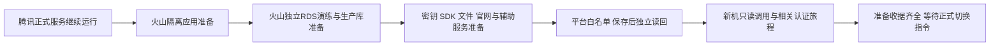

# 迁移前置准备：服务器、独立数据库与外部平台

2026-10-09；原任务01a11e64-e0ad-7d93-a114-c5121379276b。

用户最新范围：只完成迁移前准备，不完成正式迁移。该范围取代此前完整迁移授权。准备期间腾讯正式站点、生产数据库与所有生产消费者继续正常服务；不改www解析，不切数据库，不停旧worker，不在火山开启正式消费者，不重启源数据库改变WAL，不退役旧机。最终切换须等待用户后续明确指令，这来自本次范围调整。仅为证书域名验证添加与清理ACME TXT可作为准备操作，须核验准确记录并保留原有值，不改变A/AAAA/NS流量指向。

## 目标结构与出口IP

- 当前源公网出口IPv4实测：124.220.53.183。
- 当前目标公网出口IPv4实测：115.190.113.5。
- 测量方法：分别在两台服务器直接curl checkip.amazonaws.com，IPv4、不走代理，均成功；api.ipify.org连接失败，不能作为第二条验证。
- 这是公网出口的时点证据；Provider实际返回来源IP和接口响应仍需逐项验证。以后若接入NAT/代理或切换EIP，须重新测量。
- 白名单操作原则：保留所有现有合法IP，仅增加115.190.113.5；不要拿RDS私网IP、Provider回调IP或域名替代应用出站IP。

## 管理员操作表

下面是待核验/待操作项，不代表已经保存。源代码已确认企微应用Secret、客户联系ContactSecret与存档Secret分别存在使用边界；不能只配置一个页面就认定全企微可用。

| 平台与实际能力 | 需要核验的配置 | 准备操作 | 当前状态 |
|---|---|---|---|
| 企业微信CRM自建应用 | 所用应用的企业可信IP | 保留现有IP，增加115.190.113.5，保存，退出重进读回 | 管理后台访问被浏览器策略阻止，未修改 |
| 企业微信客户联系 | ContactSecret对应的API可信IP/允许调用应用 | 核验现行设置并增加新出口；核验客户联系API调用范围 | 同上，未修改 |
| 企业微信通讯录同步 | 实际同步所用应用/Secret及可信IP | 如果有独立配置，单独核验；不能拿客户联系页面代替全部验证 | 同上，实际页面待管理员核对 |
| 企业微信会话内容存档 | 存档功能可信IP、RSA版本/SDK权限 | 在存档所属配置增加新出口并读回，保留旧IP与原私钥版本 | 同上，未修改 |
| 微信公众号全局API | 实际使用AppID的IP白名单 | 现有IP加115.190.113.5，保存后重新进入读回；多公众号逐一核验 | 管理后台访问被浏览器策略阻止，未修改 |
| 微信公众号网页授权与JS接口 | 网页授权域名、JS接口安全域名、业务域名和验证文件 | 保留www.youcangogogo.com，准备验证文件与证书；不把域名项当IP项 | 未读回后台设置 |
| 微信支付 | 当前商户启用产品的接口安全IP/安全医生设置 | 查明哪些现有支付/退款/分账/开票调用受IP限制，再按实际配置增加新出口；不新增未使用的产品权限 | 商户后台访问被浏览器策略阻止，未修改 |
| 微信支付入站回调 | 火山安全组/防火墙/WAF及现有notify_url | 准备允许正常HTTPS回调的网络策略及签名路由；Provider来源IP与商户自身出口IP分开 | 正式回调未切换，目标待验证 |
| 支付宝、开票及外部AI/推送 | 实际启用Provider的安全设置、证书、授权和网络限制 | 按现有能力分别核验，无来源IP限制的项目明确记不适用 | 未完成独立Provider验证 |
| 火山RDS | 应用服务器私网来源及实例绑定的白名单 | 核对新生产应用最小访问权限与私网连接，保留测试/伙伴访问 | 当前CRM测试库认证连接已通过，生产准备由工作台进行 |

微信支付的“商家转账”官方文档明确要求接口安全IP，但这不能推导所有支付产品都共用同一白名单，更不能因迁移而开启商家转账。本项目当前代码已确认JSAPI下单、退款查询/申请等使用微信支付v3接口，现有配置还启用分账和开票；应核验这些实际产品。

保存证据至少包含：正确企业/公众号/商户、对应应用或功能、保留的旧IP、增加的新IP、保存成功，以及重新进入配置页的读回。只填写输入框、截图编辑页或口头称已加，不计完成。截图不要包含Secret、Token、私钥或客户数据。

## 新服务器验证要求

| 项目 | 可在准备阶段执行的验证 | 完成边界 |
|---|---|---|
| 应用与客户联系 | 使用实际相应凭据从新机获取/使用凭证，做最小只读接口请求 | 只记录HTTP/Provider错误分类及是否有有效响应，不回显token/客户详情，不发消息、不改标签 |
| 公众号全局token与JSAPI | stable_token(force_refresh=false)及JSAPI ticket只读获取 | 不能强刷共享token；成功还不能代表网页OAuth或支付成功 |
| 微信支付/开票 | 使用现有签名材料做适用的只读查询或证书/权限验证 | 不下单、退款、分账、开票或重放资金效果；敏感响应只汇总 |
| 会话存档 | SDK动态库、私钥版本以及受控最小读取检查 | 不启动持续拉取任务，不把客户聊天正文写到诊断报告 |
| 目标应用旅程 | 隔离库健康、登录、鉴权拒绝、相关客户/订单/产品读取、官网与文件路径 | 对实际构件和独立RDS执行，不用Mock或HTTP200代替认证业务检查 |
| 数据迁移演练 | 最新一致性快照恢复至独立演练库，结构/记录/序列/约束与完整耗时 | 保留CRM测试库及伙伴库，外部效果关闭；演练副本不能称最终生产同步 |

## 服务器与数据库准备状态

- 已完成：目标到企微/公众号/微信支付/支付宝API的TCP与校验TLS握手，未做带凭据的Provider调用；两台SSH连通与Host Key校验；应用构件/摘要、运行服务、监听端口、独立数据库认证汇总；DNSPod实际权威记录与火山未生效记录读取；TLS到期日；新旧公网出口IP测量。
- 已交付唯一工作台：当前V4迁移PRD和聚合收据，文档候选已推国内；用户“只准备”的最新范围已实际投递，并要求继续隔离准备及演练。
- 工作台当前回报：目标RDS具备建库权限，保留现有测试库与伙伴库，正在准备独立演练库及固定构件，外部效果关闭。此为工作台进度，须以最终收据核验。
- RDS容量门槛：当前登录控制台看不到postgres-54b430626a32，尚缺所属账号及实例存储容量/已用空间，完整恢复演练暂停在容量核实前；构件与文件准备继续。
- 证书实测：正式www的Caddy使用/etc/caddy/tls-www-20260911/fullchain.pem和privkey.pem，均存在且权限0640，有效至2026-10-17 19:30:12北京时间。未发现certbot renewal配置或实际证书续签systemd timer；本次未全面检查cron/自定义签发器，不能认定绝无续签机制。文件已纳入工作台导出范围，续签/新签发路径仍待准备；详见certificate-preparation-readback.json。
- 未完成：完整恢复演练、目标正式组件与证书/SDK/文件准备、平台白名单保存/读回、从新机实际Provider认证只读验证、ICP备案接入核实。不能把这些记作通过。

## 人工步骤的访问阻碍

本次尝试work.weixin.qq.com、mp.weixin.qq.com及pay.weixin.qq.com管理后台均被Browser site-safety policy阻止。工具明确禁止通过其他浏览器、原始CDP、间接执行或替代地址绕过。这不是登录状态问题，也不是自动审批拒绝。因而这些后台配置需要管理员在自己的正常操作环境完成；代理可继续服务器准备、整理操作表及授权范围内的安全只读验证。

原备案主体用户确认为北京可能无限大科技有限公司，域名由别的账号转入。当前登录的腾讯/火山账号中没有对应备案记录；尚需原备案账号/备案号与当前有效状态，接入时保留原主体，不擅自更改主办单位。

## 参考与代码依据

- [公众号IP与OAuth配置的腾讯官方说明](https://docs.cloudbase.net/integration/wechat-official-oauth)：全局API来源IP与网页授权域名分别核对。
- [微信支付接口安全IP，适用于商家转账](https://pay.wechatpay.cn/doc/v3/merchant/4013751010)。
- [微信支付回调通知注意事项](https://pay.wechatpay.cn/doc/v3/merchant/4012075420)：网络与验签是分别处理的事项。
- V4 internal/wecom/adapter/client.go 的accessToken/contactAccessToken；cmd/aicrm/composition.go 的MessageArchiveConfig；internal/invoice/provider/official_account.go 的stable_token及JSAPI ticket；internal/payment/provider/wechatpay.go 的v3请求路径。该项目Go import保留旧模块名，不是从旧仓取证。
