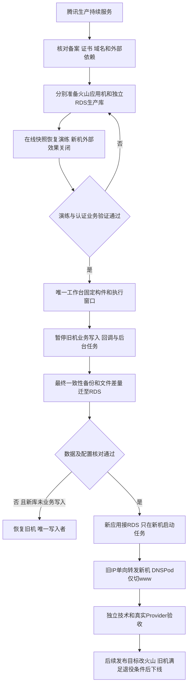

# CRM V4 腾讯云至火山引擎正式迁移

日期：2026-10-09，北京时间。原任务：01a11e64-e0ad-7d93-a114-c5121379276b。

用户要求：完成正式迁移，应用服务器与数据库分离，稳定优先，尽量不离线。用户先选择可以安排维护窗口，后补充尽量缩短中断；因此准备和演练期间旧站持续服务，实际暂停写入的时长由演练决定，不承诺零停机。正式安装使用项目现有唯一工作台、队列和锁，不开第二个发布通道。

## 业务判断与流程

OneID：全库迁移保留 customers.id、外部身份 scope/source 和全部关联；不重新匹配、建客或合并。

持久化：腾讯本地 PostgreSQL 16 → 火山独立托管 PostgreSQL 16。服务器迁移与数据库迁移分别记录。文件、密钥和辅助服务不包含在数据库快照中，单独迁移。

外部效果：支付、退款、分账、开票、企微发送、存档、OAuth、回调与任务均涉及。队列、幂等键、effect/attempt、executed/outcome_unknown 状态随最终库保留，禁止复制后重置重发；切换期间只允许一套业务写入和消费者。

限制判断：复用既有鉴权、事务、单一消费者与凭据保护边界；不添加额外业务审批、第二套发布通道或新业务限制。

## 当前实测事实

10:05–10:11 附近的只读结果存于 tencent-readback.json、volcengine-readback.json；数据仍在变化，正式执行前须刷新。

| 项目 | 腾讯源 | 火山目标 |
|---|---|---|
| 应用机 | 124.220.53.183 | 115.190.113.5，4核/约4GB，根盘约53GB可用 |
| 应用构件 | 4c39050574a4f0aeaa72b89419e06eb96b04f553 | 641d75779c46dc32b7db05d057580dd2f7a4d849 |
| 二进制 SHA256 | 504fbf2585a45ceadb6b210ed804c4f3483dd4eb9e62d9aa72a4313ec5505483 | 30b5983ed1384568513216d10c59dbbfa798ef8e22686f656f517611d100374b |
| 数据库 | 本机 aicrm，16.15，约4.80GB | 独立 RDS 的 CRM，16.8，约3.26GB |
| 非系统表 | 484 | 480 |
| 客户 / 订单 / 支付记录 | 23792 / 5611 / 1229 | 23783 / 5606 / 1224 |
| 复制 | 无 publication/subscription/slot | 无 publication/subscription，已有1个slot不能视为生产同步 |
| 入口 | Caddy 80/443，API 127.0.0.1:8080 | 只有测试API，127.0.0.1:8080；未监听80/443 |
| 外部效果 | 多个生产开关为true，effects worker运行 | 29项测试关闭开关，未运行生产worker |

生产 source main 为 21b06f7b47ae88d7bf800b7761db7398edd921da，包含测试修复；应用 SHA 为4c3905是合法区别。迁移使用切换时已核验的完整V4构件，避免同时升级业务版本。

此前快照交付时间为2026-10-05 18:21，480表导入前计数曾匹配，恢复阶段81.9秒。这不包含此次最终导出、传输、验证、文件同步和回调切换，不能直接当作本次停机时间。火山副本已经落后。

## 域名与备案

- 实际权威DNS：antlia.dnspod.net / semicircle.dnspod.net。
- 实际 www A：124.220.53.183，TTL 600秒；查询时未返回www AAAA。
- DNSPod 的父域 youcangogogo.com 下共17条记录，包含飞书MX、TXT、小鹅通根域CNAME以及其他业务子域。
- 根域 @ 指向 apphq1wxszf7825.pc-cname.xiaoe-tech.com，与www不是同一入口。
- 火山控制台只有 www A →115.190.113.5，TTL10分钟；页面明确标记“未使用TrafficRoute解析”。该记录已保存，但不是现行权威解析。
- 只在腾讯DNSPod父域记录列表修改 www A，不操作暂停的独立www子域区域，不添加两个不同生产IP的A记录。切换后保存、重新读取控制台并从权威DNS查询。
- 不同时更换NS。若以后把DNS托管也迁到火山，须先完整复制业务记录、核验邮箱/根域/所有子域，再单独切NS；不能把只有1条记录的区域直接启用。域名注册商、DNS托管、服务器承载和ICP备案是分别处理的事项。
- 当前www证书有效至2026-10-17 19:30:12北京时间。现用证书覆盖www，可安全迁移证书与私钥，但必须安排续签/验证续签方式，不能只复制到期证书。
- 当前登录腾讯备案账号显示qianlan333.cloud，当前火山备案账号显示lhbl.com.cn；两处都未看到youcangogogo.com。这不证明该域名未备案，可能属于另一账号/主体。用户随后确认原备案主体为“北京可能无限大科技有限公司”，域名从其他账号转入，当前账号未办理该域名备案。尚需核实原备案记录是否有效及原主体在火山的接入方式；不把转入域名误当作备案迁移，不擅自变更主办单位。
- 在大陆新接入商承载前，核实该域名当前主体及火山接入备案要求/状态；等待接入处理时旧站继续服务，不取消旧接入。

## 应用机与数据库分离

目标应用：火山115.190.113.5；目标数据库：现有火山独立RDS，私网端点 postgres54b430626a32.rds-pg.ivolces.com:5432。

建议在同一RDS创建独立生产库 aicrm 和生产应用账号，保留原 CRM 测试库及 CRM_copy_c。此前交付文档记载另两台服务器访问测试库；本轮未登录这两台，不覆盖它们的数据或自动改变其连接。

现有测试服务与正式服务必须分别固定构件路径、环境文件和监听端口。测试服务目前读取 /opt/aicrm/current；正式安装前先隔离它的路径/配置，避免正式current切换同时把旧测试API连到新生产库或用新二进制加载旧schema。

托管数据库应分别核验库Owner、应用权限、序列、约束、扩展、排序规则、私网访问、磁盘预算与已有消费者。业务凭据只存服务器受保护文件，报告和Git中不存密码。

## 迁移方法选择

首选先演练最新全量导出/恢复，测量完整暂停写入链路；数据库约4.8GB且已有同引擎恢复经验。以用户允许的维护窗口实现单次最终一致性快照，复杂度最低。

若演练的完整窗口不符合“尽量不停服”，改用经验证的单向全量加增量同步，再短暂停写追平。当前源wal_level=replica，尚未启用逻辑复制；启用logical需要安排数据库重启并验证应用恢复。DTS可作为现有产品选项，费用和当前网络可达性需核验，不能假定已配置。

使用逻辑复制时，DDL、序列和大对象不能假定自动同步；当前所有普通业务表都有主键，large objects计数为0，但最终仍核对迁移、序列和约束。无需为了这次小库迁移引入新自建CDC系统。选择方法以实际演练证据和用户稳定要求为准。

## 单独迁移的应用依赖

| 内容 | 当前源证据 | 目标准备 |
|---|---|---|
| Caddy、路由及TLS | 正式www、id-dev配置 | 配置新机80/443；沿用实际正式入口 |
| 静态网站 | /srv/wuxianda-website-20260916，当前根路径由它承载 | 保留静态路由与文件，避免CRM覆盖官网 |
| 私钥与税务配置 | 微信支付、支付宝、开票在/etc/aicrm/keys与secrets | 安全传输，权限/文件存在和摘要核对，正文不回显 |
| 企微存档SDK | /etc/aicrm/message-archive，约8.6MB | 复制SDK并检查动态库依赖与实际runner |
| Excel辅助服务 | /opt/aicrm-excel，约19MB；服务运行 | 环境、内部地址、权限及相关流程验证 |
| 本地业务文件 | /var/lib/aicrm约381MB | 分类保留正式业务文件/必要状态，准备及最终差量 |
| 定时与worker | 企微30秒任务、客户日同步、HXC刷新/课程同步等实际timer | 列出实际unit，正式切换时先停源，再启目标 |
| Provider网络条件 | 企微、支付、开票、外部AI/推送 | 核对可信IP、SDK、签名材料、OAuth和回调允许域名 |
| 历史资金回调 | 当前Caddy仍转发https://150.158.82.186 | 明确原Owner及精确路由；本轮未登录第三台，不能声称其已迁移或可退役 |

## 正式执行与回退

1. 唯一工作台重新读取workstation.json，沿用原串行锁和已有队列，绑定迁移成员、当前构件、目标机/RDS与已有用户授权。准备期间不暂停旧站。
2. 准备新应用与生产RDS库、证书、辅助服务、文件、密钥和Provider网络条件。新机外部写与消费者关闭；演练库不得自动消费复制队列。
3. 在线导出一致性快照到隔离演练库，完整恢复，检查所有表与最新schema、序列、关联数据以及实际构件的相关认证旅程。演练账户与外部效果隔离。
4. 按演练结果选择最终快照或单向增量方案。正式窗口前读取所有进程/timer/DB客户端，禁止凭目录或文档推断停用。
5. 正式切换先隔离新的业务写入入口、支付发起和可变后台接口；让已开始的事务及效果得到明确状态，停止源worker/timer，确认没有其他写入者。回调窗口策略按各Provider重试合同执行，不能未经持久化就回复成功；签名状态查询只读对账。
6. 生产迁移前完成可验证备份及最终一致性数据迁移，保留原库和测试库。核对表结构、记录、关键金额/权益关系、序列、队列和unknown效果，完成最后文件差量。
7. 新机只连接新RDS生产库，启API并验证；确认源消费者已停，才恢复新机消费者和正式外部配置。恢复配置需同时检查部署env和数据库发布配置，不能只改一个开关。
8. 旧IP仅单向转发到火山固定IP，保留Host、HTTPS/SNI、回调精确路由及长连接，避免新机又回指源机形成循环。旧机不再承载业务写入或任务。先验证旧IP转发，再在DNSPod修改www A到115.190.113.5并保存/读回。
9. 新旧入口均指向同一新应用及新RDS，处理DNS缓存残留流量。观察实际旧IP访问、回调、错误和任务状态；满足退役条件才停旧代理，不用固定等待天数代替实测。
10. 原发布通道的生产目标改为火山，保留队列/锁/attempt/收据。国内源码和发布工具若依赖腾讯跳板/预备机，登记迁移其访问路径；不初始化第二工作台或timer。预备机维持2核2GB。

回退边界：新生产库未开始业务写入/Provider执行前，可停止新侧并恢复旧侧；新侧开始写入以后，单纯把DNS改回旧库会丢数据。此时保留新库作为唯一数据源，回退应用构件或入口；需要回迁数据库时须重新停写、备份并核对差量。不得双主运行。

## 验收与未验证项

- 技术：准确完整构件清单/二进制、RDS独立认证查询、表/序列/约束、API readiness、TLS、静态网站、相关后台登录与客户/订单/产品读取、附件及Excel路径、新旧IP路由、唯一worker/timer所有者。
- 外部：实际微信授权、受控支付/退款/开票、企微可信IP与真实消息接收、存档恢复和业务回调，分别保留Provider、认证业务与观察证据；开关true或HTTP200不代表业务成功。
- 本次已完成：源/目标SSH只读检查、实际构件与数据库汇总、域名权威解析、两端云控制台DNS/备案页面读取。
- 本次尚未执行：生产备份/恢复演练、生产库创建、目标正式安装、Provider网络改配、接入备案提交、证书续签、DNS写入、流量/任务切换、真实业务验收及旧机退役。

五项影响：对外合同保持原域名与业务接口；业务机制迁移库与消费者Owner；关联应用/Config/Identity/Payment/Invoice/Outbound/Jobqueue/存档/Excel/HXC；页面复用已安装资源和现有官网，不开发UI；验证绑定迁移构件和实际目标，不称完整回归。

## 官方参考

- [DNSPod A记录](https://support.dnspod.cn/dns/help-a/)与[解析记录TTL生效](https://docs.dnspod.cn/dns/faq-effective-time/)。
- [火山备案场景](https://www.volcengine.com/docs/6428/119072?lang=zh)：原备案与新接入商关联需分别处理。
- [火山DTS迁移方案](https://docs.volcengine.com/docs/DTS/Overview_of_migration_solutions?lang=zh)和[迁移至火山PostgreSQL](https://www.volcengine.com/docs/6390/347656?lang=zh)。
- [PostgreSQL 16 pg_dump](https://www.postgresql.org/docs/16/app-pgdump.html)与[逻辑复制限制](https://www.postgresql.org/docs/16/logical-replication-restrictions.html)。
