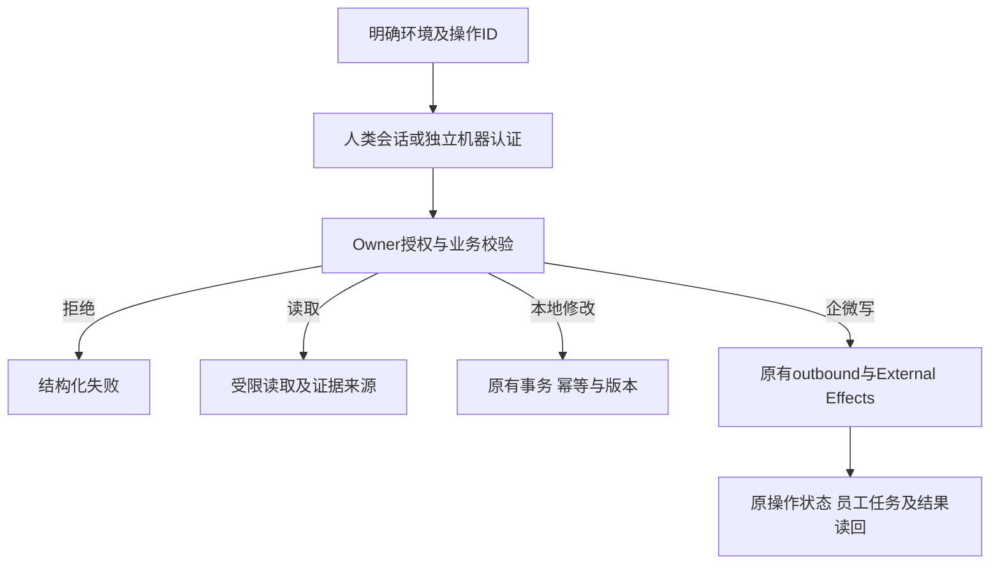
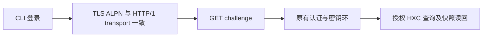

# CRM CLI 总体 PRD与当前交付边界

父方案：用户已授权的“第一性原理与对抗验证后的完整方案”。
基线：82edf652065beecf77409723c0a25a7581d0764d。

## 业务判断流程

## 分类与复用

OneID：客户操作读取/解析既有canonical customer；不隐式建客或合并。
Persistence：CLI只保存非秘密环境配置，凭证交给系统keyring；服务端复用现有事务和jobqueue。
External Effects：CLI不调用Provider，不新增队列；已注册业务接口继续走各Owner；未知Provider契约暂不注册执行。

CLI采用Go+Cobra。现有20项机器V1操作保持冻结；新增V2自我发现与权限查询。人类调用当前Owner管理接口，不转换成机器主体。
新增身份/发现合同独立登记在api/cli-v2.yaml，由原路由文档一致性检查联合核验，schema cli可读。
目录是编译时登记的契约元数据；登记不代表已授权、Provider就绪或真实验收。命令执行仅允许登记路径。

## 研究参考

- https://github.com/WecomTeam/wecom-cli/blob/main/docs/cli-reference.md
- https://github.com/ccclucky/wecom-cli/blob/main/specs/wecom/customers.yaml
- https://github.com/salesforcecli/plugin-data
- https://github.com/salesforcecli/plugin-user
- https://cli.github.com/manual/gh_api
- https://kubernetes.io/docs/reference/kubectl/generated/kubectl_auth/kubectl_auth_can-i/
- https://github.com/shuaidd/wecom-core/tree/main/services/externalcontact

借鉴发现、schema、文件输入、分页和业务操作；不把第三方全覆盖说明当Provider证据。企微官方条件未实时核验的候选登记在gaps.json。

## 当前实现

- 7类24个模块与细分sections；549项登记，497项人类绑定、20项原机器绑定、32项不可执行项；OpenAPI契约目录、实际Owner补充路由及待核Provider候选。
- profile/auth/invoke/schema/capabilities/doctor与按板块生成的命令。
- 人类challenge/session复用Access；机器OAuth复用现有授予；凭证绑定Origin及系统keyring。
- 显式ID、路径参数、文件/stdin、multipart、保护下载、幂等键、原操作等待及游标分页。
- can-i返回allowed/denied/requires_resource_check，执行继续Owner授权；不模拟未接入的资源规则。

## 当前未完成的父方案项

全系统新增机器业务写契约、各Owner缺失的范围/字段/导出契约、调度撤权新增合同，以及未核验Provider能力不是目录生成器能够完成的工作。它们必须作为后续独立完整旅程开发，不能通过管理员身份映射或任意API代理补齐。目录中的候选明确不可执行。

## 五项影响

1. 对外合同：新增CLI、Access JSON challenge/self-session、V2 CLI context/can-i及人类发现接口；V1不变。
2. 业务机制：无业务表迁移/第二队列/新Provider写；命令沿现有事务、角色、资源检查；机器授予未自动扩大。
3. 关联模块：Access HTTP、OpenPlatform HTTP/Port、Host composition、编译目录、CLI、OpenAPI及生成器。
4. 页面：无UI编码，原登录与页面接口保留；共享Host路由与依赖需验证。
5. 验证：各修改包全集、CLI TLS旅程、权限/重放/环境/输入/未知结果专项、编译及影响计划；真实Provider和安装独立记录。

## 新增限制必要性

Origin绑定/不转发重定向凭证：防跨环境秘密泄露；复用HTTPS session规则。
已登记ID：防任意API代理、身份误转换与越权；复用服务器授权。
秘密输出文件：防一次性凭证泄露；仅作用秘密与业务下载。
需要资源校验时不报allowed：防把动作权限当对象授权。
不新增通用审批/业务配额，沿已有合同。

## 验收与发布

本候选验收CLI接入、元数据及认证/授权边界，不声称所有Provider旅程已完成。父方案剩余项以目录缺口与后续候选跟踪。
准确HEAD/tree运行fast、compile、修改包完整测试和适用Host测试；Mac证据不替代Linux安装旅程。
后续推送国内codex/crm-cli-system后按动态路由向唯一工作台交付；无当前生产部署授权。
删除新增CLI与自我查询入口可撤销本次应用变化；不要求数据库逆向迁移。

## 2026-10-03 上线授权与验证增量

用户明确要求“上线吧。然后我来做后续测试”，授权当前 CLI 候选上线生产；qianlan 真实登录及 HXC 查询由用户安装后验收。复用本父 PRD，不增加业务或 Provider 写入范围，不涉及 UI 编码或数据库迁移。原候选收据仍只证明其原版本，当前候选依据国内累计源码更新。

短清单见 `docs/release-checks.json`：CLI 传输及生成器、Access 登录/会话、OpenPlatform V1/V2、Host 身份发现与 PostgreSQL 撤权旅程、OpenAPI 路由一致性。直接消费者为 Composition 路由、现有认证管理与客户读取；不要求无关页面/支付/企微发送全量回归。

预发 `cli-access` 使用安装包核对 challenge 登录合同、未认证 self-session/能力发现拒绝及实际 Origin 配置；CLI→TLS→PostgreSQL 登录/客户范围/撤权旅程由选定测试证明。生产独立读回版本、摘要、ready、worker 及上述认证入口；认证接口存在不能代替 qianlan 实际账号/HXC 数据验收。沿用唯一工作台的原队列与收据，CLI 授权不扩大至其他成员。

最终上线候选基线为 `449f8180babad320d47da557af70f4f58cec26f2`（由唯一工作台提供）。重新生成目录，只同步已有 automation-runs 的 `package_id` 查询、`total` 响应及已声明错误；仍为 549 项/24 模块，不新增业务或权限。原认证/权限代码未变化，复用原有效局部证据；目录直接消费者补 CLI/生成器合同，Linux PostgreSQL及安装验证绑定最终候选。

对齐后复现：`admin.listAutomationRuns --query package_id=27 --dry-run` 因 `$ref` 数值参数未在解析前展开，错误地报告 expected integer。修复仅在查询参数选择解析器前解析本地 Schema 引用，沿用现有整数/布尔/数组校验及原始 HTTP 序列化；非法数值、缺失或循环引用仍拒绝。已补登记接口27/20正常查询与非数值/小数/溢出拒绝回归。该修复是无状态客户端参数处理，不改身份、服务端授权、OneID、任务或 Provider 效果，属于本次已授权候选的相关修复。

## 2026-10-03 本机真实登录：HTTP/1 ALPN 修复

复用已授权 CLI 父 brief。qianlan 密码已完成维护恢复及生产 HTTPS 登录读回；真实 Darwin CLI 对同一 challenge 的 GET 报 transport/EOF，Python/curl 正常。Go `DefaultTransport.Clone` 保留已初始化的 TLS `NextProtos` 包含 h2；CLI 的 wire transport 只启用 HTTP/1，服务器却协商到 h2。支持 HTTP/2 的真实 TLS 夹具在原代码复现失败，公开生产 GET 在显式 NextProtos=http/1.1 时 200。

参考当前 Go 1.26.6 标准库 `net/http/transport.go` 的 Clone、Protocols、TLS ALPN 初始化逻辑，沿用父 PRD 的 Go/Cobra 和 HTTP 客户端约定。只在克隆出的 TLS 配置中明确宣告 http/1.1；保留证书验证、默认密钥交换、Origin 绑定、不重定向和写请求禁止盲目重试。没有新增限制。

OneID：不涉及，不解析或关联客户。Persistence/External Effects：本修复是无状态 HTTP 传输，沿用已有认证及业务边界，不新增任务/Provider 调用。无 UI、迁移或服务端接口变化。直接消费者仅 cmd/aicrm-cli；cmd/aicrm 的引用为测试文件。回归使用启用 HTTP/2 的 TLS 服务，证书通过独立 RootCA 验证，GET/POST 均必须为 HTTP/1.1，整包 CRMCLI 测试同时覆盖凭据和失败边界。候选构建本机客户端并进行真实 qianlan 登录和只读 HXC 查询；服务器发布仍由唯一工作台判断实际消费者与载荷。

正式构件交付：工作台核对发现 `build_commands` 请求的 CLI 尚未加入既有 release 程序清单。本次在原 `build_release_binaries` 加入 `aicrm-cli`，让同一正式包交付 Linux 客户端，并保留开发侧已验证的 Darwin 客户端。没有新发布通道、服务、定时器或业务能力；新增程序清单由已有构建合同及最终安装后的 CLI HTTPS challenge 读取验证，读取后因无密码安全停止，不创建生产登录会话。
