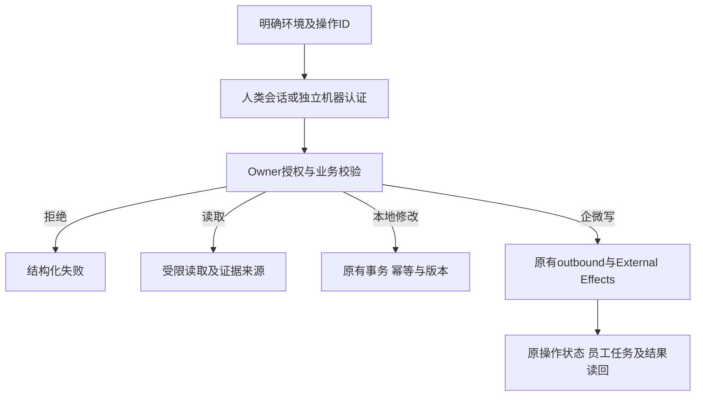

# CRM CLI 总体 PRD与当前交付边界

父方案：用户已授权的“第一性原理与对抗验证后的完整方案”。
基线：82edf652065beecf77409723c0a25a7581d0764d。

## 业务判断流程

## 分类与复用

OneID：客户操作读取/解析既有canonical customer；不隐式建客或合并。
Persistence：CLI只保存非秘密环境配置，凭证交给系统keyring；服务端复用现有事务和jobqueue。
External Effects：CLI不调用Provider，不新增队列；已注册业务接口继续走各Owner；未知Provider契约暂不注册执行。

CLI采用Go+Cobra。现有20项机器V1操作保持冻结；新增V2自我发现与权限查询。人类调用当前Owner管理接口，不转换成机器主体。
新增身份/发现合同独立登记在api/cli-v2.yaml，由原路由文档一致性检查联合核验，schema cli可读。
目录是编译时登记的契约元数据；登记不代表已授权、Provider就绪或真实验收。命令执行仅允许登记路径。

## 研究参考

- https://github.com/WecomTeam/wecom-cli/blob/main/docs/cli-reference.md
- https://github.com/ccclucky/wecom-cli/blob/main/specs/wecom/customers.yaml
- https://github.com/salesforcecli/plugin-data
- https://github.com/salesforcecli/plugin-user
- https://cli.github.com/manual/gh_api
- https://kubernetes.io/docs/reference/kubectl/generated/kubectl_auth/kubectl_auth_can-i/
- https://github.com/shuaidd/wecom-core/tree/main/services/externalcontact

借鉴发现、schema、文件输入、分页和业务操作；不把第三方全覆盖说明当Provider证据。企微官方条件未实时核验的候选登记在gaps.json。

## 当前实现

- 7类24个模块与细分sections；549项登记，497项人类绑定、20项原机器绑定、32项不可执行项；OpenAPI契约目录、实际Owner补充路由及待核Provider候选。
- profile/auth/invoke/schema/capabilities/doctor与按板块生成的命令。
- 人类challenge/session复用Access；机器OAuth复用现有授予；凭证绑定Origin及系统keyring。
- 显式ID、路径参数、文件/stdin、multipart、保护下载、幂等键、原操作等待及游标分页。
- can-i返回allowed/denied/requires_resource_check，执行继续Owner授权；不模拟未接入的资源规则。

## 当前未完成的父方案项

全系统新增机器业务写契约、各Owner缺失的范围/字段/导出契约、调度撤权新增合同，以及未核验Provider能力不是目录生成器能够完成的工作。它们必须作为后续独立完整旅程开发，不能通过管理员身份映射或任意API代理补齐。目录中的候选明确不可执行。

## 五项影响

1. 对外合同：新增CLI、Access JSON challenge/self-session、V2 CLI context/can-i及人类发现接口；V1不变。
2. 业务机制：无业务表迁移/第二队列/新Provider写；命令沿现有事务、角色、资源检查；机器授予未自动扩大。
3. 关联模块：Access HTTP、OpenPlatform HTTP/Port、Host composition、编译目录、CLI、OpenAPI及生成器。
4. 页面：无UI编码，原登录与页面接口保留；共享Host路由与依赖需验证。
5. 验证：各修改包全集、CLI TLS旅程、权限/重放/环境/输入/未知结果专项、编译及影响计划；真实Provider和安装独立记录。

## 新增限制必要性

Origin绑定/不转发重定向凭证：防跨环境秘密泄露；复用HTTPS session规则。
已登记ID：防任意API代理、身份误转换与越权；复用服务器授权。
秘密输出文件：防一次性凭证泄露；仅作用秘密与业务下载。
需要资源校验时不报allowed：防把动作权限当对象授权。
不新增通用审批/业务配额，沿已有合同。

## 验收与发布

本候选验收CLI接入、元数据及认证/授权边界，不声称所有Provider旅程已完成。父方案剩余项以目录缺口与后续候选跟踪。
准确HEAD/tree运行fast、compile、修改包完整测试和适用Host测试；Mac证据不替代Linux安装旅程。
后续推送国内codex/crm-cli-system后按动态路由向唯一工作台交付；无当前生产部署授权。
删除新增CLI与自我查询入口可撤销本次应用变化；不要求数据库逆向迁移。
