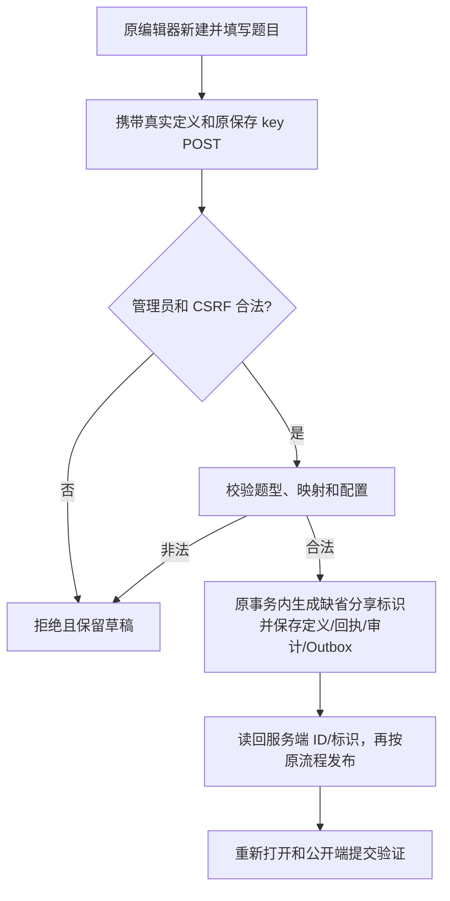

# 新题型问卷创建修复：复用原父 PRD

父 brief：docs/prd/2026-10-12-survey-redemption-attachments.md；本次只修现有定义保存的集成缺陷，不新增题型或页面。基线 fee5cb1947465c2d1ab81f14702542ec2067ca92。

现场真实请求：新建无 ID、slug=""、assessment_config={}、one_by_one，shipping_address/兑换码/附件三题及空 placeholder_text。先按该原样请求隔离复现，再分别覆盖三种单题及既有四种题型。用户原 Chrome tab 和草稿不操作。

分类：定义配置保存不涉及新 OneID 解析或客户归属；沿用 Survey 本地 UoW、幂等回执、审计/Outbox。公开答卷验收沿用现有可信身份及图片/核销事务。无新持久任务/Provider 写入/迁移/限制。

复用：已保存与复制定义的分享标识规则；缺省标识在新创建的事务回调内生成，原 key 重放不再次生成，不把新题型识别、空配置或选项错误混为同一结论。用户明确输入的标识、配置及领域拒绝边界保持校验。

参考：[Go JSON 严格字段解码](https://pkg.go.dev/encoding/json#Decoder.DisallowUnknownFields)，核对实际 Go DTO 标签；沿用父 PRD 的 [SurveyJS 延迟上传](https://surveyjs.io/form-library/examples/delayed-file-upload/documentation)，本次不引入上传阶段。

Product Design：用户当前截图是视觉目标，沿用编辑器工具卡、配置区、未保存状态和错误反馈；不重设计。必要时只延伸已有保存与读回合同。

验收：真实 PG/HTTP 的原形状请求，三种单题和混合；既有单选/多选/文本/手机号；保存后服务端 ID、定义及标识读回、原 key 重放、失败无半成品；完整混合定义发布和公开提交。真实浏览器创建/保存/重新打开及失败草稿保留在安装包旅程中验证。

定位证据：真实请求严格 JSON 解码成功，各题型、空 placeholder、空画像映射、空 assessment_config 均合法；唯一失败条件是新建空 slug。原 PostgreSQL/HTTP 八种原形状请求（混合三题、三种单题、单选、多选、文本、手机号）全部 HTTP400、0 答卷定义。只替换 slug 后领域验证成功。修复创建命令缺省标识，由原事务在取得幂等回执所有权后生成 q- 随机标识；重放返回原 ID/标识，不生成新定义。

验证记录（本机真实 PostgreSQL16 + 隔离 headless Chromium，不操作用户 Chrome profile）：
- Survey app/http 整包通过；显式无登录、只读账号、CSRF、未知顶层和题目属性拒绝；显式非法分享标识与更新清空标识仍拒绝。
- TestPostgreSQLSurveyEditorCreatesUnassignedSlugDefinitions：现场原样三题请求及七种单题配置保存/发布/重开、原 key 同 ID 同标识、同 key 改内容 409；无效画像映射不留记录/回执；真实写入定义/回执/审计/Outbox 后注入失败，五表计数不变，同 key 重试可创建。
- TestPostgreSQLSurveyEditorCreateChromiumJourney 两模式通过：原编辑器空白新建、显式非法 slug 保存失败仍保留全部草稿、清空 slug 保存成功并读回服务端 ID、刷新重开、运营 Excel 导入、填写真实级联地址/兑换码/本地图片、multipart 提交成功；数据库每模式仅一份新定义、答卷/私有图片/核销=1/1/1，后台安全答卷和图片可读。
- 原编辑器保存/发布合同与原 H5 Host 构建合同通过。
- 清单只包括 Survey app/http、具名 PostgreSQL 创建及编辑器生命周期。安装包沿用 survey-recovery，增加创建旅程到原安装包脚本，与已有身份恢复/丢失响应/输入恢复/附件旅程一起验证；不引入源码阶段无 dist 的浏览器门禁。Linux 准确候选与正式安装包证据由唯一发布工作台形成，本机证据不冒称安装包或真实 Provider 验收。
- 页面、对外 DTO、身份/映射策略、数据库迁移和 Provider 写入无新增；仅定义创建服务自动分配缺省标识，复用原随机标识与 UoW。
