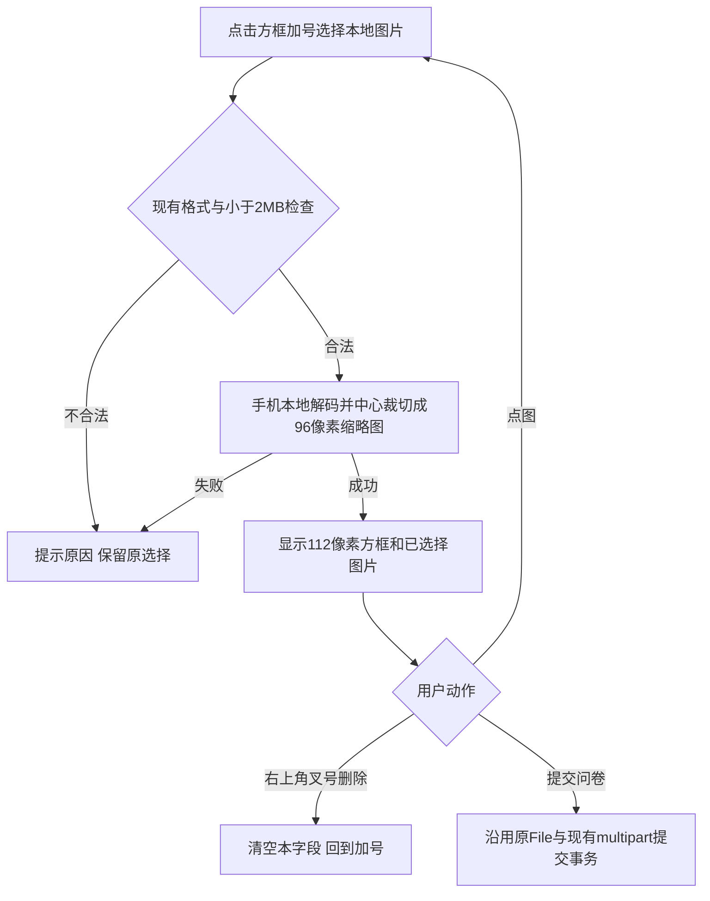

# 问卷图片选择：已选设计的精简实现

复用父 PRD `docs/prd/2026-10-12-survey-redemption-attachments.md`。用户已选第一张紧凑左对齐方框设计，并明确删除“刷新后需重新选择”和“提交问卷时上传”两段日常说明；保留“已选择图片”。新基线5485044bd41ea8fc34ea3881f7b938b6c6199636。

必要职责仅为选图反馈、删除/重新选择和本地小裁切预览。预览不发网络请求、不读服务器原图；最终上传保留原File，不把图片或缩略图写入答案JSON/草稿。96像素为预览质量预算，并非新的业务图片限制。编码过程中禁止旧的异步预览覆盖新选择或恢复已删除图片。生成预览中暂不提交，防止用户尚未确认的文件被提交；失败后原选择保留。

现状核对：现有H5生成blob预览，而实际composition安全头只允许self/data图片，H5不在blob例外中。用小canvas产生仅供DOM显示的data缩略图，复用现有CSP，不扩大允许的网络来源或修改安全头。客户端格式/大小校验及服务器真实图片解码、原key与原文件摘要、事务及私有图片读取保持既有合同。

OneID：本地控件不解析身份，提交沿用现有可信身份。持久化：预览仅页面内存；无新表/临时上传/清理/持久任务。External Effects：无新Provider调用或接受意图。复用现有一字段一图、严格小于2097152字节、JPG/PNG/GIF约束，无新业务限制。

视觉目标：Creative Production board ce093228-5035-4188-9a1d-53e1b5de4e5d，用户选择compact-square并作两处删文；修订图 /Users/qianlan/.codex/generated_images/01a12dad-c7da-72a0-9173-293fab637ed2/exec-a7279460-97c9-4802-a350-f9c3beb74578.png。Product Design get-context/image-to-code/design-qa，H5原页与tokens保留，只改变附件字段区域。空方框加号、选后小裁切图、可见圆形叉号44px触控、蓝色勾和已选择图片；没有文件名长串或替换/移除文字按钮。

参考：[Ant Design Upload图片卡片](https://ant.design/components/upload/)、[MDN object-fit](https://developer.mozilla.org/en-US/docs/Web/CSS/Reference/Properties/object-fit)、[Heroicons官方图标](https://github.com/tailwindlabs/heroicons)。仅借鉴图库交互与使用三枚MIT图标，复用现有运行时，不引入UI框架或网络图标请求。

复用组件：原H5Controller/原all与one模板、surveyPublic.css；公用localImageThumbnail仅解码/裁切不承担领域写入。相关测试选附件交互与授权恢复、真实PG浏览器附件与编辑器旅程；在实际安全头下断言自然图像尺寸与无预上传请求，并验证替换、删除、损坏图片、2MB、异步竞态、原File提交和刷新/拒绝保留。原安装包survey-recovery执行正式安装验收，不在源检查阶段额外构建完整Host。

验收补记（2026-10-13）：附件H5单元合同两mode通过，含96像素中心裁切、老WebView FileReader/data回退、2MB边界、重试原key、错误保留、迟到结果不覆盖新选择、删除后不恢复、definition更新后丢弃。兑换码交互与原草稿/授权恢复合同通过；named CSP测试确认H5仍未放开blob。实际本地PG/Chromium附件与编辑器各两mode通过，自然图像96、显示112、叉号44、已选择状态、两段删除文案消失、选图/替换/删除/预览无新增POST；答卷/原图/核销1/1/1。

Product Design同视口390×844全页及控件对照已完成，IAB真实选图/删除/重新选择、零console错误；报告`design-qa.md` final result passed。IAB为可查看的本机设计数据fixture，不冒称真实提交；真实提交由独立PG旅程证明。最终安装包survey-recovery保留原5旅程，源阶段只跑不依赖dist的相关合同，避免前置完整Host构建。

累计基线更新：唯一工作台要求从bcc0ed7a2b8ab3e51c1f8492a86640e0ddbfed6c继续下一批；新候选线性rebase，仅清单冲突，保留本附件短清单并更新base，不覆盖已累计治理成员。附件/H5全部产品与测试输入保持8c字节不变；治理改动进入cmd组合根/平台，具名CSP编译与源码PG附件两模式重验，三条纯前端合同及设计比对以相同输入收据复用。原8c ref和收据不移动、不改写；正式安装包验收仍独立待工作台。
