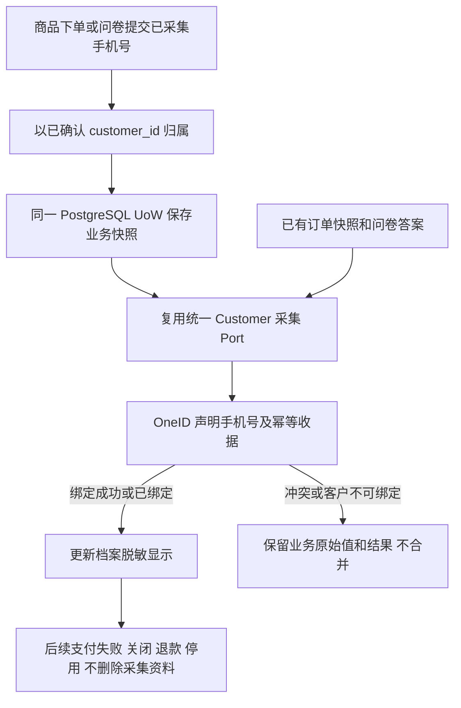
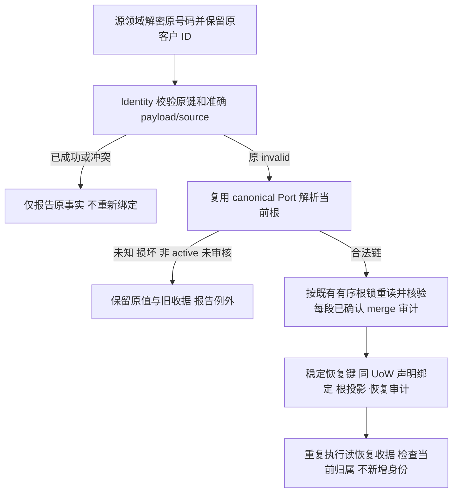

# 商品与问卷手机号永久入库修复

授权：用户要求从结构修复所有商品手机号与问卷手机号题的资料入库，不依赖订单、支付、问卷后续状态；同时提供已有采集数据的幂等补录。生产安装归唯一发布工作台，本任务不直接安装应用。

## 业务判断与复用

订单 1206 用户 1023763 已保存收货手机号，商品 68 version 12 要求 shipping_address，但缺少 OneID 手机号与绑定收据。当前 Order 只冻结联系人，Survey 提交调用声明手机号接口；Survey 把所有 replay 当成功更新目录，有冲突回放风险。复用 Identity 的 declared phone、Phone Vault、锁、收据和 Customer 的 ProjectionWriter。来源实体持续保留加密原值，声明手机号不能升级 verified，不能按手机号建客或合并。

参考：HubSpot 表单采集字段可创建或更新 CRM 资料（https://knowledge.hubspot.com/forms/create-and-edit-forms）；Shopify 明确订单联系方式与客户档案是两个可独立更新的记录（https://help.shopify.com/en/manual/fulfillment/managing-orders/editing-orders/customer-details）。本需求明确要求同步到客户档案，采用统一采集应用服务协调，订单事实保持不可变。

## 合同与实现范围

- OneID：涉及，向既有 customer_id 绑定声明手机号，仅 Identity Port；无第二套身份匹配。
- Persistence：本地事务，采集来源业务记录、Identity 收据与目录更新在同一个 UoW，任何存储错误整体回滚。
- External Effects：不新增 Provider 调用；数据补录不重放支付、退款、营销、问卷提交动作或外部推送。
- 统一 Customer 采集 Port 负责手机号格式兼容、声明绑定和成功状态判断；Order 和 Survey 调用该 Port。不以付款完成、商品在售、问卷仍启用作为采集或补录条件。
- 商品提交下单即归属付款用户；手机号/收货地址两种采集等级都处理。所有历史订单状态可补录。没有成功提交到服务器的表单草稿不作为已采集记录。
- 问卷每个实际填写的 mobile 类型题都保存并绑定已确认答题客户，选填非空同样处理，多个手机号保留；无客户归属的历史答卷保持未归属，不猜测。
- 回放成功结果不得把历史手机号反复覆盖新档案资料；冲突回放不得更新目录。保持已有 verified 身份保证。
- 补录由各领域拥有的读取/重放方法处理加密数据，运维命令默认 inspect，只输出数量与安全结果。apply 使用稳定来源键，重复运行不新增身份和效果，按来源逐笔事务，失败可原键续跑。
- 无数据库 schema 迁移。复用既有手机号格式、鉴权、事务和冲突边界，不涉及新增业务限制。

## 五项影响

| 项目 | 影响 |
|---|---|
| 对外合同 | 表单请求不变，已提交手机号可被档案和既有手机号查询读取 |
| 业务机制 | 下单新增声明绑定，问卷复用统一采集和准确回放判断，新增已有记录补录命令 |
| 关联模块 | Customer、Identity、Order、Survey、Payment 下单消费者、Composition；不重放 Provider |
| 页面影响 | 用户档案、侧边栏、订单买家手机号经现有读取自然呈现，无 UI 编码 |
| 验证 | PostgreSQL 原子回滚、来源和幂等、未支付/失败/关闭/退款、问卷冲突回放、多手机号、加密/无 PII、补录 inspect/apply/replay，专项全集与准确影响计划 |

## 验收与回滚

未支付订单创建后即在 OneID 与用户档案读取到声明手机号；业务后续状态不删除手机号。问卷成功提交和已有答卷补录可读到对应手机号；冲突保留原值和收据，不能冒充成功。注入事务错误不得遗留半条快照、身份或收据。已有订单 1206 属于待生产数据补录对象，不能把合成测试当其已修复。撤回应用只回到原程序，已采集的手机号保留，不批量删除业务资料。

## 已合并历史客户的相关修复

b8 生产补录中，合法订单手机号的 105 条原客户已 merged；原键留下 invalid。无归属问卷 527 条继续保持未知，不能把所有 invalid 都称未知。复用本父 brief 与上述参考，新增范围仅为已核定订单 1210 / 答案 6914 水位内的 canonical 恢复；最终父基线为工作台已核验的开放批次累计预发 HEAD；正式准入前仅本地重放重验，不推送。

OneID：涉及，沿已存在的 Identity canonical Port / Owner 根锁读取已确认关系，不按手机号推断或合并，不恢复历史根。Persistence：源事实、旧 invalid 收据不可改；新增 Identity 专属恢复审计将原 payload、原键、原客户、目标根、根 lineage version、链摘要、恢复收据关联，同 UoW 提交或回滚。External Effects：不涉及，零 Provider/队列/营销/财务动作。为保存不可覆盖的恢复证据需要前向新增恢复表，复用既有 Phone Vault 与声明收据，不建立通用审批框架。

默认 inspect 真正只读并输出安全分类；recover-canonical 必须指定单来源和显式固定 through-id，防止静默加入后续新业务。只恢复已有准确 invalid 且当前每段可审计的 merged 链；已有成功/冲突不改、无原收据不冒充已审核恢复。原键仍 invalid，恢复键由 Identity 从原键确定性派生，不由调用者传目标或随机键。恢复已成功之后根再次变化，仅核对当前已存在身份归属；链撤销或归属漂移报告例外，不把同源手机再附着给另一个根。

必要限制：准确原 payload / 已确认链 / 同事务锁与审计防误归属及重复恢复；固定来源水位继承本次补录授权。正常 active 提交合同、用户请求字段及 UI 不变。验证多级链、缺失/环/深度、未审核/非 active/撤销、并发合并、原 invalid/成功/冲突、恢复成功/冲突回放、投影失败整体回滚以及源/财务摘要不变。技术与 nova 已完成验收保持原事实，本次 merged 例外另行核验。
