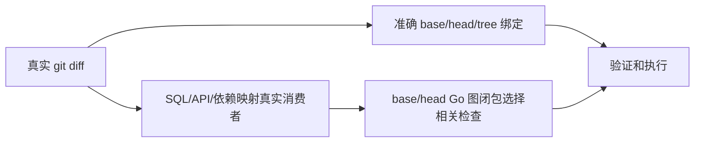

# 发布消费图源码差异绑定修复

授权：唯一发布工作台用户要求自行逐项处理已说明候选的阻断；本修复承接 HXC 候选受信任计划的现存缺陷，沿现有串行队列、锁、attempt、检查与源码发布入口交付。

现象：HXC 29 个真实差异路径在 Go graph 报告里被并入 14 个未改动 SQL 消费者，触发 package-graph-changed-paths-mismatch；消费者应参与影响闭包，准确源码差异字段应保留真实 diff。

参考：Go 官方 go list 实现分别提供源码文件、Imports/Deps 和测试/Embed 输入（https://github.com/golang/go/blob/master/src/cmd/go/internal/list/list.go）；复用本仓 input_scope、go_affected_graph 与 affected_plan.validate_graph 的现有合同。

分类：不涉及客户/OneID，不涉及 Provider 效果；检查收据及源码绑定沿既有控制器持久机制。无 UI 能力、业务数据迁移或新增限制。

五项影响：
- 对外合同：Go graph changed_paths 准确对应 git diff；已有字段和图指纹机制沿用。
- 业务机制：相关消费者和依赖闭包保持，错误源码绑定仍拒绝；无业务状态变化。
- 关联模块：受信任影响图、影响计划与发布构建器消费者。
- 页面：无影响，无应用载荷变化。
- 验证：真实临时 Git/Go 仓库的 SQL 变更经消费者和下游选择，再验证准确 diff 绑定；旧代码应失败，修复通过；执行相关检查器全集及 fast，发布前在最新准确基线重验。

交付：独立源码工具候选；不修改正在执行的门禁、收据或原业务候选。通过现有控制器的工具/源码发布路径后，再让业务候选使用更新后的可信基线检查。
