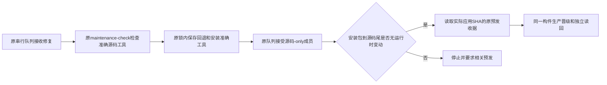

# 已验证构件后的源码-only封批修复

继承已授权 `docs/prd/2026-10-03-extreme-release.md`，本次十项业务能力和应用包不变。只修复发布器将末尾测试/文档源码 SHA 当作安装包 SHA 的拒绝；412 只读诊断证明生产未开始安装、无 in_flight、原生产824健康，83预发收据真实有效，83到3d无运行时变动。

参考：GitHub 的 [环境部署示例](https://github.com/octodemo/actions-environment-deploy-demo/blob/main/README.md) 将同一构件在环境间晋级；复用本仓原控制器、分类器、maintenance marker、包清单、stage-evidence、队列及锁。没有新增发布渠道、构建、预发安装或定时器。

## 边界及五项影响

- OneID：不涉及；发布控制器不解析客户身份。
- Persistence：现有私有控制器文件状态与原串行锁；不新增数据库表、迁移或任务。
- External Effects：不改变安装器/Provider调用；保留 outcome_unknown 停止和独立读回。
- 对外合同：允许无运行时变动的源码尾使用真实应用收据；运行时变动、错误应用树/收据、缺检查继续拒绝。
- 业务机制：十项业务代码、订单、支付和权限规则不变。
- 关联模块：封批、最终证据读取、maintenance-check及marker验证的直接消费者。
- 页面影响：不涉及 UI。
- 验证证据：短清单执行源码尾正常/运行时拒绝/树绑定/缺早期旅程/marker当前累计基线/不明状态拒绝合同及邻近原维护协议。
- 不涉及新增限制；复用现有准确SHA、分类、收据、锁和权限边界。
- 回退：保存原固定工具字节；若安装/生产状态不明则停止写入只读对账，不盲目重试。真实微信支付、保存、上传仍由用户手测。
