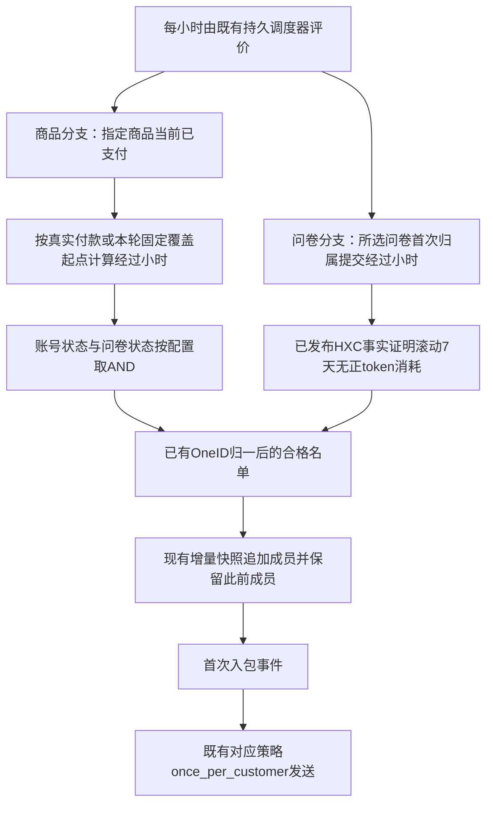

# 黄小璨运营：按小时筛选、增量入包、一次发送

用户已授权只做后台逻辑。条件只决定首次入包；后续填写问卷或消耗 token 不移出既有人群、不增加发送前复查。新活动采用每 1 小时增量刷新，保留现有每 3 分钟与每日完整刷新模式的行为。



## 复用与参考

- [cron/v3 官方文档](https://pkg.go.dev/github.com/robfig/cron/v3)：沿用已有标准五段 cron 解析器，每小时表达式为 `0 * * * *`；不新增进程内 ticker 或调度系统。
- [Customer.io 时间条件](https://docs.customer.io/messaging/segmentation/timestamp-conditions/)：使用业务事件时间而非入包时间，明确窗口边界。
- 复用 Segment 的 paid_order、questionnaire_submissions、配置版本、快照发布、River 调度及 MemberEntered 事件；复用 Order、Survey、Customer、HXC 稳定 Port；复用 Automation 的一次发送和 Outbound。

## 后台配置合同

在上述两种既有模板的 parameters 中增加可选 `activation` 对象。未提供时完全保留原筛选行为；不增加模板或前端控件。

- elapsed_hours_min / elapsed_hours_max：可选非负整数小时；下界包含、上界不包含；上界大于下界。不能溢出 Go 时间间隔。
- 商品分支 registration_status：any（默认）/registered/unregistered；未知不当作未注册。
- 商品分支 questionnaire_status：any（默认）/submitted/unsubmitted；启用时需要 questionnaire_ids。任一所选问卷已提交即为已填写，客户身份通过已有 Customer Port 归一。
- 商品分支 enrollment_override：一个 RFC3339 活动起点与冻结的订单 ID 列表。仅命中所选商品且当前依然 paid 的订单适用。本轮配置用 2026-10-02T12:00:00+08:00，执行配置时只冻结已支付订单；待支付及退款不包含，之后新付款使用真实付款时间。
- 问卷分支 token_usage_status：any（默认）/unused_7d。以所选问卷中同一客户最早的完整归属提交起算，重复提交不重启时钟。
- 每小时刷新使用 refresh_mode=every_1h，refresh_cron_utc 留空。它是 incremental，不是会清退成员的 legacy_custom。

例：商品报名12至36小时、未填问卷、不限账号（保留原模板必需字段）：

```json
{
  "refresh_mode": "every_1h",
  "definition": {
    "schema_version": 1,
    "template_key": "paid_order",
    "parameters": {
      "product_codes": ["334465678"],
      "paid_at_from": "",
      "paid_at_to": "",
      "owner_scope": "all",
      "owner_staff_ids": [],
      "require_active_wecom_contact": true,
      "activation": {
        "elapsed_hours_min": 12,
        "elapsed_hours_max": 36,
        "questionnaire_status": "unsubmitted",
        "questionnaire_ids": ["16"],
        "enrollment_override": {
          "at": "2026-10-02T12:00:00+08:00",
          "order_ids": [123]
        }
      }
    }
  }
}
```

123仅为示例，不是生产订单。后台配置需保存并读回；前端不提供这些新条件，修改活动配置走既有鉴权后台API。问卷引用在保存/预览前使用既有 Survey 引用校验，避免不存在的问卷被当成无人填写。

## Token 数据与负载

HXC 原始消息的未删除且 total_tokens>0 才构成 token 消耗。现有同步聚合中增加最后正 token 时间，不另做每包源库请求。两列 last_token_used_at / token_usage_observed_at 由 HXC Owner 持久化并经已有 SharedFacts Port 提供；旧发布缺 observed_at 不当成零。已知零消耗与数据未知必须区分，重复/冲突客户不准入。

滚动窗口为评价时刻前168小时至评价时刻，正好7天仍算有消耗；lesson/assessment/review 与累计 has_token_usage 不代替本次判断。沿用 HXC 注册筛选的2小时事实有效期；超时、未来来源或版本冲突不发布新的错误名单，保留此前快照。

既有 HXC 同步 timer 从每6小时改为每小时15分；人群每小时整点取最新已发布代次。仍保留单个活跃 HXC refresh、现有幂等与队列，无重叠同步、新 worker 或新重试框架。生产只读最近5次 HXC 同步均约3022条、17–19秒，此为改动前耗时证据，不冒称新增查询的生产性能。15个包每3分钟对应300次/小时，每小时模式15次/小时，触发次数减少20倍，不等同CPU降低20倍。查询复用 projection/customer 索引，不另加索引或缓存。

## 架构与五项影响

- OneID：涉及只读 canonical Customer 与既有 HXC 覆盖；不建客、不重匹配外部ID、不自动合并。
- Persistence：沿用已有配置、快照、事务和内部持久任务；仅前向增加 HXC nullable 时间列及 Segment 刷新模式约束。生产迁移前由唯一工作台备份；不修改 Order 财务流水。
- External Effects：HXC 是 Owner 的只读 Provider；本候选不启用真实发送。后续活动复用既有 outbound/一次发送收据，无新 Provider 写入实现。
- 新限制：技术整数范围来自 time.Duration；闭合字段与可信引用复用已有合同；2小时有效期复用现有 HXC 注册合同；无额外业务阈值。
- 对外合同：两种模板的后台参数可选扩展、新 every_1h；旧定义/频率保持兼容。
- 业务机制：增加 AND 条件、固定已支付运营起算覆盖和最后正 token 事实；不改付款前好友资格。
- 关联模块：Segment app/adapter/http/port/store/domain，HXC provider/domain/store/port/readiness，既有HXC timer及安装合同。
- 页面：无前端代码、控件、入口或布局改动；既有页面不提供新条件编辑，活动用后台API配置。
- 验证：两个领域全部测试（独立PG16）、HTTP保存/读回/增量发布合同、一次发送相关回归、fast/compile和实际影响计划；预发/生产技术读回与真实Provider/用户收信分别记录。

## 验收与回退

已支付订单范围、时间边界、账号未知、问卷AND、归一客户、首次提交、token7天边界/无消耗/旧代次未知、源扫码顺序、DB持久化、每小时独立游标与幂等、既有增量保留/不重复入包事件都应覆盖。安装后先刷新HXC发布新事实，再保存新活动配置，不能把旧代次缺字段当作零消耗。

回退暂停新活动或移除 activation 条件，保留迁移列、旧付款证据和既有收据；恢复旧6小时timer须同时停用依赖新token事实的新活动。发布由唯一路由工作台处理。开发不自行安装共享预发/生产，不将本地合成合同称为真实发送完成。

## Linux 边界合同修复

Linux backend 首次检查发现小时配置 Host 合同的首次入包为空。原测试用 `time.Now()` 同时构造 JSON 运营起点和恰好12小时后的刷新时间；前者保留纳秒，后者经过 PostgreSQL 持久化后只有微秒。确定性复现给时钟增加123ns，实际读回 elapsed 为 `11h59m59.999999877s`，严格下界正确排除了该成员。参考 [PostgreSQL 16 时间类型官方文档](https://www.postgresql.org/docs/16/datatype-datetime.html)，时间分辨率为1微秒。

流程为：测试起点按数据库微秒精度构造 → 原 HTTP 保存/读回 → 原持久刷新 → 新增断言确认刷新读回仍为同一瞬间 → 保留12小时包含、问卷过滤、增量保留、单次入包事件及不启用发送断言。只调整测试时钟，不放宽生产筛选边界，不增加延迟、容差、重试或限制。此修复不改变 OneID、业务持久化、Provider、页面或对外合同；复用原已授权范围。验证包括原失败精确重现、修复后重复用例、fast/compile、完整 backend 阶段及准确新 SHA 的影响计划；Linux 完整适用阶段仍由工作台串行完成。
