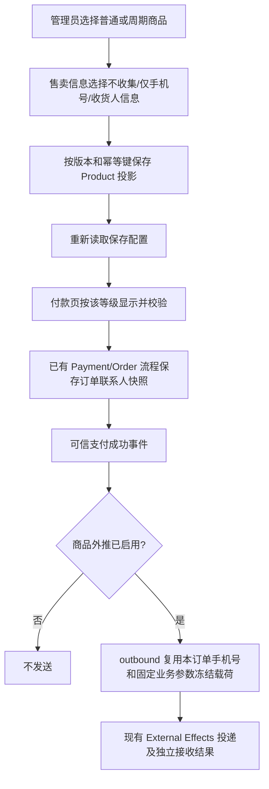

# 周期商品购买信息收集与外推复用

用户授权：登录生产排查、修复周期商品缺少购买信息收集，并验证收集手机号随固定外推参数发送。参考视觉为用户图2普通商品，保持现有管理端壳、表单与维度保存。

## 业务判断

## 复现与确认根因
2026-10-02生产普通商品68（334465678）显示收货人信息；周期商品12（ces，version14）缺入口；两者外推均未启用。`mountContactCollectionPanel`仅支持productForm，保存适配只透传普通产品新字段；周期公开读与HTTP付款视图另有未传收集等级的缺口。已由真实Host可见页面、序列化回归和公开读/付款视图测试核实。周期旧手机号字段位于隐藏的购买后动作区，新控件必须挂到售卖信息网格。

## 参考与复用
市场参考：[Stripe Checkout](https://stripe.com/payments/checkout)同时支持一次性与订阅付款的信息收集；[Checkout Session](https://docs.stripe.com/api/checkout/sessions/object)保存手机号及收货配置。工程主依据仍为本V4普通商品的控件、CanonicalLegacyAdminProjection、CheckoutProduct、共享publicProductPage及Order联系人快照。Product Design audit已用当前生产截图复现；image-to-code使用用户图2作为选定控件视觉，扩展现有组件，不初始化第二应用。

## 范围和验收
- 周期新建/编辑都有三档同款控件；保存、刷新和其他维度保存保留等级，历史配置兼容require_mobile。
- `/s/{code}/pay`与订单创建使用同一等级：none不要求手机号，mobile要求手机号，shipping要求手机号及完整收货信息；省市区复用既有数据。
- 外推复用现有outbound：当前订单手机号进入固定`phone_number`与自购`buyer.phone`，赠送保持付款人/受益人区别；固定type/day/frequency/remark和自定义字段不能覆盖保留字段。不将动态手机号写成管理员常量，不自动启用生产外推。
- 覆盖控件真实序列化/读回/维度隔离、公开读与付款视图、支付及外推已有合同；Linux Host和已安装旅程由唯一工作台执行。真实支付及接收方业务验收独立记录。

## 边界分类
OneID涉及下游已有订单客户及外推，复用身份Port，不通过所填手机号猜客户、不自建归属。Persistence为Product投影CAS与原幂等事务，Order快照继续原边界；无迁移。External Effects复用outbound及externaleffects Port/同一UoW，不增队列/worker/retry/对账核。不涉及新增限制。

## 五项影响
对外合同：既有contact_collection_level字段正确用于周期商品；已有外推保留字段语义。业务机制：配置及付款字段校验，客户身份/支付事件机制不变。关联模块：product的公开读、公共付款Host、payment/order/outbound消费；页面：周期售卖编辑与付款表单，普通商品共享控件回归。验证：模块全集及前端合同、共享付款与外推专项，准确候选交给唯一工作台补Linux及安装验证。

回退：恢复前一应用同包，不删除已收集联系人/订单数据。依赖：2026-10-03沿工作台已核验的累计预发HEAD 32e15938d4e756bc6ec2b68664260b91b957ab7d 更新；国内main/生产应用仍b30de6bc8ab054608828d6f260b94ea1c3b8576a。问卷成员的生产授权与本修复分别核对；本候选不扩大其授权。

2026-10-03补充：已提供[实际安装包驱动](../plans/2026-10-03-installed-periodic-contact-journey.md)。工作台已收到用户“完成周期性商品后一起晋级正式环境”的累计批次授权；开发继续提交准确国内候选，不自行安装。
