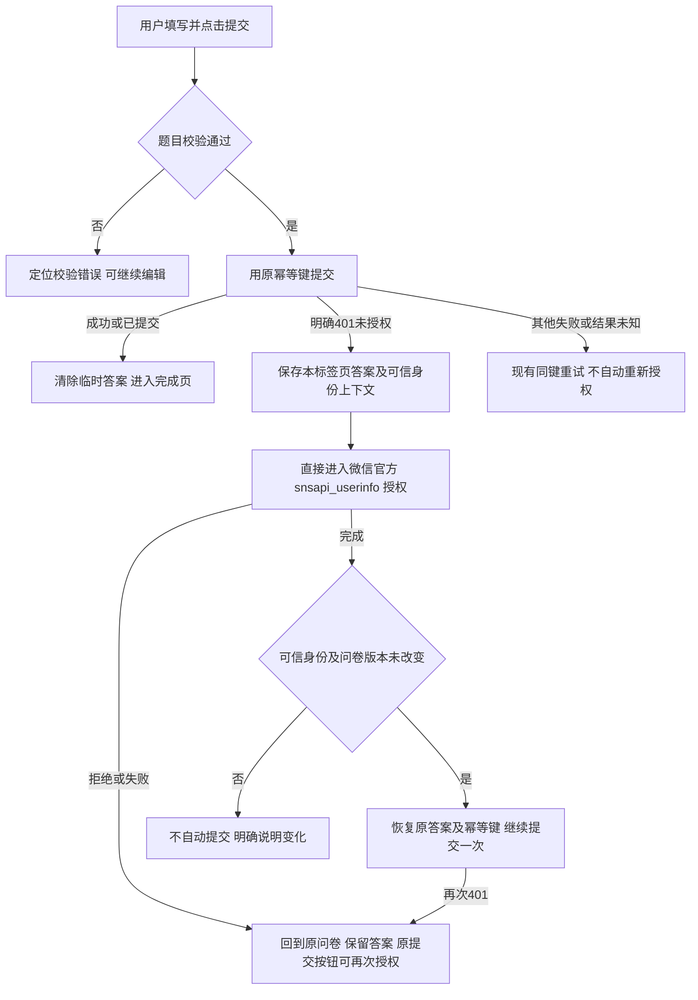
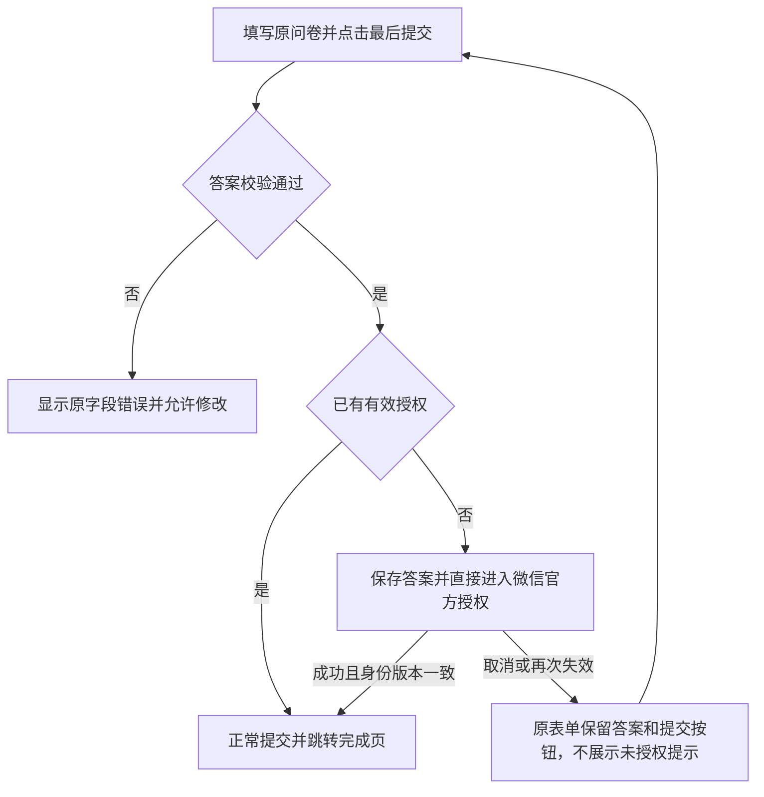
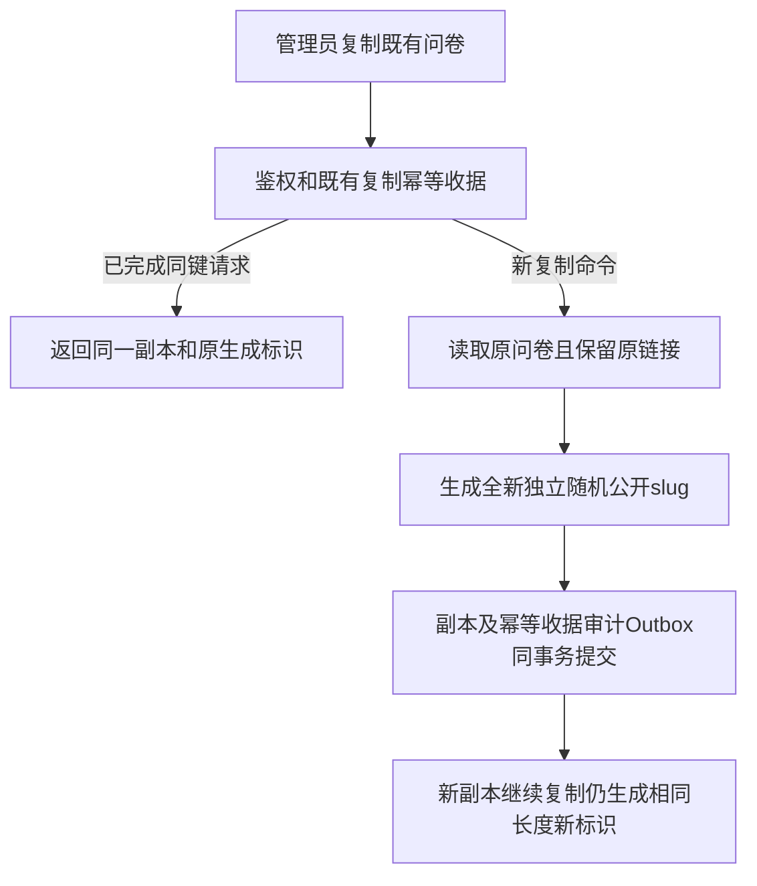
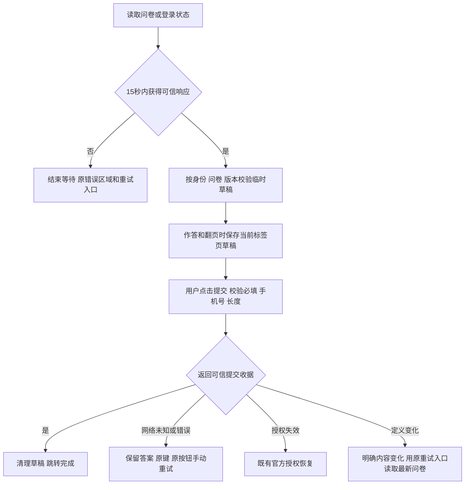

# 问卷提交时直接恢复微信官方授权

## 业务判断与目标

用户已授权本能力增强：公开问卷提交遇到授权失效，直接唤起最轻的微信官方头像昵称网页授权，跳过原来复杂的 CRM 授权页；保留答案，避免按钮灰色且没有下一步。

## 参考与 Product Design 决策

[腾讯 CloudBase 公众号官方集成指南](https://docs.cloudbase.net/integration/wechat-official-oauth)明确 `snsapi_userinfo` 是获取头像昵称的网页授权，入口为微信官方 OAuth 地址。H5 无法指定官方界面变成小程序底部弹窗；授权 UI、再次弹窗与否由微信控制。不仿造微信官方授权样式、不引入新 SDK 或扩大权限。

Product Design 的 user-context/preflight、get-context 已执行。用户随后明确要求「不要设计，就是纯粹的弹窗官方能力即可。不要加新的东西」，其最新指令优先：本候选不新增任何自制弹窗、页面、文案区域、按钮、样式或视觉资产。仅直接调用官方授权，取消后原提交按钮再次点击即唤起官方授权。真实官方授权弹窗只能在微信验收，桌面浏览器不模拟为官方。

## 复用、身份与数据边界

复用 Survey OAuthService、现有一次性 OAuth state 及持久化 return redirect；Provider `snsapi_userinfo` 和 OneID Identity Port 不变。既有 HttpOnly return cookie 仅标记恢复提交模式；回跳必须精确匹配已成功消费 state 给出的既有答题路径及 slug，cookie 不提供身份、目的地或权限。公开问卷 GET 返回一个问卷作用域的不可枚举上下文响应头，来自当前已验证客户及身份高熵证据，供回跳后比较；它不授予任何服务端权限、不包含身份原值，不接受客户端身份自报。上下文随客户或可信身份变化而变化。

OneID：读取既有验证身份及 canonical customer，不新增身份匹配或建客路径。Persistence：复用 OAuth state 本地事务，答案仅在当前标签页 sessionStorage 临时保存，完成时删除；新增表、迁移、队列均不涉及。External Effects：已有 Provider 授权读取；不增加企微写入、外部推送或执行状态机。

只有明确 401 才启动恢复；其他错误复用现有重试。授权回跳只自动继续一次，拒绝/失败/再度失效后需用户再点击，防止往返循环。新授权身份或定义版本改变时不自动把旧答案提交给新身份/新定义。这些是复用身份、不可变问卷版本和幂等边界，不增加业务字段限制。

## 五项影响与验收

对外合同：公开定义增加非凭据的上下文响应头，OAuth start 接受固定 `resume=submit`，回跳仍为既有 all/one 路由；普通入口不变。业务机制：原提交事务、OneID、30分钟会话、同键幂等与外部效果不变。关联模块：survey app/http、public API presentation seam、H5 controller；all/one 模板和 public Host 为既有消费者，其源文件不变。页面：两种作答布局均直接唤起官方授权，取消后原答案及入口可见。验证：OAuth state 单次消费/安全回跳、未授权无提交、身份/版本隔离、恢复同键、拒绝/再次401无循环、完成清理、普通503重试、真实 Host Chromium 与移动视口。

本地 fast/compile/专项测试只证明各自范围；Linux Host/PG16及预发实际旅程由唯一发布工作台补齐，生产安装和真实微信授权/业务验收单独记录。本次用户尚未发出生产部署命令，开发任务只提交候选和交接，不自行安装。

回退：恢复前一应用包；无需数据库回退，旧 OAuth state 格式仍前向兼容。临时 sessionStorage 格式显式版本化，旧版页面不提交这些状态。

## 2026-10-02 恢复开发补充

用户明确要求按已查信息完成全部开发优化，沿生产/国内主线 b30de6bc8ab054608828d6f260b94ea1c3b8576a 继续。目标用户手机号已唯一关联，重新授权在截图时有效，但其具体失败响应未留存；不推断手机号冲突，不修改身份归属。

补充范围：校验及提交失败时滚动到现有错误区域，无新增界面；提交请求使用与 Host WriteTimeout 相同的15秒预算，响应未知时解除按钮锁、保留答案与原幂等键，仅由用户手动重试，禁止自动重复提交；只将问卷提交 POST 的4xx纳入现有诊断记录，记录固定路由模板、状态、版本和随机诊断ID，不记录手机号、身份值、Cookie、问卷slug或答案。平台诊断提供可选过滤器，Composition Root指定消费者，其他路由沿用原策略。

限制必要性：提交等待预算｜网络响应丢失会使按钮无限锁住｜cmd/aicrm/main.go既有15秒WriteTimeout｜仅该提交请求15秒后取消等待，结果未知保留原键。服务端鉴权、幂等和事务不变。没有数据库迁移，不增加队列或Provider效果。

新增验证：8题长表单底部漏填时原错误进入视口、按钮解锁；丢失响应后可同键手动重试；问卷快速401诊断保留且不泄漏输入、未选路由不改变策略。共享Composition与诊断消费者由准确影响计划核对，不能用局部测试代替Linux/预发收据。

凭据事件作为生产运维事项交由唯一发布工作台核对轮换，不将凭据或生产连接串加入源码/收据。开发任务不直接修改生产配置。

### 新增400排查与修复

第二位用户通过外部联系人ID唯一定位到活动客户14436，手机号身份24438为正常already_linked，20:28:38授权成功，未提交目标问卷16、无提交占位。生产发布版本多次切换all/one布局，最新定义13；版本不匹配按既有合同为409，不能把截图400归因于版本。

发现并以准确基线Validator复现：H5允许文本首尾空格/换行，服务端ValidateAnswers拒绝这些正常文本并映射400。移除自由文本无依据的首尾空白禁止，原文、长度和幂等摘要完整保留；必填纯空白由前后端一致提示。该缺陷确实可产生400，但历史具体请求未留存，不能断言该用户一定触发此分支。验证覆盖原基线红灯、修复后领域测试，以及all/one真实Host+PG16完整8题带首尾换行提交/授权恢复/加密答案读回。

HTTP诊断必须按实际ServeMux挂载前缀/api/public/questionnaires/选择POST消费者；快速4xx的安全诊断code包含HTTP状态数值，现有数据库记录和日志均能区分400/401/409，无原始slug或身份输入。真实挂载连接合同防止仅测试虚构路由。

## 2026-10-02 用户复核后的移动页面修正

复用本父PRD及已完成的官方授权参考，不新增方案。选定视觉真值是用户图二的现有整卷答题卡：白色题卡、灰色选项/输入边框、蓝色选择态；浏览器和微信拥有手机导航。Product Design index、user-context preflight、image-to-code及design-qa用于已有生产项目的局部复用，不初始化新原型、不生成资产。

当前候选在9960aa1基础上修正四项：逐题题卡复用整卷标题/必答/题型/输入结构，移除输入区域多余边框；两种答题页不再渲染仿手机导航；HTML初始标题为中性「问卷」，读到可信定义后document.title为实际问卷title，包括授权取消的草稿恢复；授权失效与取消不插入红色未授权提醒或独立登录按钮，由提交动作直接唤起既有官方OAuth，授权成功自动继续，取消后原提交按钮重试。保持整卷/逐题模式及字段校验，不修改问卷配置。

OneID/Persistence/External Effects沿用父PRD：复用既有Identity Port验证、sessionStorage恢复、原提交UoW/幂等、Provider读取；不改身份归属、不加队列或写入效果。不涉及新增限制。五项影响：API和数据库合同无新增变化；业务变更仅授权提示/提交时机；消费者为H5 controller、Survey public Host/CSS及其构建和实际Host旅程；页面为all/one，其他H5独立页面保持既有行为；验证覆盖两种布局的真实标题、无仿导航、单层输入框、取消无提示、同键自动提交、身份/版本隔离、503与超时恢复。原候选的400和安全诊断修复仍全部保留。Linux、共享预发、生产与真实微信验收由工作台分别记录。本次授权为修复并重新投递工作台，没有新增生产部署命令。

每次用户明确点击提交都以原提交Owner端实际会话判定为准，不缓存「需要授权」为强制跳转状态；授权取消后若会话仍有效（或另一标签已恢复），本页直接正常提交。若仍无授权，Owner再次401才进入官方OAuth。取消回跳不自动提交、不自动授权；授权成功自动续交只一次。新增回归验证有效旧会话取消后普通提交，以及无会话取消后额外401不产生业务写入、三个请求保持同一幂等键。

## 新复制问卷使用独立公开标识

用户新增授权：保留所有既有问卷链接，只修改从本候选上线后发生的复制。当前Survey Service.Duplicate将source.Slug与copy、秒级时间拼接，造成复制链增长，且同一秒复制同源会得到同slug。复用既有复制Port/HTTP、PG唯一约束、Reserve/Complete幂等收据及audit/outbox同一UoW。参考[Go官方crypto/rand](https://pkg.go.dev/crypto/rand#Read)随机标识生成；使用q-加16字节随机值的小写hex（34字符），不增加依赖、不携带源slug/时间/客户标识。

OneID：不涉及，问卷公开slug不是客户身份；数据库questionnaire ID继续由既有Owner生成，不替换客户主键。Persistence：本地PG事务，原问卷只读并锁定，随机标识只在拥有新幂等reservation时生成；重放取已存结果。External Effects：不涉及Provider或外部写入。不涉及新增限制，沿用slug字符/唯一约束；不改历史slug、不迁移数据库、不新增后台控件。五项影响：HTTP结构和路径规则不变，新副本public_path更短；复制机制和关联资料沿旧流程，只有slug分配变化；消费者为Survey app/store、已有后台复制HTTP和公开读取/OAuth；无UI布局新增变化，原答题/资料界面消费新链接；验证覆盖长源slug、递归复制长度不增长、同秒不同复制标识唯一、同键重放不再建副本、原/新链接均能按Owner读取。

## 最终交包前稳定性扩展

用户授权增加对抗性测试并按成熟方案系统补齐打开、填写、提交的恢复路径。参考[SurveyJS草稿恢复](https://surveyjs.io/form-library/examples/save-and-restore-user-responses-to-complete-survey/documentation)的按答案/分页变化保存和完成清理、[Typeform断网说明](https://help.typeform.com/hc/en-us/articles/360039114711-Can-I-use-forms-without-an-internet-connection)的保留答案直到连接恢复，以及[SurveyMonkey响应状态](https://help.surveymonkey.com/en/surveymonkey/analyze/response-statuses/)的字段验证后才推进与完成。采用适合当前Owner的恢复模式，不引入第三方问卷框架或自动网络重试。

复用Survey presentation seam的生成API、现有错误/重试/提交控件和身份作用域sessionStorage。OneID仍只消费可信授权上下文，不新增匹配/合并。Persistence为同一标签页24小时临时草稿，普通编辑/分页/发起提交即保存，按slug、可信身份上下文和不可变定义版本隔离，完成删除；存储受限不阻止普通提交，授权跳转前必须先确保答案保存。External Effects不新增写入或重试内核。

新增限制必要性：读取15秒预算复用Host预算，解决一直转圈；24小时草稿保留窗用于避免长期残留个人答案，不限制问卷答题时长；2xx必须满足既有OpenAPI提交收据结构且slug/version匹配，解决代理空响应被误判成功。定义变更不猜测题目映射，保留当前表单直到用户点击现有重试入口重新读取；all/one路由按Owner返回的实际布局纠正，避免后台切模式后的旧入口无法正常作答。

五项影响：无HTTP/数据库新字段或迁移，前端更严格消费已有收据；业务新增编辑草稿与有限读取等待，不自动网络重提；消费者为public API/H5 controller/auth adapter及现有Host旅程；无新页面、弹窗、导航或设计，沿用Product Design已核验控件；验证增加读超时/恢复、刷新草稿与幂等键、双击、存储异常/损坏/过期、身份和版本变化、旧布局入口、异常2xx、Unicode与手机输入、真实PG唯一提交与收据。真实微信、iOS/Android及共享Linux预发分别列未验证，不用桌面模拟冒充Provider验收。

登录入口的200响应也校验既有authorized/resolved/display/submitted投影并在同一读取预算内解码；空响应或非resolved响应留在现有重试入口，不把HTTP200当登录成功并反复往返问卷入口。

最终截图复核补充：输入时只移除过期的字段/运输错误节点，不重挂载输入框，保护移动焦点和IME。已确认定义变化的提示及原重读按钮不能被编辑/翻页清除；重读前不重复发送同一已失效定义。真实Host验证修正输入后旧提示消失，DOM合同验证输入节点未重挂载。
