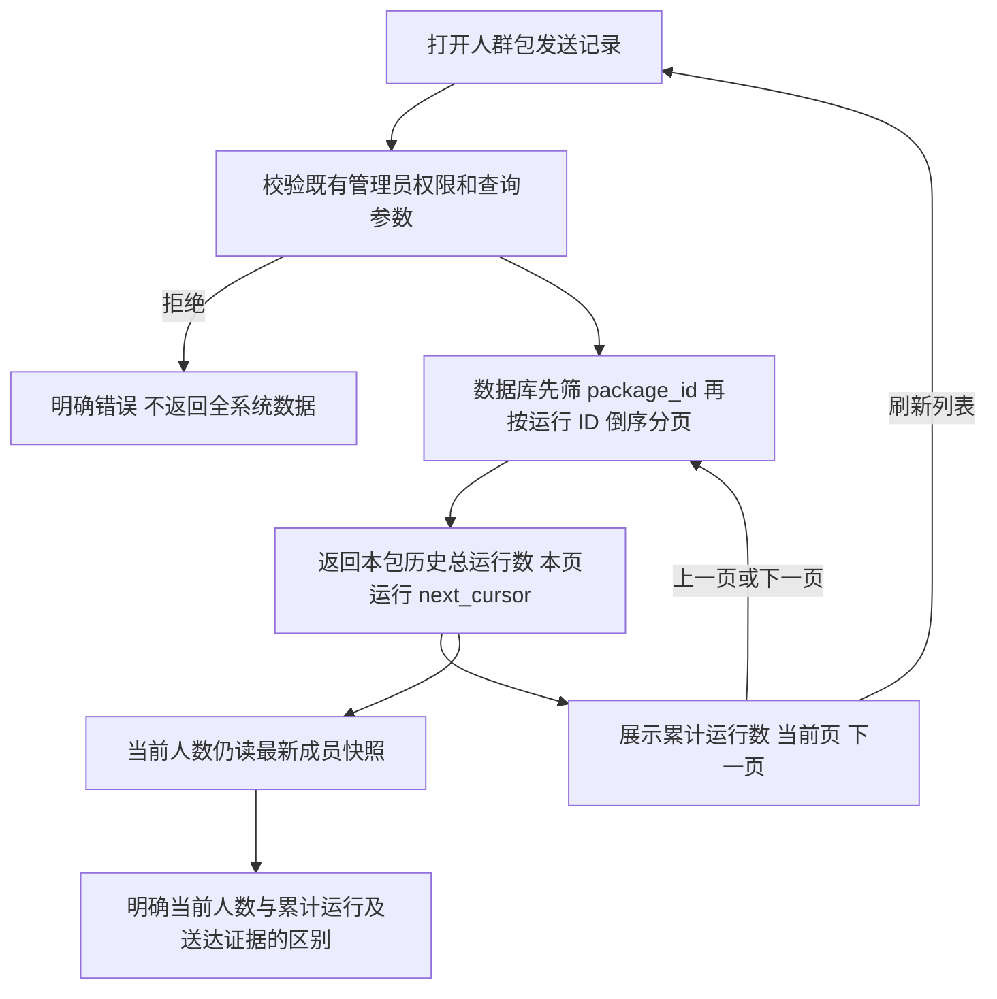

# 人群包发送历史准确取数

## 问题与范围

生产人群包 #33 在 2026-10-03 10:42 的只读核查：当前成员 24；历史运行 84（10-02 为 65、10-03 为 19），均为 Provider accepted，非收件人送达证明。页面先取全系统最新 100 条再筛包，仅显示 18 条，并把展示行数当成总数。已有上一页/下一页按钮未接入。

本候选修复运行历史的包内筛选、准确总数和游标翻页，并说明当前成员数不是累计发送人数。人数变动是当前 0–12 小时规则与企微资料发布完整重算的结果；本候选不改变成员规则，不修改历史数据，不触发补发。接口推送现有接口仅提供最近 100 条，其展示明确标注“最近”，不声称累计总数。

## 业务判断

## 参考与复用

- [GitHub REST 分页说明](https://docs.github.com/en/rest/using-the-rest-api/using-pagination-in-the-rest-api)：读取服务端下一页标记，不以一页长度冒充全部。
- 复用 Automation 的 `automation_runs` Owner、既有 Unit of Work、运行投影和 ID 游标，保持全系统查询兼容。
- Product Design get-context/image-to-code：视觉目标为用户提供的详情截图与现有 V4 模板；复用 `.ai-pagination`、已存在的前后页按钮及既有字号/间距/颜色，不重新设计页面。沿现有刷新枚举展示真实刷新方式。

## 合同与验收

- `GET /api/admin/automation-runs` 增加可选正整数 `package_id` 和响应 `total`（筛选后、不受 cursor 影响）；不传包号仍查询全系统。
- 非法包号/游标拒绝，不能悄悄降级为无筛选请求。保留既有 cursor=0 起始页兼容、1–100 页大小边界，不涉及新增限制。
- UI 请求始终携带当前包号，用服务端 total 展示累计运行数，使用 next_cursor/本地游标栈切页；请求失败不推进页码，快速交互不能覆盖较新结果；刷新回第一页。
- 显示“当前人数”为最新快照、非累计发送；实际 every_1h 显示“每小时增量”。运行状态沿用既有 Provider/送达语义。
- PostgreSQL 回归制造本包超过一页、其他包超过 100 条更新记录；逐页读回本包所有运行、总数稳定、无跨包/重复/遗漏、空页仍保留真实总数；HTTP 参数与权限回归；浏览器交互验证前后页、刷新、失败恢复。
- 回滚：撤销读路径与展示候选即可，无迁移、数据修改或外部效果回滚。

## 边界与五项影响

OneID：不新增身份解析/归属，仅沿既有只读运行投影返回现有用户编号。Persistence：Automation Owner 的只读 PostgreSQL 查询；无新持久任务。External Effects：不提交/重试/改变 Provider 效果。无新身份匹配、队列、Worker 或收据机制。

| 判断 | 结论 |
| --- | --- |
| 对外合同 | 运行列表新增可选包筛选与 total；原调用仍可用 |
| 业务机制 | 仅读查询范围和分页，无成员/幂等/发送策略变化 |
| 关联模块 | Automation app/store/http、Webshell 详情消费者、OpenAPI |
| 页面影响 | 发送记录总数及翻页、当前人数口径说明、真实刷新方式 |
| 验证证据 | 本候选精确 SHA/tree 的 preflight、编译、PG/API/UI 回归；Linux 安装旅程由唯一发布工作台执行，生产尚未授权 |

本地验证：独立 PostgreSQL 16 `aicrm_test_history_20261003`；Automation/Webshell 165 项测试通过，无跳过；真实登录 Host Chromium 翻页旅程通过，首/尾/390 截图和视觉检查见根目录 `design-qa.md`。首次 fast 的 API canonical 摘要不匹配已按现有绑定同步修复，重新 fast 通过；首次浏览器执行在数据源安全校验/缺 Host 资源阶段失败，补齐合成数据库与最终 Host 构建后同一旅程通过。保留失败收据，不据此更改断言。最终 SHA/tree、命令和证据收据在开发交接中绑定。

## 基线更新与短清单

候选更新至国内主线 `0bb4f0fe7ca4b4196f2003d6bf04467b12046a78`，业务修复字节保持不变，复用前述 165 项及两项浏览器通过收据。按极简发布规则，`docs/release-checks.json` 选 8 项源码直接合同，不因共享模板脚本版本引用扩散到全量 Host。

- Automation：运行状态投影；HTTP 筛包、total、参数拒绝与既有鉴权；PG 完整三页/空页/全系统兼容。
- 直接调用方：`TestAudienceRefreshToAutomationProviderAndReadOnlyHistoryPostgreSQL` 覆盖原全系统 `ListRuns` 与真实手动发送详情读回，保持 AI plan/progress 投影兼容。
- Webshell：详情/列表资产与模板绑定；两项 JSDOM 验证分页错误恢复、旧请求、every_1h 展示及保存保留。
- 真实 Host：本包历史翻页与现有发送确认两项 Chromium；不涉及支付、其他后台页面或发布控制器实现测试。
- installed_checks：`audience-send-history` 与 `audience-confirmation`。在最终预发包使用已认证页面/接口覆盖本包完整页和累计总数、当前人数口径与每小时增量显示，以及原归档取消/确认的隔离 Provider-disabled 合同；本地源码 Composition 通过不冒称安装包验收。

纯单元沿 Go 原生缓存；PG/真实浏览器按清单具名执行。新增基线的工具检查已由发布工作台完成，本候选不重复全仓 fast/compile，不修改控制器或新增安装通道。

## 安装夹具补齐

仅补测试夹具：Audience 读取可选 `AICRM_INSTALLED_AUDIENCE_{BINARY,ROOT,SHA,BINARY_SHA256}`，以独立进程启动给定安装二进制。复用已有隔离 PG、API 进程退出与 readyz 校验、TLS 反向代理；Browser 的页面、API、资源全部来自给定包，源码仅准备合成数据和数据库读回。二进制 SHA256 与 readyz release_sha 绑定本次应用；安装根和 Host 文件由工作台前后 `_verify_stage_app` 的完整包摘要绑定。Host manifest source_sha 可以保留上次真实构建的合法 SHA，并在日志明确记录 host_source_sha，不伪改复用资源元数据；不继承生产环境、不启用 Provider 或效果 worker。安装模式只检查安装 Host，略过源码 Host/npm 准备。

源码清单只留原 6 backend + 2 frontend，两项具名 Chromium 留在既有 installed_checks，在最终预发包上运行一次。工作台调用 `scripts/run-installed-audience.sh --binary <包二进制> --root <包目录> --sha <准确SHA> --binary-sha256 <摘要>`，要求准确 clean 源码与显式 loopback `aicrm_test_*_acceptance_test` 数据库。确认旅程是归档对话框取消不写、确认只写一次与生命周期读回，不是 Provider 发送。

国内仓禁止强推，控制器拒绝第一父链 merge：停止旧 merge ref，改由同 tree、无 merge 的 a5b6e755 继续 `codex/audience-send-history-release-20261003`，同一任务、能力、交付顺序与发布通道不变。
