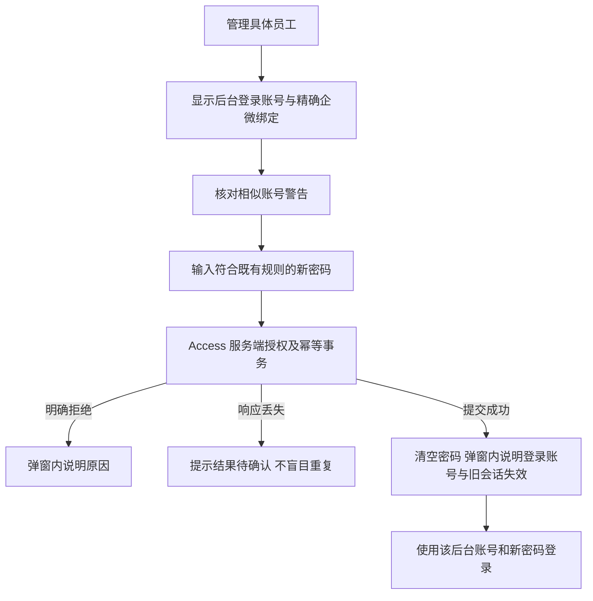

# 员工密码重置可用性修复

## 业务判断

## 当前证据与目标
生产只读观察发现大小写不同的两条企微绑定，拥有不同后台 username。登录只按 username 查找，重置按 admin_user_id 保存。现有弹窗只展示企微账号，minlength=12 没有可见规则提示，成功/错误信息位于被遮挡的页面。不能据此推定 DB 写失败。修复显示真实后台账号、复制按钮、相似企微账号的独立性警告和弹窗内状态。没有改 username、合并账号或按大小写猜测身份。

Product Design audit：基于用户截图和本次实际生产弹窗捕获；保持现有抽屉、表单、按钮和颜色。规则与结果紧邻提交按钮，状态可读屏；关闭清空密码。源页面可读检查已完成；真实员工密码不用于测试。

## 复用与边界
不涉及客户 OneID。企微绑定是已有 Access 身份，仅精确展示、不新增认证匹配。持久化沿原 Access UOW、hash、session_version、幂等及审计；没有 Provider、队列、迁移或新角色。参考 OWASP Forgot Password Cheat Sheet 的一致密码规则及会话失效：https://cheatsheetseries.owasp.org/cheatsheets/Forgot_Password_Cheat_Sheet.html 。

## 验收
真实模板 JS DOM 旅程：显示/复制准确 username、相似账号提示、短密码零请求、成功清空、失败不伪成功、关闭清空与异步切换目标隔离。PostgreSQL HTTP 旅程：精确目标重置、新密码登录、旧密码失败、旧会话失效、另一个大小写账号不变、幂等重放不重复增版本。生产安装后仅认证读回 UI；真实员工密码由用户后续测试。

本机证据：PostgreSQL 16.13 的 TestPostgreSQLGovernancePasswordResetLoginJourney 通过；实际模板的密码重置 DOM 旅程及原有 committed-search 旅程通过；浏览器打开修复后的真实模板/样式合成预览，已检查账号复制入口、相似账号提示和滚动后的规则/按钮布局。合成预览没有真实写操作；生产安装后仍需认证只读检查。
