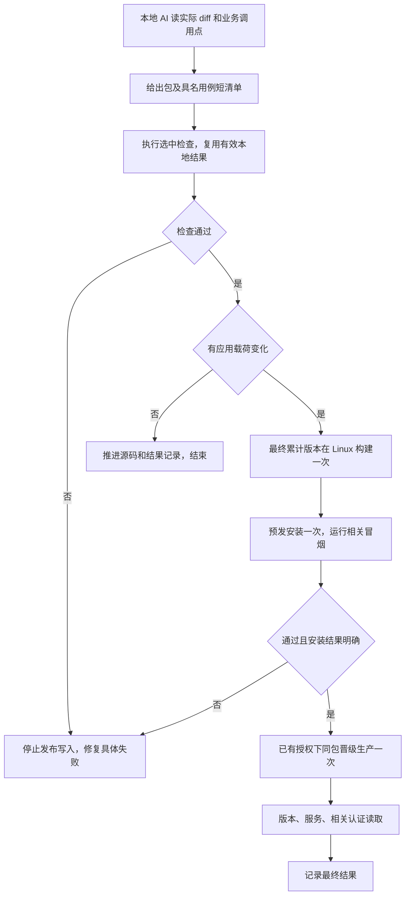

# CRM V4 极简发布方案

2026-10-03 · 复盘与父 PRD · 用户已批准本方案并授权实施部署；本文件为实施规格，实际部署结果另行记录。

## 1. 决策

**普通发布由本地 AI 直接列出检查包和具名用例，只检查改动包及直接业务消费者；最终版本构建一次、预发一次、同包晋级一次。接受遗漏普通回归的风险，取消未知映射自动全量回退。**

本次目标是缩短日常发布。身份错误归属、鉴权绕过、重复支付或 Provider 写入、不可逆数据损坏、Secret 泄漏仍属于停止条件。涉及这些行为时检查对应合同，也不扩展成整个仓库回归。

## 2. 这次为什么慢

依据本次控制器原始执行记录，周期商品最终候选的五阶段检查如下：

| 阶段 | 实测耗时 | 实际范围 |
|---|---:|---|
| preflight | 0.73 分钟 | 10 条必跑命令 |
| backend | 24.37 分钟 | 233 个包，3960 项通过 |
| frontend | 9.71 分钟 | 9 条命令 |
| browser | 7.30 分钟 | 38 个顶层合同 |
| archive-sdk | 0.07 分钟 | 1 条命令 |
| **合计** | **42.19 分钟** | 仅这些检查，不含构建、安装、夹具修复和协调 |

最终生产晋级执行耗时约 **34 秒**。周期商品候选从入队执行至整批完成约 **85.8 分钟**；整批首项到完成约 **3 小时**。这些时间属于不同范围，不能把 42 分钟当作整次发布总时长。

主要浪费：

1. 选择器表面按影响检查，实际上未登记输入、共享入口、政策与业务一起改动，都会扩大检查。此次计划明确为 `unknown-runtime-input`，进入全部五阶段。代码中混入测试驱动脚本也能触发这一分支。
2. `cmd/aicrm` 汇集很多业务合同，一个附近改动可以带出整组浏览器旅程；包目录太大被当成必须全测的理由。
3. 已安装验收夹具仍准备源码产物和 npm 环境。本次先后遇到缺 npm、缺 esbuild、Chromium 临时目录清理竞态，形成额外修复和重跑。
4. 累计发布按成员依次构建、安装预发，最终还要覆盖累计版本，批次越大重复越多。
5. 我在执行中增加了人工核对、临时驱动与重复证据整理。下一版应由现有控制器一次记录结果，执行者只处理具体失败。

[实测汇总](/Users/qianlan/Documents/Codex/2026-10-03/release-redesign/MEASURED_CURRENT_FLOW.json) · [本次完整发布记录](/Users/qianlan/Documents/Codex/2026-10-02/periodic-contact-release/FINAL_DEPLOYMENT_RESULT.md)

## 3. 业务判断流程

遇到安装失败或结果不明，停止后续写操作，读取原 attempt、版本和服务状态对账。修复后从失败的检查或未完成的安装步骤恢复；通过部分不自动作废。

## 4. AI 如何选检查

开发 AI 看当前 diff、改动函数的直接调用点、改动字段的直接读写者，输出一张短清单：**检查对象、包或用例、选择理由**。发布器直接执行清单，只核对对应候选和用例确实运行。

- 小包：整包 `go test`，无需拆得很细。
- 大包：按实际行为指定 `-run`，尤其是 `cmd/aicrm`、支付、outbound 等集合包。
- 邻近范围：改动包 + 直接调用或使用改动字段的业务包。到此为止，不递归展开反向依赖闭包。
- 前端：运行相关 adapter/组件用例；有页面交互变化时增加该页面一条旅程。静态类型与资源编译交给一次最终构建。
- 测试脚本、发布工具：检查自身用例或引用它的旅程；不带出整套业务测试。
- 未登记路径、共享文件：AI 按具体改动选最贴近的合同，记一句遗漏风险；取消“无法证明全部消费者就全量”的规则。
- 依赖锁文件：安装依赖、正常构建，检查实际变更依赖的使用方；不自动全前后端回归。

一般是几个包，常见约 3–6 个；这只是示例规模，**不设硬性包数上限**。同一业务同时改多个包就一起选，纯前端或文档可以没有 Go 包。

涉及身份解析、鉴权、支付幂等、事务或迁移时，把本次改动对应的拒绝、重放、并发或数据保留用例纳入短清单。纯页面展示、字段排版不自动触发支付和身份检查。

取消依赖图双向闭包证明、映射登记完成证明、AI 再审 AI、全量对照试运行和覆盖比例门禁。实际选漏普通消费者的风险由本方案明确接受。

### 周期商品这次应该怎么选

| 对象 | 检查范围 | 理由 |
|---|---|---|
| `internal/product/app` | 整包或联系人设置专项 | 修改售卖维度和联系人配置 |
| `internal/product/http` | 周期付款页、公开 checkout 专项 | 修改 HTTP 校验和付款页输出 |
| `internal/payment/app` | `TestH5CheckoutRequiresAndFreezesNormalizedMobile`、`TestAlipayWapCheckoutPreservesCollectedMobileInOriginalOrder` | checkout 直接使用本次联系人字段 |
| `internal/order/app` | `TestCreatePaymentOrderWithinEncryptsRequiredContactSnapshot` | 验证订单冻结快照 |
| `internal/outbound` | `TestCommercePaidPayloadEnteredPhone`、`TestCommercePaidPayloadCollectedPhoneAlongsideFixedProductParameters` | 验证字段进入外推载荷 |
| `web/v3` | `productAdapter.periodic_contact_collection.test.mjs` | 相关 UI 状态和保存行为 |
| 已安装 Host | 周期商品 HTTP/Chromium 专项组 | 覆盖相关页面、校验、保存与读取 |

问卷修复只加对应恢复旅程。测试配置包按实际改动补自身断言或编译，不扩散到整个平台。其余后台模块、企微全套、38 条浏览器合同、SDK 全套都不进入此次清单。

## 5. 删掉、合并和复用哪些步骤

| 现有要求 | 新默认 |
|---|---|
| 五阶段全量检查、`go test ./...` | 删除日常全量入口；按 AI 清单执行 |
| 未知输入、共享入口、未登记合同自动全量 | 删除自动扩散；选具体行为用例 |
| 全仓 `go vet`、所有测试编译、全仓 race | 日常不执行；相关 Go 包由测试编译，应用依赖由最终构建编译；并发行为改动才跑相关 race |
| 全前端测试、全浏览器组、无关 SDK 合同 | 只运行改动消费者的用例 |
| 本地已通过的纯单元测试到 Linux 再全跑 | 可复用对应测试输入未变化的结果；环境相关用例才在所需环境执行 |
| 每个累计候选构建并安装预发 | 源码先累计，最终版本统一构建、预发 |
| 同一行为在源码 Host、安装 Host 重复完整旅程 | 保留纯逻辑测试；系统旅程在最终安装包上执行一次 |
| 每次验收重新 npm 安装、准备源码 Host | 保留锁文件缓存；已安装验收直接使用已安装资源和二进制 |
| 临时目录删除失败导致整阶段重跑 | 全部业务断言已完成且进程已停止时，清理失败记警告；业务结果不明仍失败 |
| 修复一个用例后重跑整个失败阶段 | 重跑失败用例和修复所影响的用例 |
| 每一步人工摘要、额外多份收据 | 原控制器保留一次执行结果和安装记录，失败再展开日志 |

正常依赖缓存、Go 测试缓存、npm 缓存直接复用。测试输入发生变化时重新运行对应检查；合并冲突修复视作新改动。已通过检查不因无关文档或临时目录清理变化全部失效。

最终 Linux 应用仍正常编译全部实际编译依赖。Web 应用需要的资源完整构建一次；“少测包”不改变实际安装包的完整性。普通发布只构建运行服务及本次需要的工具，不为所有维护命令和 SDK 准备产物。

## 6. 日常发布只有四步

1. **选检查**：本地 AI 提交实际候选及短清单。已有父 brief 的修复不再做一套流程图、调研、PRD和批准。
2. **检查与构建**：运行选中用例，复用有效结果；最终累计版本在国内 Linux 构建一次。
3. **预发冒烟**：安装最终包一次。每个改动行为保留最短有效场景，通常 1–2 条；多成员批次合并清单去重。纯后端逻辑不强制浏览器。
4. **生产晋级与读回**：已有当前范围授权，直接晋级同一包。读取安装版本/摘要、API ready、worker 状态，以及相关业务的认证接口或页面。安装器已有的文件校验不再另做一轮人工全文件扫描。

批次按累计源码 HEAD 接收后续成员，成员自己的相关检查先完成。封批后只对最终累计版本构建、安装、验收；不要求每个成员先成为已安装预发基线。跨成员直接相互影响的用例在最终版本重跑。

沿用唯一国内源码、现有队列、串行锁、attempt 和安装器。无需新机器或新发布通道，预备机保持 2 核 2GB；Go 检查与 Chromium 在这台机器上错开执行，避免内存争抢。

环境固定为现有一套 Linux 运行器：Go、Node/npm、Chromium、PostgreSQL 路径与版本在环境配置变更时检查一次。常驻依赖缓存，按锁文件变化更新；旅程只准备自己的隔离数据，不重新初始化全部模块夹具。已安装验收使用安装包，取消为验收再建立一套源码 Host 和前端构建环境。

文档、测试、无应用载荷的工具改动只推进源码。普通发布不做数据库备份；确有生产迁移时才备份并验证相关数据后果。真实支付、扫码及接收方结果独立记录，不作为每次技术发布前置条件。GitHub 归档、观察等待继续不设日常发布门禁。

## 7. 适当容错的含义

允许远处普通模块出现漏测回归，由后续修复发布处理。保留上一完整构件；无迁移兼容问题时可用既有安装器回退。全量回归改为独立、按需维护命令，只有明确选择全量维护时执行，不自动嵌入日常部署，也不新增定时任务。

选中业务用例失败、应用构建失败、关键身份/支付/鉴权/数据合同失败，以及安装结果不明，仍停止后续发布写操作。超时、空用例匹配和 skip 不算通过；它们也不自动触发全仓回归。

## 8. 实施范围与验收

分类：不修改 OneID 身份算法；持久状态复用发布队列与安装 attempt；不增加 Provider 业务写或异步基础设施；无产品 UI 开发。

改造只落在现有工具：

1. `scripts/ci/behavior_selection.py`、`affected_plan.py`、`quality_lanes.py`：接受 AI 短清单，按包/具名用例执行，删除普通发布全量回退和重复编译检查。
2. `scripts/domestic_main_release.py`、`domestic_release_build.py`：累计源码后统一构建和预发，只构建本次运行产物；直接消费清单并复用有效结果，保留原串行锁、同包晋级及结果不明停止规则。
3. 已安装 Host 夹具：直接使用安装二进制/资源，沿用已有隔离 PostgreSQL 种子准备；分离业务结果与临时文件清理结果。
4. 同步唯一发布文档、仓库根规则与三个已注册 V4 skill，删除相互矛盾的全量要求。无需复制到旧 worktree。

验收只验证这几个改造点：清单只运行选中检查；用例真实执行；源码累计只产生一次最终构建/预发；生产使用相同摘要；失败或不明阻止下一次写入。不以十轮全量对照、影子发布或新增证明框架作为启用条件。

**目标：普通小改动、缓存已热、无迁移时，发布完成时间 10–20 分钟。** 这是改造后的目标，尚未实测；不作为强制时限，更不能为了达标忽略失败。首轮实际发布记录一次耗时即可，发现具体慢步骤再修。

## 9. 参考与取舍

Go 已支持指定包、`-run` 具名用例和成功测试缓存，最终命令构建也会编译实际依赖，可直接使用现有工具。[Go 官方命令文档](https://pkg.go.dev/cmd/go)

Nx 的既有做法是只执行受影响任务并复用缓存，说明减少无关执行和重复准备具备成熟参考。[Nx 官方 Reduce waste](https://nx.dev/docs/kb/reduce-waste)

本方案进一步采用 AI 选择直接业务消费者，不要求完整依赖图证明。这是结合用户接受适当容错所作的取舍，参考文档并不保证这种选择不会漏测。无需引入 Nx 或新的缓存服务。
