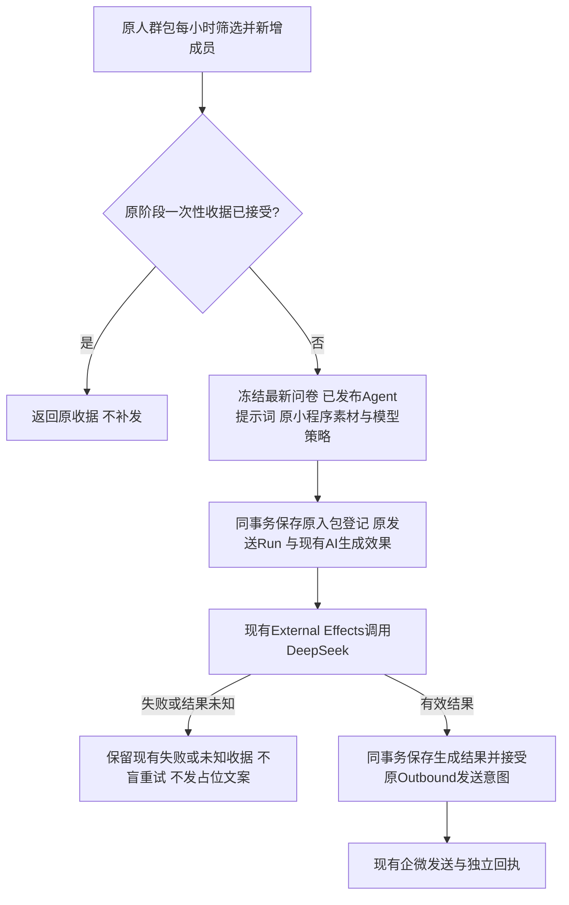

# B 板块按最新问卷生成个性化私信

用户授权：2026-10-03，使用 Agent 模式及现有 DeepSeek 配置跑通 B0–B5；不让用户填空，让用户感到被理解与关心。继承原 B 时间窗口、小时刷新、每阶段每客户一次及生产配置授权。

现状：生产保存 deepseek-chat 配置 version=2，真实连接测试 200 / 连接成功（11 tokens，无客户数据）；环境默认开关 false，但认证读取有效配置中心 revision=2 的 ai_agent_generation.enabled=true，因此生产最终开关已启用，不改环境或全局配置。Agent 可冻结问卷、聊天、标签、激活上下文；现有手工 Agent Run 生成后进入人工审核。自动入包策略只接固定内容，直接换模式不会通。

最小改动：复用原自动入包与一次性登记，原生成 item / EER / River / completion 和 Outbound；自动策略 Run 的有效生成结果进入已授权自动发送，手工 Run 保持原审核。冻结最近一次问卷，避免旧回答混入。小程序源在接受时冻结，生成完成不再读取当前问卷、Agent 或素材。使用现有 JSONB 上下文保存自动发送所需冻结参数，无新表、无迁移、无新队列或 Python 定时器，无前端开发。

OneID：读取原 canonical customer，复用原成员事件及一次性 lineage 保护；问卷经 Survey Port、聊天与标签各经稳定 Port，不自建匹配或建客。

持久化 / 外部效果：生成接受、入包登记、一次性收据、Run、审计在同一 PG UoW；生成 completion、Outbound 接受及效果完成同事务。DeepSeek 及企微写沿用现有 EER / Outbound；结果未知保留原键，不补发历史用户。无需新增限制，复用已有模型输出和 Provider 边界。

文案：六个 Agent 按阶段分别提供开始提问、降低门槛、拆行动、卡点帮助、推荐话题、轻提醒。结合最新问卷中的一个真实方向表达关心，推荐完整可直接复制的问题；HXC 提问使用“根据你对我的了解”，不要求 HXC 读取问卷全文。不得输出填空、未替换变量、具体联系方式或收入，不假设没聊天，不编造邀请或权益。

验收：最新问卷选择含重提覆盖；Agent 自动入包真实生成接受/成功完成/原小程序意图，重复事件与完成重放只产生一次；失败/未知不发送；固定路径与手工 Agent 审核保持原行为；生成或 Outbound 接受失败原事务回滚。最终同包安装旅程与生产 Agent 绑定/启用/模型开关独立读回，真实 Provider 与收到结果分别报告。

五项影响：接口不新增；业务自动策略增加 Agent 生成分支；直接模块 automation、Composition、generation context；无 UI；相关 Automation 与 Composition 用例及 PG 接受/重放旅程。回退使用旧固定 Agent 及原包绑定，保留原一次性收据，运行未知先只读对账。

参考：[DeepSeek 官方首次调用](https://api-docs.deepseek.com/zh-cn/)、[Chat Completions](https://api-docs.deepseek.com/api/create-chat-completion/)、[Temporal Durable AI](https://docs.temporal.io/ai)。采用其持久化模型步骤思路，复用本仓 EER/River，不引入 Temporal 或 SDK。
