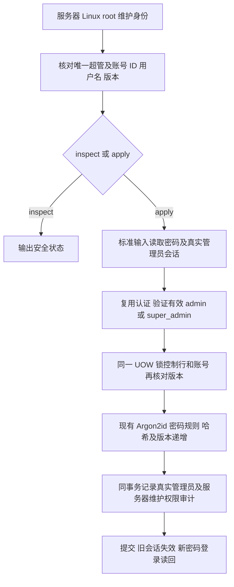

# 超级管理员密码恢复

用户明确授权恢复自己的 qianlan 登录密码并继续查询 HXC。线上 qianlan 是唯一 super_admin；已配置 admin 身份有效，但现有治理 API 明确禁止修改超管密码。保留该治理权限边界，通过服务器维护入口恢复，不冒充超管，不新增公开 HTTP 入口。

参考 Django 官方受部署环境控制的 [changepassword 命令](https://docs.djangoproject.com/en/6.0/ref/django-admin/#changepassword)。复用 Access Repository、Authentication、Argon2id 与 PostgreSQL UOW；不是使用普通 admin 权限执行原本拒绝的 HTTP 请求。

OneID：不涉及，恢复员工后台账号，不解析客户身份或修改企微绑定。持久化：Access 本地事务。External Effects：不涉及，没有 Provider 写、任务或队列。UI：不涉及。

维护入口必须同时具备 Linux root、现有真实管理员认证、准确目标 ID/用户名/会话版本、当前唯一超管控制行。限制依据是账号恢复的权限边界和并发避免误改；沿用最少 12 字符密码规则。stdin 不作裁剪，拒绝未知字段与额外 JSON。凭据不得进入参数、源码、报告或错误。审计使用现有 reset_password 动作，记录 authority=linux_root、实际管理员 ID、sudo 操作者、授权引用、前后版本，不含密码或哈希。

查询失败没有写入。apply 用版本检查防止重复恢复；结果未知时先使用新密码登录和查询版本，不换版本盲目再次执行。密码、session_version 和审计任一失败全量回滚。角色、绑定、登录开关、客户和业务配置不改变。

验证：正常新密码登录、旧密码/会话拒绝；错误目标/版本、普通 HTTP 身份无维护权限、无效管理员会话和短密码无写入；审计失败事务回滚；并发只有一次变更。Linux/PG 在隔离测试库运行。工具作为源码与维护程序交付，唯一工作台核对候选后执行本次恢复；不安装/重启业务应用。

五项影响：新增服务器维护命令；仅 Access 密码、版本和审计；直接消费者为 Authentication；无页面；测试与生产新密码登录分开记录。没有数据库迁移。
