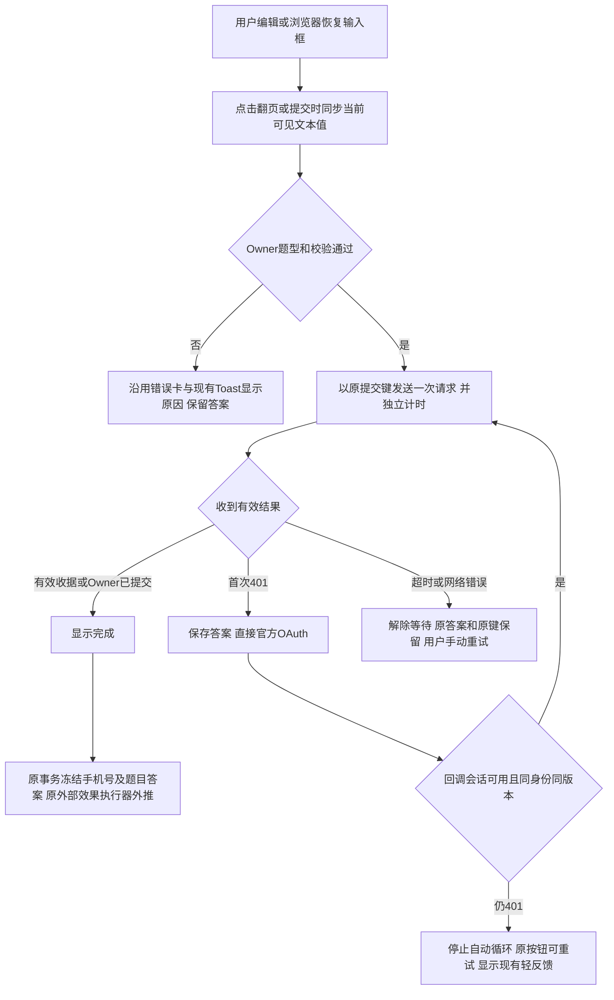

# 问卷提交兼容与生产外推核查增量

沿用已授权的问卷稳定性父 brief，本次仅修复原提交链路的兼容性和反馈。生产核查时应用为 be05afe、源码游标为 1f397fa；首轮修复以 0bb4f0f 为 base 完成本机验证。工作台现已给出通过 Linux 6backend+2frontend 的累计源码 6ceb3aec，本候选仅将原修复变基到该准确 base。没有数据库迁移、新外推目的地或客户绑定修改。

## 业务判断

生产只读证据：目标客户23662（公开编号1023661）只有一个active手机号身份，OA/UnionID/企微身份均verified，10:45:38创建resolved问卷会话，没有问卷提交/claim。该时间段没有问卷HTTP诊断；当前Caddy仅支付回调访问日志，不能反推出所有请求都未到达。无法还原用户的浏览器分支，不把后续合成复现冒称为过去请求根因。

问卷16今天核查时25次外推均executed且实际调用/收到结果；抽查1691–1695冻结载荷均有一项有效手机号、六项选择和一项文本，共八题，题目及答案完整。当前Provider将phone_number和answers放入同一POST。未重放生产外推，也未独立证明接收方后续业务处理完成。

## 参考与复用

- [MDN input event](https://developer.mozilla.org/en-US/docs/Web/API/Element/input_event)：程序设值及历史恢复可能没有input；提交/翻页时读取当前渲染控件避免model与可见值漂移。正常自动填充应发input，不能宣称所有自动填充都缺事件。
- [MDN Promise.race](https://developer.mozilla.org/en-US/docs/Web/JavaScript/Reference/Global_Objects/Promise/race)：独立拒绝的deadline才能保证Promise结束；race不取消网络。仍调用AbortController终止可中止请求，禁止自动重放未知提交。
- [MDN AbortController](https://developer.mozilla.org/en-US/docs/Web/API/AbortController/abort)：请求及响应体可中止。仅发abort信号并不能约束不响应信号的嵌入式网络实现。
- [MDN scrollIntoView](https://developer.mozilla.org/en-US/docs/Web/API/Element/scrollIntoView)：保留现有滚动，另外复用当前toast避免滚动缺失/抛错时只有页首错误。

OneID：只消费现有可信授权投影，不增加匹配/建客。Persistence：沿用sessionStorage草稿及后端原子提交。External Effects：只读原Survey/Outbound/EER收据；不改外推合同、队列或Provider重试。限制：复用原15秒等待预算和原校验，无新增限制。Product Design：当前V4页面和用户已指定通铺样式为目标，按get-context/现有组件检查；不新增视觉方案、授权弹窗或导航。

## 五项影响

| 判断 | 范围 |
|---|---|
| 对外合同 | HTTP和外推字段不变；原输入可见值进入原DTO；停滞请求可退出等待 |
| 业务机制 | 原身份、版本、幂等、事务、外推规则不变；超时不自动重试、不把迟到响应当成功 |
| 关联模块 | H5Controller、surveyPublicApi及其all/one/auth/result/done读取消费者；原Survey/Outbound合同用测试核对 |
| 页面影响 | 复用现有错误卡/Toast，保持题卡、文案层级及官方授权方式 |
| 验证 | 基线失败复现，双布局DOM与输入恢复/同键/迟到响应对抗合同；8b347d0本机通过证据保留，原测试输入未改结果按输入复用；工作台已验证9d86ffb的7backend（5命令/93通过事件），4项纯逻辑frontend待执行；2项HTML资源合同后移，最终安装包覆盖恢复合同 |

验收：输入事件缺失仍按当前可见值提交；翻页前保存文本；同输入失败重试同键；独立deadline包括授权入口响应体，前台恢复/历史页恢复后重查原截止时间，晚到成功不清答案；缺少AbortController仍可提交并结束停滞等待；二次401不静默/不循环。新增实际Host双布局旅程在无input事件下填写，并独立解密合成PostgreSQL数据核对原始手机号和文本，同时验证响应丢失后的同键重试只写一次。

docs/release-checks.json保留7项backend和4项纯逻辑frontend前置。原7项installed名称不变，追加installed-survey-auth-render与installed-survey-public-host-render。h5AuthAdapter.test.mjs和surveyPublicHost.test.mjs读取web/dist HTML，精简前置不构建Host时第一项在加载文件阶段失败，未运行到业务断言。两条测试文件和全部断言不改；工作台在最终构建后，从已核验同SHA包复制web/dist到隔离测试checkout，以现有根npm锁文件缓存执行原Node测试，不重新安装npm或构建Host，日志封入原stage-evidence。原已通过的Linux后端93事件收据保留复用。

Presentation/Completion测试文件、断言和历史通过证据保留，本次未改这两条源码旅程，不再作为重复的源码Host前置。OAuth恢复、响应丢失及新增NativeInput三个旅程支持既有安装二进制模式，复用run-installed-survey-recovery入口，改用既有preflight具名发现/结果验证，避免维护手工正则。Linux最终包执行这三个旅程的all/one六组和源码/二进制/Host摘要读回一次，连同两项资源合同填写同一stage-evidence，不新增发布路径。源代码本机五个旅程不替代最终安装验收。发布只向唯一路由工作台交接。回退前端应用包不动提交记录和历史链接。真实微信设备和目标用户重试为独立业务验收。
