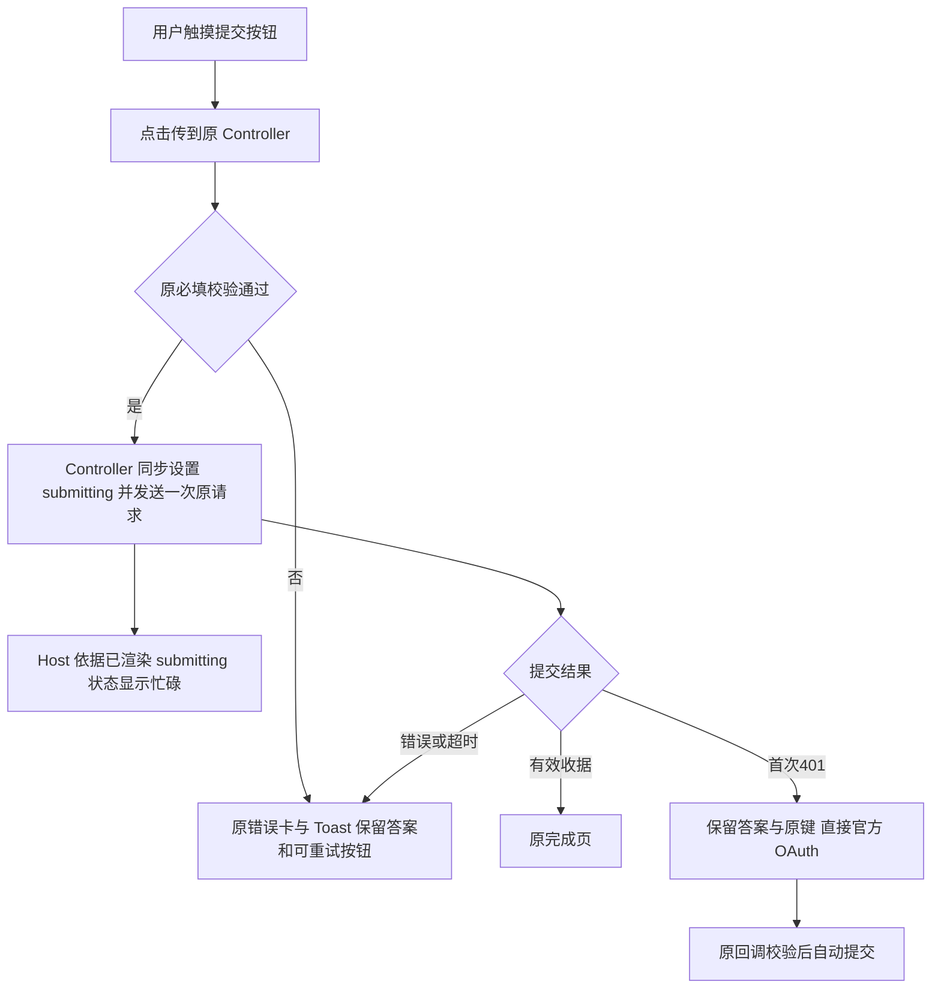

# 问卷旧 WebKit 提交点击兼容修复

继承已授权的问卷稳定性父 brief。首候选 ca0e629 从当时国内 main `52270f0db6d5f016501f20cc294ef4da6caac4ca` 出发；交接时 main 推进到 `d994b4a3a47efdce9637040f878b3a9e72095a41`，本候选按该准确累计 base 对齐，修复生产 Host 在点击捕获阶段禁用提交按钮的问题。复用现有移动问卷、官方 OAuth、草稿和提交 Controller；不改变样式或增加授权页面。

## 业务判断与复现

生产只读核查：目标用户 15:34:36 授权成功、会话 resolved；其在问卷18无提交和 claim。该问卷已有另一位用户成功提交。当前生产已安装 `52270f0`，HTML 与 JS 摘要匹配。选中 4xx 诊断由匿名401拒绝探针验证可用，核查时间窗内没有目标提交错误记录；没有前端点击记录，不能还原该用户的实际 iOS 版本和点击事件。

隔离测试使用实际生产 `web/dist`、合成八题定义和合成答案，HTTP 响应 stub，不使用用户 Cookie、不提交生产数据。Playwright 1.17.2 的 WebKit 15.4 真实 `tap` 和鼠标点击中，Host 捕获监听先设置 `button.disabled=true`，目标按钮监听不再执行。实际生产双布局的正常提交、无 input 事件输入、401恢复和空文本校验共六组均失败：前五组提交请求为零，第六组没有校验反馈。相同资源在 WebKit 26.0 六组通过；`dispatchEvent` 的合成 MouseEvent 在旧引擎仍能触发监听，不能代替真实触摸点击回归。

这是已复现的旧引擎缺陷，与用户表现相符；用户手机版本未知，不能将合成环境复现冒称为该用户历史请求的完整根因。

## 参考与复用

- [WebKit Safari 610 Node::handleLocalEvents](https://github.com/WebKit/WebKit/blob/Safari-610.4.3.1.4/Source/WebCore/dom/Node.cpp)：disabled form control 的 MouseEvent 可在目标监听执行前被跳过；与真实旧引擎复现相符。
- [WebKit bug 239810](https://bugs.webkit.org/show_bug.cgi?id=239810)：iOS15 的 click 使用 MouseEvent。
- [WebKit Safari18.2 说明](https://webkit.org/blog/16301/webkit-features-in-safari-18-2/)：click 改为 PointerEvent，说明仅测试最新 WebKit 不足以覆盖旧点击处理。
- 复用 `H5Controller.submit`：校验后同步 `submitting=true`、刷新，再开始异步请求；既有 guard 与原 submission key 已负责并发点击和幂等。Host 只观察原已渲染 submitting 标记，无须另一层提前锁。

Product Design：按 get-context 复用明确的 V4 源码目标与用户指定移动问卷交互。仅移除事件捕获阶段的状态修改，保留题卡、样式和官方授权路径，不生成新视觉方案。

OneID：不新增身份解析/建客，沿用可信会话与原授权恢复。Persistence：不改原 sessionStorage 草稿、后端提交事务或幂等键。External Effects：不改外推载荷、队列或 Provider 调用；前端修复使原链路能被调用。无新增限制、身份匹配器、Worker、重试状态机或外部写入口。

## 五项影响与验证

| 判断 | 范围 |
|---|---|
| 对外合同 | HTTP DTO、校验、OAuth 和收据合同不变；旧 WebKit 真实点击可进入原提交逻辑 |
| 业务机制 | 防重复提交由原 Controller 同步 guard 与原幂等键负责，不由 Host 捕获点击提前锁定 |
| 关联模块 | surveyPublicHost 的 all/one 提交控件与原 H5Controller.submit；不改其他页面/后端 |
| 页面影响 | 按钮仍依据实际 submitting 呈现忙碌，错误/校验仍可重试；不增加 UI |
| 验证 | Host 测试断言目标监听执行前按钮保持启用；原恢复/同键/重复点击合同；旧 WebKit15.4 与现代26.0 的实际静态资源双布局旅程 |

清单只选择 `surveySubmissionResume.test.mjs` 源码合同。`surveyPublicHost.test.mjs` 读取 HTML，放入已有 installed-survey-public-host-render 检查，在最终包构建后执行。保留既有 reauthorization、lost-response、native-input 六个安装旅程名称作为直接提交链路冒烟。不增加全仓测试或旧浏览器下载发布门禁。旧引擎隔离复现/修复收据由开发侧提供，不替代 Linux 最终包预发或真实 iPhone/微信授权验收。

验收：WebKit15.4 的真实触摸提交进入原 Controller；双布局正常提交、无 input 值读取、401官方 OAuth 入口与空文本校验后重试通过，答案完整且每次点击只发一个请求。原 Controller 重复点击测试继续只发一个在途请求。回退使用上一完整前端包，不动客户身份、历史问卷链接、提交和外推数据。源码候选推送后交付唯一路由发布工作台；本任务不安装共享预发或生产。

基线对齐仅吸收 d994b4a 的源码发布工具修复，问卷运行时、测试、浏览器输入和锁文件与 ca0e629 完全相同。保留 ca0e629 旧引擎复现/十二组完整 Host 通过收据，以相同输入摘要复用；新准确 head/tree 的定向源码合同单独执行。最终 Linux 包与安装冒烟仍由工作台统一执行一次，不把旧本机 manifest 的 source_sha 改写成新候选。
