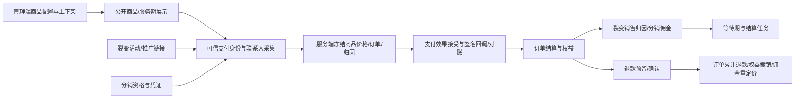

# 商品、裂变、分销深入审查父 brief

基线：国内 main 与本机 HEAD 均为 94d4b845f9d9ddcc30e7e05432032ba1677fac5a（2026-10-04 只读核对）。QA739 仅历史；不使用旧 GitHub main。原工作目录干净，隔离 codex/commerce-adversarial-audit-20261004 worktree。

目标：按真实业务入口和持久化结果定位并最小修复缺陷；不以用例数量代替覆盖。不合并、部署或执行真实支付/退款/提现/消息；所有数据库验证用独立 localhost PostgreSQL16 临时库。

OneID：商品定义不涉及；购买、裂变与分销使用 canonical customers.id 及既有 identity Port，核对付款人/受益人/推广人边界。Persistence：商品本地事务；订单、支付、权益与归因必须在共享PG UoW及既有收据/outbox中验证；可恢复任务复用jobqueue。External Effects：支付/退款/分润/外推只审查既有port与禁用或合成Provider合同，禁止真实效果。本轮不新增身份匹配/队列/执行内核。

参考：[PostgreSQL16锁语义](https://www.postgresql.org/docs/16/explicit-locking.html)、[Stripe重复与乱序回调](https://docs.stripe.com/webhooks)只用于核对不变量，不引入Stripe能力。

验收：先证明实际失败（可行时修复前测试），随后用真实PG、HTTP合同及必要浏览器交叉验证；版本CAS、幂等键/载荷、支付事实金额、退款余额、归属与权益必须一致。各缺陷记录复现/影响/根因/最小修复/结果；覆盖报告区分代码审查、合成测试、真实Provider和未覆盖。

五项影响随最终diff记录：对外合同兼容性、事务/身份/效果机制、直接模块消费者、真实页面及验证证据。不涉及无证据新增限制；必要拒绝范围须来自既有权限或数据不变量。修改可用独立代码候选撤回；本轮不迁移生产数据。最终交付准确base/head/tree、局部检查收据、剩余能力；用户已授权本轮审查/修复/隔离本地验证，未授权合并/部署。

## 第二阶段范围增量

继续已验收候选51e0516，不回退基线。真实HTTP/PG证明归档服务期商品的既有匿名分享无法撤销；创建仍要求可写，撤销允许锁定历史资源，仅关闭原能力。OneID只读既有Customer/Order/HXC投影；分享及回执沿用同一Product UoW，不涉及新增身份、任务或外部效果，也不新增限制。

裂变商品上下文已证明同actor/key重复创建、跨活动不冲突及HTTP/cookie期限与数据库不同；复用Referral现有actor-scoped操作收据和UoW，重放原token与原期限，不改变公共签名handoff的无身份语义。OneID沿用可信会话的canonical customer；本地事务，无新持久凭据或Provider写入。

真实PG进一步证明既有receipt operation白名单不允许上下文命令，因此追加0222前向迁移，仅增加该操作；result_kind复用实际引用的campaign，保留原行、唯一键和append-only触发器。不改已发布旧迁移，不迁移生产。分销公共佣金读取的非法cursor实际误报503；入口复用既有持久化分页合同，拒绝非规范正整数并返回400，不新增分页范围或权限限制。

WeChat通用退款HTTP入口的必要限制：商户退款编号若超Provider合同会接受无法执行的退款意图；依据微信支付国内退款官方合同，校验规范化值最多64 ASCII字符且仅0-9/A-Z/a-z/_/-/|/@/*，只对数据库确认的WeChat订单施加，不改原始幂等载荷或其他Provider。新增拒绝范围只位于Provider业务入口，不改变支付、佣金和退款余额规则。

验证增量以实际分享撤销、上下文网络重试、券预占/消费/释放、签名合成支付及退款、分销本人读取和商品WebKit操作为准；Provider合成、浏览器模拟、真实PG和真机/真实Provider分别记录。库存合同未获答复，暂不改变该字段语义或展示。

WebKit真实PUT/GET及PG复现普通/周期商品空图片响应null违反既有OpenAPI数组合同。只在HTTP响应构造非nil空数组，OneID/任务/外部效果不涉及，保持已有本地业务事务与请求省略/清空语义；浏览器作为相关回归，生产UI不改。

同一真实HTTP合同回归进一步证明普通copy直接JSON返回LocalProduct投影为null；仅将该投影保持空数组，不改复制业务/收据/库存。

交付补核真实HTTP/PG证明两个管理员对不同支付使用同key：compat自动编号和generic EER accept收据均因全局键缺actor而409。只补全既有actor-scoped退款合同的编号/accept键；老compat编号从原Payment+actor+key回执恢复，完整载荷仍由原app校验。既有同UoW外部效果接受不改调度/Provider/状态或旧记录，OneID不涉及新增解析。本地效果worker停用。

## 高风险补审增量

真实River证明Alipay缺付款时间的签名通知在查单任务discarded后重放仍只返回旧query_required收据，无法恢复查单。最小修复让该重放确保原目标任务，使用River现有去重；平台只读检查兼容旧无unique_key任务，保留cancelled/未耗尽任务和旧收据。OneID仍读取既有规范客户；通知收据与任务接受在同一PG UoW；只恢复Provider读取，不新建支付效果、身份或调度内核，不增加重试次数和自动循环。不涉及新增业务限制。补测实际River失败/权益回滚/重启竞争、核心授权分支及本地页面源码恢复；checkout拦截，不代表真实Provider或真机验收。

对象关系补核真实HTTP/PG证明会员备注跨商品引用被Order正确拒绝，但Product未识别Order稳定Port的not_found/conflict错误，误报503，导致客户端把无效对象和版本冲突当作依赖中断。仅补HTTP错误映射404/409，不改变授权、Customer/Product关系约束、持久收据或页面；对应有效管理员写入、Viewer拒绝和旧版本CAS交叉回归。
