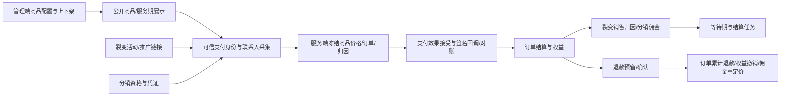

# 商品、裂变、分销深入审查父 brief

基线：国内 main 与本机 HEAD 均为 94d4b845f9d9ddcc30e7e05432032ba1677fac5a（2026-10-04 只读核对）。QA739 仅历史；不使用旧 GitHub main。原工作目录干净，隔离 codex/commerce-adversarial-audit-20261004 worktree。

目标：按真实业务入口和持久化结果定位并最小修复缺陷；不以用例数量代替覆盖。不合并、部署或执行真实支付/退款/提现/消息；所有数据库验证用独立 localhost PostgreSQL16 临时库。

OneID：商品定义不涉及；购买、裂变与分销使用 canonical customers.id 及既有 identity Port，核对付款人/受益人/推广人边界。Persistence：商品本地事务；订单、支付、权益与归因必须在共享PG UoW及既有收据/outbox中验证；可恢复任务复用jobqueue。External Effects：支付/退款/分润/外推只审查既有port与禁用或合成Provider合同，禁止真实效果。本轮不新增身份匹配/队列/执行内核。

参考：[PostgreSQL16锁语义](https://www.postgresql.org/docs/16/explicit-locking.html)、[Stripe重复与乱序回调](https://docs.stripe.com/webhooks)只用于核对不变量，不引入Stripe能力。

验收：先证明实际失败（可行时修复前测试），随后用真实PG、HTTP合同及必要浏览器交叉验证；版本CAS、幂等键/载荷、支付事实金额、退款余额、归属与权益必须一致。各缺陷记录复现/影响/根因/最小修复/结果；覆盖报告区分代码审查、合成测试、真实Provider和未覆盖。

五项影响随最终diff记录：对外合同兼容性、事务/身份/效果机制、直接模块消费者、真实页面及验证证据。不涉及无证据新增限制；必要拒绝范围须来自既有权限或数据不变量。修改可用独立代码候选撤回；本轮不迁移生产数据。最终交付准确base/head/tree、局部检查收据、剩余能力；用户已授权本轮审查/修复/隔离本地验证，未授权合并/部署。

## 第二阶段范围增量

继续已验收候选51e0516，不回退基线。真实HTTP/PG证明归档服务期商品的既有匿名分享无法撤销；创建仍要求可写，撤销允许锁定历史资源，仅关闭原能力。OneID只读既有Customer/Order/HXC投影；分享及回执沿用同一Product UoW，不涉及新增身份、任务或外部效果，也不新增限制。

裂变商品上下文已证明同actor/key重复创建、跨活动不冲突及HTTP/cookie期限与数据库不同；复用Referral现有actor-scoped操作收据和UoW，重放原token与原期限，不改变公共签名handoff的无身份语义。OneID沿用可信会话的canonical customer；本地事务，无新持久凭据或Provider写入。

真实PG进一步证明既有receipt operation白名单不允许上下文命令，因此追加0222前向迁移，仅增加该操作；result_kind复用实际引用的campaign，保留原行、唯一键和append-only触发器。不改已发布旧迁移，不迁移生产。分销公共佣金读取的非法cursor实际误报503；入口复用既有持久化分页合同，拒绝非规范正整数并返回400，不新增分页范围或权限限制。

WeChat通用退款HTTP入口的必要限制：商户退款编号若超Provider合同会接受无法执行的退款意图；依据微信支付国内退款官方合同，校验规范化值最多64 ASCII字符且仅0-9/A-Z/a-z/_/-/|/@/*，只对数据库确认的WeChat订单施加，不改原始幂等载荷或其他Provider。新增拒绝范围只位于Provider业务入口，不改变支付、佣金和退款余额规则。

验证增量以实际分享撤销、上下文网络重试、券预占/消费/释放、签名合成支付及退款、分销本人读取和商品WebKit操作为准；Provider合成、浏览器模拟、真实PG和真机/真实Provider分别记录。库存合同未获答复，暂不改变该字段语义或展示。

WebKit真实PUT/GET及PG复现普通/周期商品空图片响应null违反既有OpenAPI数组合同。只在HTTP响应构造非nil空数组，OneID/任务/外部效果不涉及，保持已有本地业务事务与请求省略/清空语义；浏览器作为相关回归，生产UI不改。

同一真实HTTP合同回归进一步证明普通copy直接JSON返回LocalProduct投影为null；仅将该投影保持空数组，不改复制业务/收据/库存。

交付补核真实HTTP/PG证明两个管理员对不同支付使用同key：compat自动编号和generic EER accept收据均因全局键缺actor而409。只补全既有actor-scoped退款合同的编号/accept键；老compat编号从原Payment+actor+key回执恢复，完整载荷仍由原app校验。既有同UoW外部效果接受不改调度/Provider/状态或旧记录，OneID不涉及新增解析。本地效果worker停用。

## 高风险补审增量

真实River证明Alipay缺付款时间的签名通知在查单任务discarded后重放仍只返回旧query_required收据，无法恢复查单。最小修复让该重放确保原目标任务，使用River现有去重；平台只读检查兼容旧无unique_key任务，保留cancelled/未耗尽任务和旧收据。OneID仍读取既有规范客户；通知收据与任务接受在同一PG UoW；只恢复Provider读取，不新建支付效果、身份或调度内核，不增加重试次数和自动循环。不涉及新增业务限制。补测实际River失败/权益回滚/重启竞争、核心授权分支及本地页面源码恢复；checkout拦截，不代表真实Provider或真机验收。

对象关系补核真实HTTP/PG证明会员备注跨商品引用被Order正确拒绝，但Product未识别Order稳定Port的not_found/conflict错误，误报503，导致客户端把无效对象和版本冲突当作依赖中断。仅补HTTP错误映射404/409，不改变授权、Customer/Product关系约束、持久收据或页面；对应有效管理员写入、Viewer拒绝和旧版本CAS交叉回归。

## 2026-10-05用户授权全模块继续审查

延续fb676f417010eb85f131e81ab4ee9e6ef987f4dd及原隔离分支，国内main重新只读仍94d4b845；其他worktree（含419d01f发布候选）不覆盖。按实际菜单/API/composition与River注册：问卷及报名直接链→客户/OneID/标签/权限/负责人关系→人群/漏斗/总览→渠道/邀请/群→自动化/运营闭环/消息归档与外部效果→素材/内容雷达/AI→开放API/CLI/配置及诊断→跨模块闭环。商品/裂变/分销已验部分仅按新变化影响或明确缺口重测。执行索引与模块结果在工作区外，避免另建治理系统。

OneID：问卷/OAuth、客户及归因使用既有可信session及canonical customer；未授权隐式建客/合并或安全设置变更。Persistence：先验证每条真实命令的PG UoW/receipt/答案或成员事实/outbox与原任务；Provider读取本地loopback，写效果只验本地接受与合成Adapter。External Effects：保留既有outbound/EER和unknown不盲重试，禁止真实支付/退款/提现/消息/外部AI付费调用、生产数据写、持久凭据。库存待决不变。不涉及无依据新增限制。

逐模块验收只选可用性、归属、数据丢失、越权、重复副作用的必要正常/异常/竞争路径；真实PG/HTTP与关键UI交叉读回。近期问卷恢复/输入/超时修复优先核对实际连接，能用既有合同则不重复新建；复现缺陷再最小修复，UI编码前ProductDesign，保留红→绿证据。模块报告准确已读/已执行/skip/外部边界，持续下一模块；最后局部影响回归与准确commit/tree，不承诺所有未知bug消除。

### 问卷发布/提交并发候选（国内 base 641d757）

真实 PG 16 复现：v1 已校验后另一事务发布 v2，原 Store 锁内只取新 definition ID，落入 v2 ID + v1 版本/题目答案。锁内 JOIN 已发布定义并比较 validated DefinitionVersion；不一致返回原有 ErrConflict，提交/占位 claim/答案/token/audit/outbox 整笔回滚。已有同 key 收据重放在版本核对前保持原语义。

OneID：读取可信 OAuth 的既有 canonical customer，不改身份匹配。持久化：沿用共享 PostgreSQL UoW 与既有问卷行共享锁，不加队列/锁表/迁移。外部效果：不新增；版本冲突不得产生完成效果接受。限制：复用客户端与后端已存在的问卷版本不变量。直接消费者为 Submit、公开填写 HTTP、结果收据及完成适配器；页面沿用现有版本冲突提示，无 UI 实现改动。验证：原始真实 PG 先红，新增 v1/v2 正常对照及冲突后各表零残留；检查当前 Store/App/HTTP 与 OAuth 提交结果、冻结管理运行时、完成 Port 契约。仍不宣称真实 Provider/真机验收。

### H5「其他」补充填写候选（继承当前问卷 PRD）

先在当前已提交源码的真实 H5 + HTTP + PG 夹具复现：WebKit 15.4/26.0 × 整页/逐题均能选择 Other，但无补充输入框；后端 ValidateAnswers 需要对应 text_value。Product Design audit 已先采集并查看当前题卡截图，修复复用既有 textarea 样式，不重做页面。选择 Other 后显示有明确 accessible name 的补充 textarea，沿用后端 other_max_length 按字符校验；取消 Other 删除其过期文字。原生未派发 input 的值、页面刷新草稿及原 key 重试均复用现有 maps/恢复机制。H5 类型改为和实际 transport 共用 generated/survey-public，去掉旧 health schema + 手写扩展。

OneID：只读既有 OAuth 可信客户；持久化：不改表/写 Port，已有提交 UoW；外部效果：不新增/不运行 Provider。新增限制：无，补充文字长度与必填复用后端已发表选项规则。合同：发送原有 text_value；机制：仅已有答案/草稿呈现；关联：H5、公开提交、手机号收集；页面：all/one 既有题卡；证据：四组浏览器先红后绿，真实 PG 一份提交/claim、九题与两项多选、手机号/自由文本/Other 密文回读，提交后响应丢失原 body/key 重放、DONE 刷新无新 POST。旧恢复契约、typecheck、问卷/手机号 PG 消费者通过；真机与真实 Provider 留待单独验收。

### 真实版本冲突响应恢复

HTTP resultError 返回 {ok:false,code:definition_version_conflict,message:...}，H5 只检查 details.error；旧 resume 测试也模拟 error，掩盖实接口恢复失败。将同一个用例改成后端真实 body，先红（canRetry=false）后绿；H5 兼容 code 及既有 error。扩展同一 WebKit/PG 恢复夹具，通过实际 DefinitionService.Update+Publish 在填好旧版本后发表新版（按真实 DefinitionVersion，不假设连续从 1 编号），原请求经过真实公开 HTTP，必须409且code正确；用户改字不得再次POST旧题，明确重新读取后重填新版，实际落库只允许一份准确新版和九题答案。身份/事务/外部效果不新增变化。

### OneID 合并后的问卷单次填写及手机号锁顺序

真实 PG 复现：Alipay 客户已填问卷后按既有强证据确认合并到 WeCom 根，新根另一个 key 再次成功，生成两份 claim/答案；仍有效的旧 OAuth session 也保留旧 customer_id。Survey 复用 OneID CanonicalLineage Port 读取历史 claim，锁定当前谱系后新写归当前根；既有历史 claim/答案不改写，原 key 收据重放优先且不因合并失效。公开状态同时识别新根与旧别名。

手机号真实 Collector 后续锁 customers FOR UPDATE，若入口先 FOR SHARE，两并发请求分别持共享根锁且一方等待 claim 主键，另一方升级根锁，真实 PG 检出死锁。为会写身份事实的调用增加既有 OneID 谱系锁的 WriteLocked 入口，复用同一排序、复读和根行锁，只将锁模式指定为 FOR UPDATE；现有只读 LockedCanonicalLineage 保持 FOR SHARE。不增加锁表、匹配器或队列。

五项影响：公开 HTTP body 不变，合并客户沿用原单次填写不变量；共享 UoW 内锁当前身份根，Survey 只写自有表，手机号仍由 Customer/OneID Owner 写；直接关联为公开状态/提交、手机号收集、完成收据及合并/反转锁语义；H5 字节不变；验证真实合并先红后绿、原 claim 保留及原收据重放、旧/新 session 并发一次写入与手机号归当前根、PG 锁升级先红后绿及锁 Port 互斥。合并反转与已有手机号/OAuth回归列在原清单。无新业务限制，无真实 Provider 效果，无部署授权。

### 客户详情合并前问卷历史

同一真实合并/提交 PG 夹具通过实际 customerSurveyAdapter 复现：谱系两份不同问卷事实，当前客户详情 total=1，旧身份记录消失。Survey App 通过原 OneID CanonicalLineage 读取谱系，Store 在 Survey 自有表用 ANY(ids) 一次全局 count/排序/分页；不移动事实，不逐别名拼页。原单客户接口保留委托语义，无绑定的历史维护和既有测试仍按单 ID。五项影响：返回形状不变，正确展示合并前后问卷；只读同一 UoW，复用身份 Port，关联客户详情/游标分页；UI不变；真实PG先红后绿，两别名同时间戳按 ID 全球排序，旧别名读回、游标终止、水位线、排除第三客户及手机号脱敏。对外 external historic union 查询合同未改，本项不扩展到企微观测合并规则。无效果/迁移/新增限制。

### 商品旧身份订单的标签命令保护

真实 OneID 合并后，实际 production customerTagCommandGate 从当前根和订单旧别名冻结出相同 external identity/标签绑定摘要。已有根命令 queued，旧别名另一个商品命令仍被接受（两条 line、两份 EER），复现了原 per-ID 保护缺口；未启动任何 Worker，不声称已发生 Provider 重复效果。

Customer 命令边界绑定 OneID 批量 WriteLockedCanonicalLineages Port，复用原排序锁定/复读 kernel 一次锁所有谱系，确保多客户命令不按每条谱系交错锁。原 payload digest 与收据检查先做；接受的新 line 用当前根，idle guard 覆盖全部历史 aliases，已有历史 line 不改写。原单个 lineage 锁复用同一 kernel；未绑定的旧纯单元合同保留原实现。合并到同一客户的两条目标沿用单客户不可重复命令的不变量返回 conflict，不将矛盾 add/remove 静默拼合。

五项影响：HTTP及商品事件合同不变；修复 old payer ID 绕过 queued/outcome_unknown 保护；Customer/OneID/EER共享原事务与River，商品业务字节不改，组合根绑定已有查询Owner；UI不变；真实Gate+PG先红后绿，unknown下旧别名拒绝且不新增命令/EER/River，原key重放与篡改冲突，批量谱系锁与原100+队列/HTTP/事务回滚合同回归。没有新Provider/身份/队列内核、迁移或生产写。

### 邀请写开关与恢复

实际 PG + InvitationService.Public + Owner Store + 事务probe复现：已执行的 a 群达到阈值，WriteEnabled=false 仍接受 b 群更新、将 join-way 置 accepted；disabled adapter源码会无Provider调用直接final_failed，而普通Retry不接受此终态。另先修公开路径后独立复现：disabled本地编辑删去已知 a 群仍接受新 b 意图。最小修复沿用既有写开关：评估可本地退休满群，但新目标保持preparing/无current，不将旧官方码展示为新群；保存允许无效果的本地编辑，实际需要新意图时由同一事务中的拒绝accepter中止并回滚。恢复写开关后按原稳定source/收据接受一次更新，不变token/官方QR。

五项影响：接口形状、公开bearer token及既有幂等不变；禁止disabled接受必然失败的Provider写，沿用原功能开关而非新增限制；关联问卷/商品完成群码与邀请轮替/元数据编辑；UI字节不变，既有preparing页面；真实PG先红后绿，metadata仍可改、拒绝目标编辑无版本/意图残留，重新启用接受一份更新且虚拟Provider确认后b有效，原native编辑/事务回滚合同继续通过。EER接受为事务probe、Provider为本机虚拟adapter，不声称真实企微验收。中间旧history断言未计入新增等待阶段的fixture失败单独保留，不称新业务缺陷。

### 问卷元数据 Unicode 合同

api/openapi.yaml 的 SurveyPublicSubmissionRequest 已公开 source_channel/campaign_id/staff_id 各 maxLength=200，生成类型同一合同；App 却用 source_channel 100字节、其余200字节。数据库为TEXT，无额外字节约束。实际 OAuth→公开HTTP→PG旅程发送合同内的200个中文/emoji/员工字符，先红400 invalid_request。App 沿现有公开合同改用 utf8.RuneCountInString <=200；不改角色/负责人来源及归属政策，不加迁移/UI字段。原旅程同时证明200字符原样持久化、各字段201字符拒绝、并发/原收据重放与既有快照结果继续通过。五项影响：修复客户端已声明合法的长度，原有效输入保持；只改验证计数，无身份/事务/效果机制变化，直接关联Submit公开HTTP及生成类型；H5字节不变；真实本地PG/HTTP先红后绿，Provider为已有OAuth测试替身。staff_id仍是原客户端metadata，其业务负责人信任来源问题另列待确认。

### HXC 合并后共享事实读取（延续同一全模块审查 brief）

真实 PG 复现：原 HXC 会员/注册投影已发布在客户 A，OneID 强证据合并到 B 后 Product/Segment 读 B 得不到 A 的事实。HXC 仅通过既有 CanonicalLineageReader 读当前谱系，仍只查询自己持有的历史 rows/coverage。SharedFacts 在原 RepeatableRead 快照中解析谱系；输出 map key 保留请求 ID、值为当前 canonical root；不改历史投影。多个原账号落入同一谱系时沿既有 ambiguous/unknown 合同，不擅自加会员/额度或选择冲突负事实。Composition 绑定同一原 OneID query；独立维护 fixture 不绑定时保持既有读取兼容。

分类：涉及 OneID 只读 Port，无新身份匹配或自动合并；持久化为原 HXC Publish，不加表或迁移；River 沿已有刷新任务，不增加执行内核；不涉及 Provider writer。五项影响：HTTP shape 不变；成员商品/Segment 正确继承合并前共享事实；原发布及 retention 保持；HXC UI 字节不改；原 Service Create→River insertion→worker Refresh→Owner Publish、真实合并/反合并、旧版本固定及冲突边界和直接消费者合同验证。合成源只替代外部 MySQL snapshot，不称真实源已验。原先先红证据 hxc-lineage-before，核心后绿 hxc-core-service-lineage-complete。

### 存档失败收尾与原 Inbox attempt 恢复

真实随机 PG schema 注入 FinishRun UPDATE 的 P0001：已接受 Inbox 的原 run 收尾错误被丢弃，Inbox 重试成功后旧 running 仍滞留。修复前正确恢复断言失败。不能直接清 running：原 60s Inbox lease 过期可重新 claim，SDK 单次 15s 不约束整笔十页，旧 attempt 仍可能写页。

复用平台原 Inbox attempt_count 和行锁：平台发布 RequireCurrentClaim，同 UoW SELECT processing+attempt FOR UPDATE；WeCom Processor 给内部 delivery 注入 guard（正 attempt 无 guard 拒绝，零 attempt 的直接 Owner fixture 保持兼容）。Archive 每个初始化 cursor、StartRun、页事务、blocked issue、成功/失败 FinishRun 都先 guard。经过该锁验证后 StartRun 只将同 Inbox ID/企业的旧 running 标 previous_attempt_unfinished，保留端点和全部计数，不动消息/cursor。没有新表/迁移/lease/River任务，Archive 不访问 Inbox 表。收尾使用5s显式 timeout、保留原与收尾错误链，Processor 只将固定 archive_run_finalization_failed 码写到原 Inbox，不向 main 暴露 raw PG/SDK 错误。

分类：现有可信外部身份解析不改；持久化仅原 Archive 与平台 Inbox Owner 协作一个 UoW；复用原 durable Inbox，不加执行内核；只读 SDK 替身，无 Provider writer。五项影响：公开 read DTO 不变；重试收尾不遗留错误 running；平台新增可选 ClaimGuard，不改变其他 Claim/Complete/Retry 语义；页面不变；真实PG部分一页提交后 fetch/FinishRun故障→同Inbox重试保留end2/pages1/inserted2，guard持锁时SKIP LOCKED领不到、lease过期新attempt完成后旧拉取恢复拒页写/拒旧Complete CAS，原存档scope/消息读/并发cursor/预算continuation回归。耗尽MaxAttempts且没有运维retry的历史孤儿仍需明确运维处置，不扫描清理或修改生产数据。

独立审查指出中间修复不能把收尾错误和预算耗尽互斥：PageBudget=1、MaxAttempts=1已提交页后FinishRun故障，原continuation必须保留。新增实际PG场景先红后绿；固定错误码优先，budget progress仍按原CAS Retry继续至空页完成。不是另一个生产缺陷计数。

### OperationCycle 不同 key 并发启动核心证据

只补已存在的单次 active-action 不变量：两个不同 idempotency key 并发启动同一策略，真实 PG Owner/App 只能接受一个，另一个冲突；获胜 key 重放返回同一 request ID 且无新增 action。复用已有 partial unique index、原配置/runner绑定和冻结快照，不改生产代码、不新增限制。OneID不涉及；持久化为现有Owner UoW与receipt；没有真实Codex/Provider执行。五项影响：API/数据/页面/消费者均无生产变动；仅独立并发回归与发布短清单。Runner本机stub/HTTP/Unix socket协议是与PG Owner互补的分段证据，不冒称真实Codex E2E。

### Radar公开核心闭环证据

只新增真实HTTP/PG闭环测试，不改生产：原composition管理员创建/启用引用Media的Radar链接→/r→loopback可信OAuth替身→原callback/OneID显式provision→Radar session/事件→原Media内容→原composition管理员访客canonical读回；篡改session内容GET拒绝。effects worker deferred且客户message intent为0。OneID复用原服务/Customer目录/UoW；持久化只有原Owner表；无Provider writer。五项影响：API、状态、页面、消费者无业务diff，仅补原公开入口尚缺的端到端证据；HTTP Handler+Service+realPG+实际OneID，不冒称真实微信或浏览器首访验收。管理端素材/引用与刷新另有真实Chromium/PG交叉。

### 2026-10-05 Direct Push 合并后客户额度

合法 OneID A→B 合并后，A 已使用每日一次额度，同一 UnionID 新 event 返回202并新增 B 推送/EER，真实 HTTP/PG 先红。按原“每客户24h”规则，复用 OneID WriteLockedCanonicalLineagesReader 一次锁全批根，当前根写入、谱系历史自有行合计额度；不更新历史推送/冻结意图，原收据优先重放。OneID：当前根/历史谱系；持久化：同UoW的push/receipt/audit/outbox/Outbound/EER与原River；外部效果：仅既有Outbound，没有新Provider路径。复用原额度及锁边界，不涉及新增限制/迁移/队列。

五项影响：外部协议不变，合并后的超额新event按既有rate_limit_24h拒绝；业务机制只补谱系一致额度及新写当前根；直接模块Automation/OneID/Segment/Media/Outbound/EER/River；无UI源码变化；真实PG具名用例验证签名拒绝、EER插入故障整体回滚后同key恢复、合并/原receipt/载荷漂移、两新key并发剩余额度、历史字节不变、实际worker+本机WeCom HTTP替身+回执/送达CAS+唯一观察job/延期重试/观察幂等。缩略图ready及打开源是隔离夹具，真实Provider/客户送达/材料上传/Excel源未执行。
