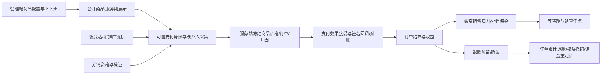

# 商品、裂变、分销深入审查父 brief

基线：国内 main 与本机 HEAD 均为 94d4b845f9d9ddcc30e7e05432032ba1677fac5a（2026-10-04 只读核对）。QA739 仅历史；不使用旧 GitHub main。原工作目录干净，隔离 codex/commerce-adversarial-audit-20261004 worktree。

目标：按真实业务入口和持久化结果定位并最小修复缺陷；不以用例数量代替覆盖。不合并、部署或执行真实支付/退款/提现/消息；所有数据库验证用独立 localhost PostgreSQL16 临时库。

OneID：商品定义不涉及；购买、裂变与分销使用 canonical customers.id 及既有 identity Port，核对付款人/受益人/推广人边界。Persistence：商品本地事务；订单、支付、权益与归因必须在共享PG UoW及既有收据/outbox中验证；可恢复任务复用jobqueue。External Effects：支付/退款/分润/外推只审查既有port与禁用或合成Provider合同，禁止真实效果。本轮不新增身份匹配/队列/执行内核。

参考：[PostgreSQL16锁语义](https://www.postgresql.org/docs/16/explicit-locking.html)、[Stripe重复与乱序回调](https://docs.stripe.com/webhooks)只用于核对不变量，不引入Stripe能力。

验收：先证明实际失败（可行时修复前测试），随后用真实PG、HTTP合同及必要浏览器交叉验证；版本CAS、幂等键/载荷、支付事实金额、退款余额、归属与权益必须一致。各缺陷记录复现/影响/根因/最小修复/结果；覆盖报告区分代码审查、合成测试、真实Provider和未覆盖。

五项影响随最终diff记录：对外合同兼容性、事务/身份/效果机制、直接模块消费者、真实页面及验证证据。不涉及无证据新增限制；必要拒绝范围须来自既有权限或数据不变量。修改可用独立代码候选撤回；本轮不迁移生产数据。最终交付准确base/head/tree、局部检查收据、剩余能力；用户已授权本轮审查/修复/隔离本地验证，未授权合并/部署。
