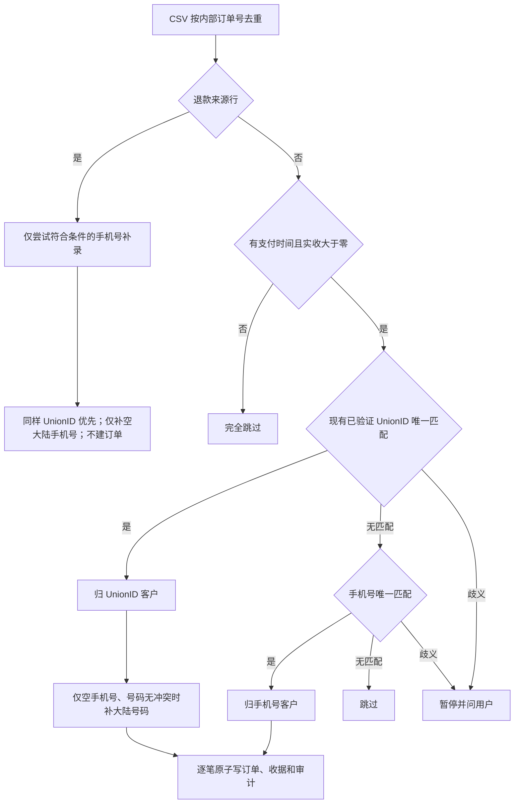

# 外部 CSV 历史订单补录（获批父 PRD，最新范围）

用户授权：本聊天 2026-10-04 “PLEASE IMPLEMENT THIS PLAN”，随后确认零元和无支付时间订单跳过，并明确退款订单仅补手机号、不录订单。此次只录支付时间非空、实收大于零、无退款的历史订单。来源字段标注退款（全额/部分）或成功退款金额大于零时仅允许补手机号。其它零元、无时间行完全跳过。

参考：https://help.shopify.com/en/manual/migrating-to-shopify （历史订单采用独立迁移/API）。复用本 V4 Order 历史导入收据、Identity Port、Customer CollectedPhoneRecorder 和 PostgreSQL UoW，不复用旧系统运行时。

OneID：解析现有客户、补 declared 电话，不建客、不绑定手机号回退所用的源 UnionID。持久化：订单逐笔本地 UoW；退款来源仅手机号/展示/Identity 收据和审计 UoW。无持久后台任务。External Effects：不涉及，不生成支付/退款流水、权益或外推消息；Order 的受众读取排除 external_history；历史手机号展示不制造最近活跃时间，不激活缺少权威目录资料的客户。

Product Design：使用 index/user-context/get-context/audit；复用当前 orders/orderDetail 模板、orderAdapter 和 commercePresentation。保持布局，补外部历史来源、原时间与导入时间、只读状态、客户资料链接和全部订单导出。企微订单及客户时间线补齐历史原时间语义。真实认证 Chromium 使用合成隔离库，页面/详情/客户关联/导出已验证；安装构件及生产认证读回由唯一工作台完成。

接口：migrate-external-orders --mode inspect|apply|reconcile，精确源 CSV 和 matching plan SHA256、稳定 run key、当前 UnionID scope。来源 external_history，不伪装微信支付；原金额约束仍为正数。API 增加可空 source_paid_at、独立 imported_at、来源状态和退款汇总兼容字段，历史订单只读。原生支付合同保持原有要求。CSV 序号不参与业务摘要；同键不同内容暂停；组合商品保留原 ID、名称和整单快照，不关联当前商品权益。

最新生产只读核查：10442 行/10417 唯一/25 重复。无时间剔除 835 行，非退款零元剔除 2516 行；退款来源 1235 行，其中匹配 1152 行，仅补手机号。可录真实订单 Union 4342 + Phone 40 = 4382 笔，未匹配 1449 笔；总待补手机号 2087 位。选中来源跨客户 17 笔，属于原已确认 26 笔范围；号码不补不移动。订单实收 489366640 分，订单退款为 0 分。新清单摘要 ec362a1ee0c6b1e9ce104f586845d227bec0ef4b9ac0f720ddb7faf010e7e12e；计划摘要以 apply 前 inspect 为准。

验收：身份优先、回退、跨客户、未匹配、仅补空手机号、国际号码不补、并发占号；重复/中断/变更/回滚；零元、无时间和退款不入订单，退款手机号独立事务可恢复；保留组合商品和原时间；不产生支付/退款/权益/Provider/新活跃证据。源 PII 不进 Git 或日志。迁移前备份；唯一发布工作台发布并执行，认证业务读回、逐笔 reconcile、财务总额和手机号收据独立核查。失败保留收据对账，不删除历史记录作回滚。
