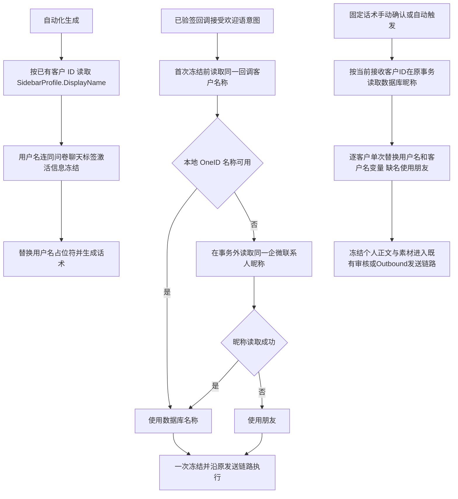

# 客户昵称进入欢迎语与自动化上下文

用户授权：登录生产处理渠道欢迎语在托底后丢失昵称、自动化增加数据库用户名字段（原任务 01a10c39-b410-7002-8f71-62397ea9b403）。

## 判断与证据

生产 2026-10-05 只读核对：11 个含客户名变量的加密快照均验证解密成功，11 个全部使用朋友，0 个匹配当前数据库昵称。近五天 16 条欢迎语意图均有名称投影，但 16 个冻结快照都早于投影更新时间；其中 11 条模板有 `{{客户名}}`。175 个生成上下文均没有客户名称字段。当前 fast welcome 在回调事务接受，客户 ID 与目录更新异步到达，首次冻结可在客户尚未关联时使用“朋友”。自动化已经读取 SidebarProfile，但丢弃 DisplayName。

## 参考与复用

[Mailchimp 官方 merge fields](https://mailchimp.com/developer/marketing/docs/merge-fields/) 在发送时使用收件人字段；[默认值说明](https://mailchimp.com/help/getting-started-with-merge-tags/) 只在实际字段缺失时托底。采用同样的字段优先原则，不新增模板框架。复用 Customer DirectoryDisplayNameReader、SidebarProfileService、Identity Resolver、WeCom ExternalContactReader、Platform webhook 读取及既有 Channel 一次冻结、Outbound 和 External Effects。

## 边界与实现

- OneID：只读现有 canonical customer；回调按已验签 corp-scoped ExternalUserID Resolve，不建客、不合并。Provider 返回身份必须与回调一致。
- 持久化：已有 welcome snapshot 和 generation context_snapshot；增加可选名称 JSON 字段，无迁移。不修改已冻结/已发送消息。
- 外部效果：新增只读昵称获取；发送/生成继续原效果、原幂等键、原 20 秒欢迎窗口。Provider 网络调用在事务外。冻结并发仍只产生一个加密正文。
- 自动化：`customer_name` 来自数据库；模型看到独立用户名字段。`{{用户名}}` 和现有欢迎语称呼 `{{客户名}}` 在角色/任务提示词中单次替换，名称缺失显示“朋友”；同时提供准确空字段状态，禁止根据其他客户猜名字。现有提示词无需修改也能获取上下文。Agent 部分已随 bbb18675 上线；用户追加授权将固定话术接入同一昵称字段，范围见下文。
- UI：管理端原 Agent 编辑页、原提示词文本框与预检按钮样式。V4 adapter 增加“插入 {{用户名}}”及用户名来源说明，保持现有保存/发布交互。Product Design index/get-context/image-to-code、前端一致性 skill 已读取并完成 preflight；现有代码是已选目标，不重设计。生产 Chrome 已确认认证状态；截图/浏览器连接失败，视觉比较未完成，需安装后的原旅程补验。
- 不涉及新增限制；使用现有字段大小、授权和 Provider 窗口。

## 五项影响与验收

|项|影响|
|---|---|
|对外合同|欢迎语有昵称时带昵称；Agent 生成获得用户名，原接口兼容|
|业务机制|只读名字并冻结，不改客户归属、定时、刷新、发送对象或权限|
|直接模块|Channel snapshot、WeCom callback/name read、Platform webhook lookup、Automation context/provider、Composition|
|页面|Agent 编辑页新增一个现有样式变量入口与说明|
|验证|回调早于客户/昵称、缺名、错误身份拒绝、目录名称优先、事务外 Provider read、冻结重放、模型请求名称、旧 JSON 兼容、按钮插入和保存|

回退：兼容条件下上一完整包；新的可选 JSON 字段对旧包可读。局部检查不称全量回归；合成 Provider 不证明真实收件人。唯一发布工作台按原队列和同包路径处理，本开发任务不安装共享环境。

安装验证发现相关既有缺陷：动态生成确认写 Config usage 时使用 `confirm_dynamic`，而 Config 的应用验证和 PostgreSQL CHECK 只接受 `preview/confirm/execution`，导致整个确认事务回滚并返回 503。改为现有 `confirm` 合同；领域事件名称、队列、发送约束保持现状。长提示词 PostgreSQL 旅程接入真实 Config UsageRecorder，验证一次提交记录一个 usage，重试仍只产生一个 run/item/确认收据；安装二进制仍须独立验证用户名冻结与模型请求。测试先复现原 503 再验证修复，不放宽 Config 合同或绕过事务。

## 固定话术追加范围（2026-10-05）

用户明确要求固定话术也接入昵称；复用本父 PRD、Mailchimp 字段替换参考和当前编辑器，原生产处理授权覆盖该追加能力。输入示例 `你好{{用户名}}`，客户昵称小明时正文为 `你好小明`；两位客户分别生成各自正文，缺失或空白昵称为朋友。兼容 `{{客户名}}`，昵称本身包含变量字符时仅作为数据，不递归解释；未知变量保留原文。只替换固定话术文字，不修改素材标题、链接、小程序、历史冻结记录或既有话术配置。

OneID：以已选择的 canonical customer ID 复用 Customer `DirectoryDisplayNameReader`，不匹配外部身份、不建客或合并。持久化：读取昵称与个人正文、收据、审核计划或 Outbound 意图在原 PostgreSQL UoW 内；不新增列、迁移、队列或状态机。外部效果：仍使用既有 AI 审核/Outbound/EER，只有原 Provider 路径发送；重放沿已有收据返回冻结结果，不重新取当前昵称。批量读取按 Customer 现有 200 ID 边界分批，不减少运行人数上限；文字继续现有内容限制，超限拒绝而非截断。不涉及新增限制。

UI：Product Design index/get-context/image-to-code 与前端一致性已读取，preflight 成功；已选目标是当前 `automationContentHost` + 共享 `contentComposer`。只配置其已有变量栏及帮助文案，新增“插入用户名”，保持保存/发布/启用语义。引用页面 `/admin/agentEdit.html?id=...`，路由仍经 Automation UI → admin_base → manifest 的 automationContentHost；不创建新页面或组件。

五项影响：对外合同=固定文本逐客户替换昵称；机制=原事务内读取/冻结且重放不改；模块=Automation 手动确认及自动 enrollment、Customer 只读 Port、Composition、既有审核和 Outbound；页面=固定话术共享编辑器变量入口；验证=多客户、空名、兼容变量、非递归、数据库失败拒绝/回滚、自动触发正文快照与digest、重放昵称变化不影响冻结结果、编辑器插入/保存/读回及当前安装包旅程。生产技术读回与真实 Provider/送达分开记录；不手动重发历史消息。

固定话术本机验收：具名单元检查、真实 PostgreSQL + River + 合成 Outbound Provider 旅程、编辑器 JS 保存/同键重试/读回及 Chromium 真实输入和保存刷新均通过。截图检查了 1280px 编辑器和 360px 编辑器，用户名入口沿用现有变量栏，窄屏无横向溢出；420/1440px 保存展示旅程亦通过。未修改共享组件样式。最终安装构件仍需工作台独立验收与生产读回。

Linux 首次浏览器门禁在无 web/dist 的干净执行目录中失败，功能断言未启动。相关修复只在已配置私有 AICRM_TEST_PREP_DIR 时复用已有 candidate-bound Artifact 准备/缓存 helper，随后仍验证全部 Host/素材资源与浏览器保存读回；不改发布控制器、不跳过用例。已通过输入不变的 backend/frontend 结果可复用，重跑失败 Chromium 旅程。
