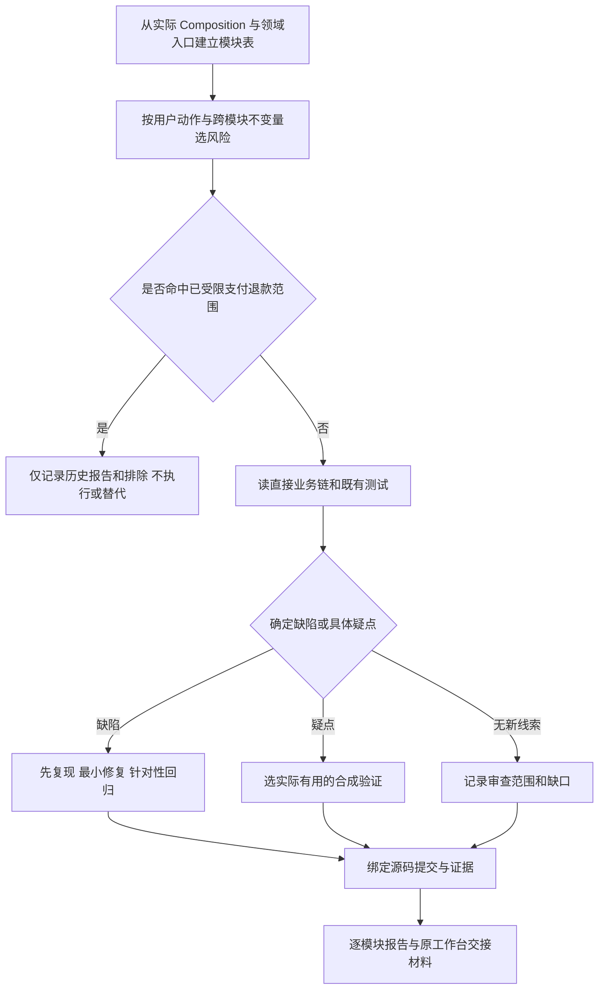

# AI-CRM-v4 换维度审查父 brief

用户已授权全系统逐模块检查、必要的本地合成测试与最小缺陷修复。准确 base 为 da810b3a77f96d58340cfcbd074243997b85a5e3，tree 4e00c0f773064705ad3aa188197bed61a7ec6a87；国内 main 经实时只读 ls-remote 核实一致。本任务在 workspace 内独立 clone 和 codex 分支，旧 workspace、记忆和生产不修改。用户明确禁止自动 push/merge/deploy，优先于旧 skill 的发布推送指引；只准备原工作台交接材料。

分类：OneID 按客户/渠道身份链复用 identity Port；配置和素材定义不强行增加身份依赖。Persistence 按领域事务和既有 internal durable job 分类。External Effects 只静态审查与本地 fake 合同，禁止真实 Provider/付费 AI/发信。复用既有 UoW、Port、queue、lease、fence、UI 组件；不增加治理、架构或为数量制造测试。不涉及新增限制；如确定需要约束，先记录无约束的具体业务后果并复用既有边界。

参考：核实 PostgreSQL 16 [事务隔离与锁后重读](https://www.postgresql.org/docs/16/transaction-iso.html)，MDN [AbortController](https://developer.mozilla.org/en-US/docs/Web/API/AbortController)，Go 官方 [HTTP client 源码](https://github.com/golang/go/blob/master/src/net/http/client.go)。参考只帮助核实当前领域假设，不引入新框架。

优先级：P1 身份/会话切换、持久状态与取消迟到结果、保存恢复及历史准确性；P2 商品非支付/优惠券/裂变、分群标签、媒体渠道群运营/归档；P3 配置/CLI/Open API 契约、分页/Unicode/时间/导航边界与运维读模型。

验收：针对确定缺陷保留 red/green 或等价准确复现；逐项列代码入口、判断、命令、断言、skip/失败/未跑与环境边界。只运行允许的具名测试或独立模块包；不执行支付退款原受限测试、改写替代、金融恢复、D6退款锁序，不恢复库存或问卷指定员工受众。全仓含受限用例的命令不得运行。

五项影响由每个修复分别补充：对外合同、业务机制、直接关联模块、页面、验证。UI 修改前使用 Product Design。回滚以撤销独立行为提交为基础；不迁移真实数据。无确定缺陷的模块明确为本次局部审查未发现，而非无 bug。
