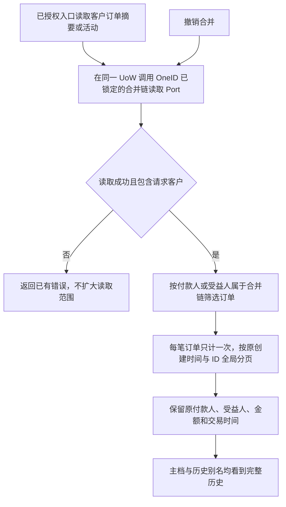

# 客户订单摘要与活动保留已合并账号历史

当前 V4 国内基线：`5d247fef0eaf948390430f5c61ff2061949be820`。父任务为生产 CRM/HXC 对齐核查，用户已要求继续解决有明确证据的技术问题。本候选只修复订单读取。

## 业务判断与验收

生产核查发现：116 笔 CRM 历史订单仍保留原账号的付款人/受益人 ID，涉及 100 个现主档。新工作台已按 OneID 合并链展示，CRM `CustomerOrderSummary` 和 `CustomerActivities` 仍按单个 ID 过滤，主档会漏读历史。合并链是读取依据，不修改订单原事实，不据手机号另行匹配。

验收：真实 PostgreSQL 隔离数据中建立两客户、外部客户与历史订单，完成现有 OneID 合并后，主档和旧别名读到同一集合；双方分别落在合并链内的订单不重复计数，活动角色正确，全局游标无重复/漏项，水位之外和外部订单不泄露；撤销合并后恢复各原归属；历史订单字段始终不改。

## 参考、复用与边界

- [Microsoft 读取视图模式](https://learn.microsoft.com/en-us/azure/architecture/patterns/materialized-view)：读取表示可适配消费者，原事实另行保留。这里只借鉴读写职责，不引入新投影基础设施。
- [PostgreSQL 16 数组比较](https://www.postgresql.org/docs/16/functions-comparisons.html#FUNCTIONS-COMPARISONS-ANY-SOME)：用参数化 `ANY(bigint[])` 在同一订单查询中匹配两种角色，避免拼接多份分页结果。
- [PostgreSQL 16 显式锁](https://www.postgresql.org/docs/16/explicit-locking.html)：复用 OneID 既有 `LockedCanonicalLineageReader`，与订单查询共用事务，避免读链时并发归并导致归属漂移。

OneID：读取 canonical customer，使用 `identity/port.LockedCanonicalLineageReader`；不创建、匹配或归并客户。持久化：已有本地 UoW 内的只读查询和 OneID 共享锁；无新表/迁移/持久任务。External Effects：不涉及，无 Provider 调用。Order Store 只读取 Order 自有表，Composition Root 注入 OneID Port。孤立单元服务未注入时沿用原单客户语义；生产 Composition Root 必须注入。复用原授权、页大小和输入检查，不涉及新增业务限制。

## 五项影响与验证

| 影响 | 本候选 |
| --- | --- |
| 对外合同 | 现有摘要/活动返回形状不变；已合并客户的订单集合、计数、角色变完整，解析失败按已有错误返回 |
| 业务机制 | 按已提交 OneID 合并链读历史，保持订单事实；不变更支付、退款、权益或身份写入 |
| 直接模块 | Order App/Store、Composition Root；客户详情摘要、客户活动读取消费者 |
| 页面 | 现有展示获得完整数据；不改 UI 文件或交互，不涉及前端能力开发 |
| 验证证据 | App 拒绝/角色合同、Store 单链筛选与去重、真实 PG 合并→读取→撤销旅程；生产安装和真实数据读回另记 |

候选包含必要测试与短检查清单。不做全仓回归。生产验收由唯一路由工作台安装后，独立读取原漏读主档确认；源 CRM/HXC 数据、Provider 行为、完整全部用户回归不在本候选验证范围。代码可回退到基线，订单与客户历史无需恢复。本任务不自行安装共享预发或生产。
