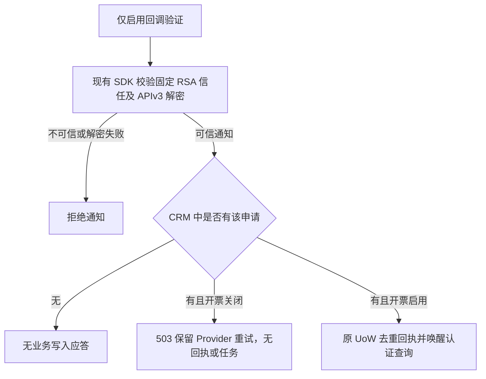
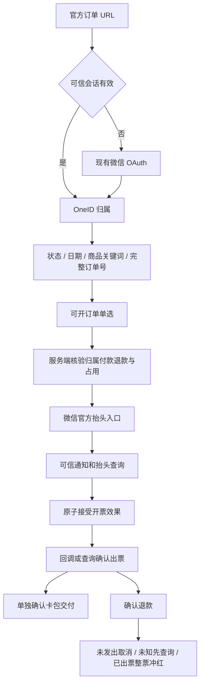
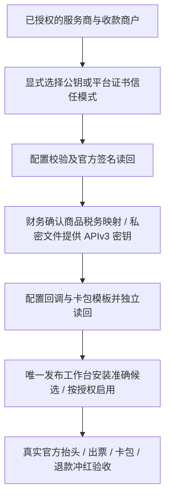
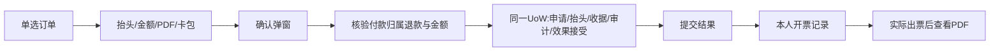
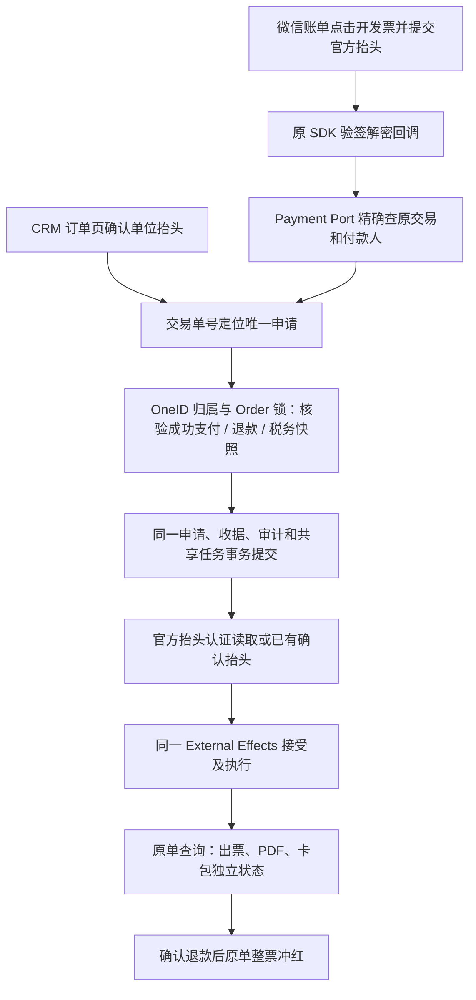
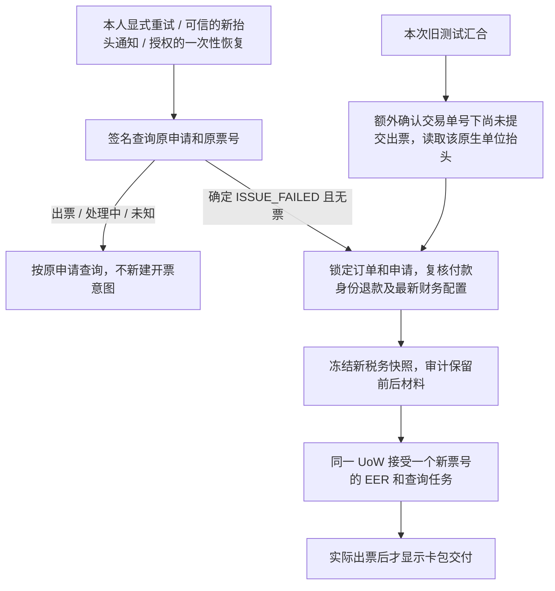
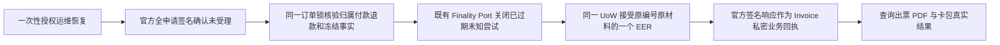
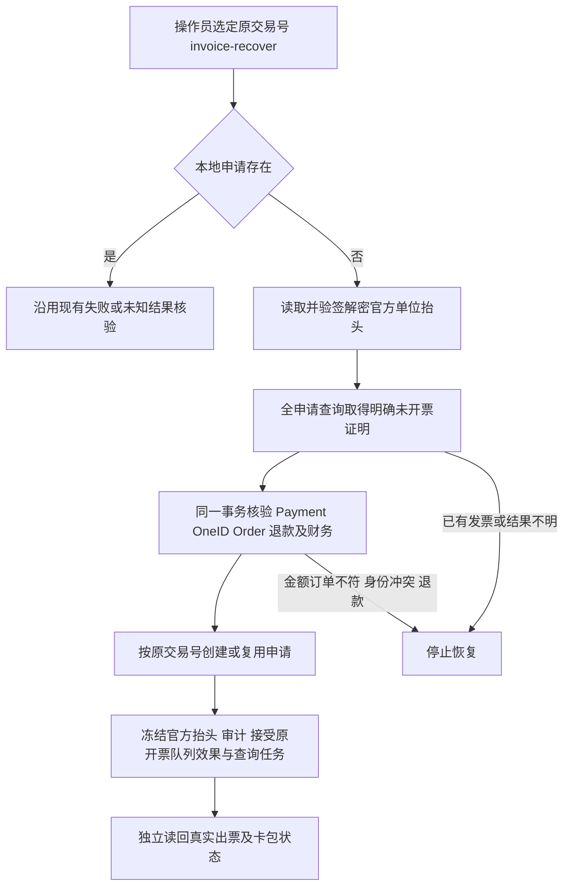
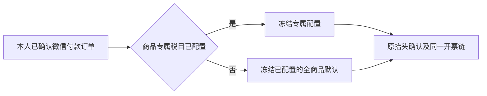

# 用户端订单中心与微信自动开票

本文件复用用户 2026-10-08 已批准的父 PRD。固定官方入口 `/my/orders`，微信授权识别 OneID，CRM 提供本人付款或受益订单。本人付款的已确认微信支付订单支持腾讯数电普通发票，官方页面填写个人或单位抬头，一单一票；确认退款后自动整票冲红。

## 官方回调初始化修复（2026-10-08）

已安装程序在业务 Provider 关闭时未创建通知验签组件，POST 在读包前返回 503；官方开发配置返回已验签的 PARAM_ERROR，独立 GET 确认回调尚未保存。受控观察确认验证 POST 长度为 603 字节，不能作为空请求直接应答。

进一步受控观察确认 pinned RSA 验签及 APIv3 AES-GCM 解密均成功，资源中服务商 mchid 匹配且申请号非空；精确事件与子商户是否为空尚未确认。不会猜测特殊探针事件或放行空子商户。本服务商的未知申请沿用原合同安全丢弃，其他子商户不对应本系统申请时也不生成业务状态；已知申请必须匹配冻结的收款商户。



分类：本次不改变 OneID、订单归属和财务映射；通知验签为无状态计算，已知申请读取及原通知 UoW 属既有 Invoice Owner，开票写能力继续由原 External Effects 控制。仅验签组件不实现 ProviderAdapter，不能出票、冲红、插卡。复用 [微信配置开发选项](https://pay.wechatpay.cn/doc/v3/partner/4012474031)、[官方通知合同](https://pay.wechatpay.cn/doc/v3/partner/4015792570) 和 [官方 Go SDK](https://github.com/wechatpay-apiv3/wechatpay-go)，不新建通知队列或重试机制。

最小独立开关 `AICRM_INVOICE_CALLBACK_ENABLED` 默认关闭；正式 Provider 开启时自动初始化同一验签器。仅回调开启只加载服务商范围、公钥/平台证书和 APIv3 解密密钥，不要求税务文件、公众号或签名私钥。新增开关依据：官方回调配置须先验证地址，不能因此提前授予正式开票写能力。通知的既有大小、签名、时间、解密和归属边界继续复用；不接受未经证实的空 POST 或猜测 TEST 事件。

五项影响：回调在独立验签后可处理可信通知；默认及开票资格不变；直接消费者为 Runtime 配置、invoice composition/HTTP/notification 和官方 SDK adapter；不改 UI；验证相关 RSA/AES 拒绝、仅回调初始化、关闭时已知/未知申请的 PG 无效果断言及实际挂载读回。官方保存、真实出票和卡包交付分别记录，修复测试不代表开通成功。

实际安装合同由 `scripts/run-installed-invoice-callback.sh` 运行 `TestInvoicePostgreSQLCallbackBootstrapInstalled`，参数绑定已安装 binary/root/head/hash。只启动隔离库上的该 binary API 角色，用临时合成 RSA/APIv3 密钥进行签名通知，断言伪签/SIGTEST/错误服务商/空子商户拒绝、可信未知申请无状态 200、已知他商户 409 和关闭时已知本人 503；独立读回申请不变且没有新增回执、查询任务或外部效果。该用例缺安装参数或显式隔离 PG 直接失败，无源码 Host 回退。财务、凭据、域名和真实 Provider 均不会被此 fixture 改动。

安装 fixture 就绪修复：原 Invoice 领域 fixture 只插入两位核心客户，真实 API 的既有 readiness 要求 active Customer 有最小 directory projection，因此安装用例在 503 处停止，尚未执行回调断言。仅安装 fixture 通过现有 Customer ProjectionWriter 和 UoW 补两位隔离客户的展示投影，并先核验原 schema readiness；保留实际安装程序的 ready 检查。分类为测试中读取已有 CustomerID、Customer Owner 的隔离持久化，无身份解析/新建/合并，无 Provider 效果、应用/UI/运行配置改动。相关验证只重跑该实际安装用例，已有发票单元/PG 和构件不重建。



复用结论：腾讯数电发票 https://pay.wechatpay.cn/doc/v3/partner/4015792556；官方 Go SDK https://github.com/wechatpay-apiv3/wechatpay-go；GoPay 发票调用仅作参考 https://github.com/go-pay/gopay/blob/main/wechat/v3/fapiao.go；CRMEB 仅参考交互 https://github.com/CRMEB/CRMEB。百望、金蝶不在本版增加供应商适配。官方冲红为整票 https://pay.wechatpay.cn/doc/v3/partner/4015792575；部分退款后的剩余金额保留财务处理，不净额自动重开。

分类：涉及 OneID、持久化、Provider 读取、开票/冲红 Provider 写。复用可信支付会话、Identity Port、Order Port、PostgreSQL UoW、External Effects 与共享 River 内部任务。申请、效果接受和审计同事务；网络调用不持有数据库事务。默认禁用 Provider，缺配置明确未开通。未知结果按原申请/票号查询，禁止换号盲目重开。

Product Design 以用户四张滴滴截图为已选视觉参考；使用当前 V4 公共页面字体、蓝色、圆角卡片，复用公共页资产挂载，不引入独立原型框架。仅保留订单与开票逻辑，不含出行、继续支付、用户申请退款、合票、专票或独立抬头管理。

订单页：全部、已付款（保留退款标识）、待付款、已关闭；组合起止日期（北京时间）、商品名包含关键词、完整订单号，支持重置与分页。历史时间缺失明确展示。开票页直接展示符合条件订单，单选且金额由服务端提供；展示待填抬头、开票中、已开票、失败、冲红中、已冲红以及独立卡包状态。

接口：GET `/api/h5/me/orders`；POST `/api/h5/me/invoices`；GET `/api/h5/me/invoices/{id}`；POST `.../{id}/resume`；GET `.../{id}/file`；POST `/api/callbacks/wechat-invoice`。会话中导出客户归属，URL 无身份凭据；ID 修改不可越权，写入拒绝跨站；OAuth 拒绝、冲突、过期、空态和接口异常有明确页面。

验收覆盖：身份合并、归属与越权、日期边界/关键词/分页/历史未知时间；重复/并发申请、冻结金额税务、事务回滚、重复乱序通知和未知结果恢复；开票前/途中/出票后退款（全额及部分）、冲红失败与通知重放；实际页面移动布局和操作。真实微信授权、出票、卡包和冲红单列于技术测试及安装证据。

五项影响：对外增加本人订单/发票合同；业务新增一单一票及退款冲红；直接关联 Identity、Order、Payment、External Effects、配置和共享任务；页面新增公共 `/my/orders`；验证采用相关领域合同、PG 原子并发、HTTP 权限和 Product Design 浏览器验收。独立候选交付唯一发布工作台，不安装共享预发或生产。

## 订单 OAuth 回跳修复 scope delta（2026-10-08）

```mermaid
flowchart LR
 A[/my/orders] --> B{可信 Payment Session}
 B -->|缺失| C[OAuth start: 校验固定回跳并持久化一次性 state]
 C --> D[跳转微信网页授权]
 D --> E[callback: 消费 state 一次]
 E --> F[Provider 读取 code 与认证用户资料]
 F --> G[现有 Identity Port 签发可信 Payment Session]
 G --> H[精确回跳 /my/orders]
 B -->|有效| H
 H --> I[订单与发票按会话客户归属读取]
```

生产只读诊断与公网复现确认：安装 SHA `560ff9d891b2e733569b2f38336a78af5c2e5b72` 的 OAuth 配置已启用，但 `payment_h5_oauth_states_return_path_check` 仍是 `0191_payment_h5_referral_return_path.sql` 的路径白名单；它没有精确的 `/my/orders`，所以 OAuth start 的状态插入失败并落回 `oauth_error=unavailable`。源码 `ValidReturnPath` 已接受该固定路径，形成应用与数据库约束不一致。

本候选仅增加 `0225` 前向迁移，将字面 `/my/orders` 加入数据库允许值，完整保留原有正向白名单、编码/反斜线拒绝及 `int64` 边界。真实 PostgreSQL start/consume/replay 与 HTTP 固定成功回跳覆盖这条缺口；不改 state/cookie、UnionID、授权权限或页面合同。

边界分类：**OneID involved**，只用现有 Provider-verified OA OpenID 与 UnionID facts 经既有 Payment Session/Identity 边界建立可信会话，不接收 URL 身份、不猜测客户；**Persistence**，一次性 state 的创建与消费仍经 Payment PostgreSQL Unit of Work，消费提交后再做网络读取；**Provider read**，只兑换 OAuth code 并读取用户资料，无 Provider 写、无内部持久任务、无 External Effect。

参考：OAuth 安全边界沿用 [RFC 9700 §2.1、§4.11](https://www.rfc-editor.org/rfc/rfc9700.html) 的受限回跳、CSRF 和禁止任意 open redirect 建议；市场实现对照 [Auth.js WeChat provider](https://github.com/nextauthjs/next-auth/blob/main/packages/core/src/providers/wechat.ts)，使用官方公众号授权/token/userinfo 端点并启用 state 检查。官方公众号网页授权说明亦由该实现链接至 [微信网页授权文档](https://developers.weixin.qq.com/doc/offiaccount/OA_Web_Apps/Wechat_webpage_authorization.html)。

## 服务商启用 scope delta（2026-10-08）



用户已完成商户开通，授权本任务完成剩余开发，待开发结束后集中确认配置。本次补齐公钥模式（保留平台证书模式）、APIv3 密钥文件加载、官方抬头完整字段及联系方式解密/加密、官方税率及财务显式优惠政策校验、只读配置检查和明确的配置操作入口。无新增页面；沿用已验收订单 UI 与官方抬头页。凭据及真实回执存私密目录，不进入仓库或日志。销售方、税率、税收编码不能从商品名猜测；未完成配置仍禁用开票。首版微信支付账单入口保持关闭，公众号菜单与消息使用固定订单 URL，避免账单申请编号未经 CRM 身份归属解析。

分类：不改变 OneID、客户归属或身份读取。已有申请、买方快照及外部效果仍经 Invoice 同一 PostgreSQL UoW；无迁移、新队列或重试器。Provider 读取复用官方 SDK；开票与冲红继续由 External Effects 执行。运维检查只读取官方权限/税务/开发配置，配置管理只修改官方开发选项和模板，保存明确请求与独立读回，未知结果停止写入。

参考与复用：[官方 Go SDK 公钥验签及加解密](https://github.com/wechatpay-apiv3/wechatpay-go)、[公钥获取](https://pay.wechatpay.cn/doc/v3/partner/4013038589)、[官方抬头字段](https://pay.wechatpay.cn/doc/v3/partner/4015784260)、[通用行业开票字段](https://pay.wechatpay.cn/doc/v3/partner/4015792574)、[配置与卡券业务示例](https://pay.wechatpay.cn/doc/v3/partner/4016078358)、[通知验签及应答](https://pay.wechatpay.cn/doc/v3/partner/4015792570)。开票人名称为选填，不新增必填配置。回调成功返回 200；无签名 POST、签名探测和商户错配均拒绝，GET 仅用于可达性检查，无业务效果。

五项影响：外部 HTTP 业务合同保持，增加只读回调可达性；买方快照保留官方可选字段且不进入客户端展示；直接消费者是配置、Composition Root、Invoice Provider 与运维工具；无前端或数据库结构变化；验证公钥/证书模式、错误信任材料、联系方式往返加密、回调拒绝及官方配置读回。真实出票、卡包和冲红仍需最终启用后独立验收。

## 配置工具发布登记修复（2026-10-08）

流程：原成员检查通过 → 最终构建发现工具未登记（安装前失败）→ 保留原 ref、成员与检查收据 → 仅检查登记及控制器修复 → 同一队列和锁追加修复成员 → 重试最终构建与预发。

实测证据：`9c9a046` 的 20 项 Linux 检查通过，但正式 builder 不含 `cmd/invoice-setup`，因此显式构建清单在安装前被拒绝。参考并复用仓库现有 `_release_commands`、`batch-tool-repair`、`maintenance-check`；不用临时 allowlist 或第二发布通道。仅严格新增标准 Go 程序登记时按应用与指定工具增量构建，其他脚本行为变化不套用该优化。恢复只接受原累计批次、成功收据仍绑定原成员、安装前构建失败且独立读回两台机器与生产游标均未变化的状态；安装未知继续停止对账。

分类：不涉及 OneID、业务 PostgreSQL、Provider 调用或新任务队列；涉及现有发布控制器的持久收据及串行锁。无页面变化。五项影响：发布 CLI 增加已检查的安装前恢复分支；保留成员、尝试与收据；直接消费者为 builder 和原发布控制器；无 UI；验证登记选包、拒绝脚本行为变化、收据保留、失败阶段及安装未知拒绝。修复继承父 PRD 开发授权，生产启用仍等待用户最终确认。

## 已安装累计批次的检查环境恢复（2026-10-08）

流程：已安装并验收的原批次 → 下一队首检查因环境中断、尚未评估 → 环境修复 → 同 SHA/ref/base 重提保留 attempt/checkpoint；若控制器本身需要修复，则从累计源码 HEAD 做 source-only maintenance → 验证两台机器及生产游标 → 既有 batch-tool-repair 追加已检查控制器成员 → 原运行时候选标记基线落后、保留历史 → 基于新累计 HEAD 重提同一业务修复。

实测：配置工具候选因系统盘容量中断、队首为 pending/environment/not_evaluated；容量恢复后 batch guard 只认 failed，挡住后续既有同 SHA environment_retry。复用当前同 SHA 重试、maintenance-check、batch-tool-repair、串行锁与保护收据；不手改状态、不新建发布通道。maintenance 仅允许明确 checks 环境中断且无 in_flight 的原 open 批次，核验原源码、预发、生产及游标；候选未知、真实检查失败、安装已开始或需恢复确认仍拒绝。固定字节与维护收据准确绑定后才追加 source-only 修复，不接受 logo 等运行时改动混入控制器成员。

分类：不涉及 OneID、客户、业务 PostgreSQL 或 Provider 效果；只使用原发布状态、同一串行锁和收据。五项影响：恢复已存在但不可达的精确候选重试；维护入口覆盖该真实环境状态；直接消费者为 submit/maintenance/batch-tool-repair；无页面；验证重提、attempt/checkpoint保留、不同候选/未知安装拒绝、精确维护回执复用和原队首重提。无需业务应用构建；原业务测试和预发证据保留。该相关修复继承本任务开发授权，不改变生产安装/开票启用仍待最终确认的范围。

## 永久素材 logo 域名兼容（2026-10-08）

流程：用户提供 logo → 当前插卡公众号上传永久素材 → 官方返回 `mmecoa.qpic.cn` → 工具保留该 URL 配置卡券 → 验签保存创建回执。实测上传及独立素材查询均由当前公众号完成，官方对 JPEG 重新编码；素材 ID、名称、更新时间及图片读回确认同一 logo。没有重复上传。

参考：[微信官方卡券模板](https://pay.wechatpay.cn/doc/v3/partner/4015792562) 要求使用插卡服务号上传永久素材返回的 URL；复用现有配置工具和官方 SDK，只补充此次已验证的官方图片域名，继续接受旧 `mmbiz.qpic.cn`，不接受头像 URL 或伪造域名。

分类：不涉及 OneID、客户或业务 PostgreSQL；现有运维工具 Provider 写入及私密请求/回执协议保持，无新队列或重试。无新增限制。五项影响：配置工具接受当前官方素材 URL；卡券请求内容与已有未知结果处理不变；仅直接影响 `cmd/invoice-setup`；无 UI；整包测试覆盖当前及旧域名、卡券主体/跳转保持，以及头像、伪装域名和带凭据 URL 拒绝。官方卡券创建受理、素材读回和真实卡包交付分别记录，税码按用户要求暂缓，生产开票不启用。

## 自填抬头与开票记录 scope delta（2026-10-08）

已批准流程：单选订单 → 自填单位名称/税号 → 确认弹窗 → 原子接受 → 提交结果 → 开票记录/继续开票 → 已出票查看 PDF。Product Design image-to-code 以本任务图2/3/4为选定参考，保留 V4 公共页蓝色、字体、卡片，去除邮箱、出行信息、多格式和独立抬头库；只交付微信卡包。

官方 [issue-general](https://pay.wechatpay.cn/doc/v3/partner/4015792574) 明确允许自行收集抬头；复用官方 SDK 和现有 Invoice Provider，GitHub [GoPay](https://github.com/go-pay/gopay/blob/main/wechat/v3/fapiao.go) 仅作请求参考，不引入第二客户端。



OneID reads canonical customer：Payment Session + Identity Port，历史只查本人申请，订单只经 Order Port；Persistence local transaction + shared durable query job；Provider reads 文件/状态，Provider writes 开票/冲红仍经 External Effects。无新身份、队列或状态机，无数据库迁移。旧申请沿用原编号/快照；与旧官方抬头读取并发时锁定订单及申请，状态检查阻止覆盖和重复效果。未知结果只读原单，刷新不隐式重试。

合同：POST /api/h5/me/invoices 增加 buyer(type,name,taxpayer_id) 与 expected_amount_minor；不带 buyer 的旧请求保持兼容。金额是确认前置条件，不是计费来源。GET 同集合为游标本人历史，返回安全收据、订单名/号及真实申请时间。既有 file 新增 disposition=inline 预览 PDF，保留鉴权/官方校验。抬头限长只按官方 name(256)/taxpayer_id(32) 字节边界，金额必须与冻结及当前订单一致，拒绝跨站与越权；不猜测税号真实性。

五项影响：扩展确认提交/历史/PDF接口；新增同事务自填确认、旧单恢复及重放保护；关联 Invoice、Order/Sessions/Identity 稳定 Port、External Effects/共享任务，复用已存在边界；页面新增自填/确认/结果/记录；相关 Invoice 单测、PG 拒绝/并发/回滚/旧通知竞争/退款、移动挂载和 Product Design QA 随源码交付。真实授权、出票、卡包与冲红分开记录。失败兼容回退上一构件，已受理记录保留不重复发出。

最新用户收窄：仅单位，无抬头类型板块；新 POST 自填合同和旧官方抬头通知的首次受理均只接受 ORGANIZATION，拒绝个人。旧已受理合同/票据保留历史兼容，不改写已有开票事实。

构建登记修复：API 内容在 V4 b2c62847c36fec8975beb66ef0277bdecbf3c0db 具备真实 Git blob，更新 source-index 与 source-lock 的该 V4 canonical、绑定及 embed view；其余历史登记不变。干净 disposable V4 candidate 检出运行现有 prepare，核对 embed 与 API 字节一致，不删校验或借旧仓。

## 微信账单入口与统一申请编号 scope delta（2026-10-09）

用户最新决定：两种入口只保留同一套开票业务逻辑，申请编号统一为微信支付交易单号；旧测试申请不做兼容。税收分类编码另行处理，不猜测或替换，不因入口接通宣称出票成功。



参考与复用：用户提供的 [官方业务示范 2.4](https://pay.wechatpay.cn/doc/v3/partner/4016078358) 明确账单申请单号为原微信交易单号；[官方抬头通知](https://pay.wechatpay.cn/doc/v3/partner/4015792559) 为 FAPIAO.USER_APPLIED；账单抬头用 WITH_WECHATPAY 读取。复用现有官方 Go SDK 和 Invoice Provider；[GoPay](https://github.com/go-pay/gopay/blob/main/wechat/v3/fapiao.go) 仅参考，不引入第二客户端。开发配置沿用官方 show_fapiao_cell 开关，保存后分别读取服务商回调和子商户开关。

分类：OneID 只读取可信原支付 identity handle、verified subject 和 canonical lineage；不通过回调建客、猜测身份或使用受益人授权。持久化为现有 Invoice 表和同一个 PostgreSQL UoW；新增 Payment 只读 Port 返回原交易的最小付款事实，不跨领域读表。抬头 / 支付 / 状态均为 Provider 读；开票及冲红仍由原 External Effects 写。没有新队列、状态机、抬头库或新前端表单。

申请、票据编号分离：application.id = 冻结的交易单号；invoice_id 仍是每次受认可的出票尝试编号。重复订单页确认和账单回调在相同 Order 锁下返回 / 使用同一申请；已接受的抬头不覆盖，未知结果不新开。回调仅为可信本商户 FAPIAO.USER_APPLIED 创建申请；未知交易 / 非抬头通知不创建，错误商户、身份冲突和交易事实不一致拒绝。进行中的退款不发出，确认退款取消或按原流程冲红。抬头查询与手动确认竞争，锁内状态检查保证只接受一个效果。

Product Design：已读 index / audit / critical overrides 并执行 user-context preflight。此次视觉目标为用户提供的微信账单原生入口 → 官方表单 → 已提交截图；官方页由微信控制，CRM 页面沿用已选蓝色体系，不重建或模拟官方页。只支持单位的执行规则保留；官方页可能仍展示个人选项，服务端拒绝个人抬头并保留待填状态。这是参考分析，真实微信原生页当前未实际操作，不冒称完成实时 UI 审计。

限制必要性：复用既有权限 / 退款 / 一单一票；申请单号长度和半角字符来自官方 string(32) 合同，超范围不能作为 Provider 申请号；无新增业务限制。

五项影响：对外创建及详情 / 记录 / PDF 的申请 ID 改为交易单号，订单页 POST 必须包含已确认单位抬头；微信账单入口新增原生回调受理。业务共用创建、原子接受、执行与退款闭环；直接消费者为 Payment Port/store、Invoice service/provider/HTTP/jobs、composition、配置工具及订单页现有 API。页面没有布局改动，现有申请编号展示自动显示交易单号。验证为相关单元、PG 回调与手动提交并发/回滚/归属/退款/合并、官方 SDK 请求合同、实际挂载读回；真实微信账单展示、真实抬头、出票、卡包和冲红另记。

交付：精确国内候选交唯一发布工作台。先安装统一回调实现，再用 invoice-setup 显式设置 show_invoice_cell=true 并独立签名读回；不提前开入口。回退可关闭账单开关；已接受效果保留原申请及原查询。旧测试记录保留审计，不自动改号重发，不作为历史兼容目标。

## 失败申请与微信账单汇合修复（2026-10-09）

生产独立验签读取确认：同一笔 ¥99 交易的原测试申请已被税局拒绝（冻结的 3040200000000000000 为汇总项），显式重试未刷新财务快照；微信账单抬头已存在，但交易单号没有 CRM 申请，唯一订单占用导致新入口冲突。微信官方开发配置的 callback_url 与 show_fapiao_cell 已正确保存。原生回调是否抵达无法从现有仅支付日志确认，不把代码冲突推断当作实际 HTTP 409 证据。



分类：涉及 OneID/付款归属读取、Invoice 持久化、Provider 只读核验和 EER 开票外部效果。复用 Order/Payment/Identity Port、现有 River 查询任务和 PostgreSQL UoW，不增加抬头库、队列或自动兼容查找。用户本次明确要求两入口一起修复，授权对这个失败测试做显式恢复；正常入口仍只接受交易单号。

参考复用：官方 [开具通用行业电子发票](https://pay.wechatpay.cn/doc/v3/partner/4015792574) 允许确定失败后修正材料并更换 fapiao_id，至多四次；[抬头通知](https://pay.wechatpay.cn/doc/v3/partner/4015792559) 要求锁、去重、验签和查询补偿；沿用官方 Go SDK 验签，不增加支付客户端。

最小范围：显式重试先获得当前票号的确定失败证据，再复核本人付款、退款、订单金额及销售主体；新快照只允许最新财务材料变化，保留前后快照和原票号审计。通知重放只查询；新的可信单位抬头通知可以请求针对原失败票号的恢复，任务重跑不得生成另一张票。普通刷新只读取，不隐式重试。旧测试的交易号归一仅由一次性运维角色执行，额外签名查询确认目标申请尚未同意出票，并读取其原生单位抬头，子记录 FK 同事务保留。无别名查找，旧 URL 不再兼容。

Product Design 根据用户此次提供的失败和原生提交截图审视状态：保持当前蓝色卡片、金额和操作；未出票显示“出票后交付微信卡包”，失败显示“未出票，暂未交付卡包”，已出票后才展示真实卡包状态。不改变单位名称/税号表单或增加抬头类型。

验证：原失败票号核验、未知/处理中/已出票拒绝重开、当前税务快照、并发一次接受、事务回滚、退款阻止、通知重放与任务票号绑定、旧测试汇合的身份付款核验及审计/收据保留、失败卡包提示；实际挂载移动页面检查，真实出票/PDF/卡包另行独立验收。生产迁移先备份，由实时路由工作台发布和执行一次性恢复，开发任务不直接修改生产。

## 签名拒绝回执与未受理原单恢复补充（2026-10-09）

生产恢复后的官方全申请查询明确返回“尚未同意开票”，而本地 EER 已尝试却仅记录 outcome_unknown。保持原交易申请号、原 fapiao_id、单位抬头和冻结财务材料；不根据猜测更改税率、优惠政策或接口参数。



分类沿用父 PRD：涉及 OneID/订单事实读取、Invoice 持久化和 EER Provider 写入；沿用现有 Unit of Work、Finality Port 与 River，不新建队列、状态机、表或前端。签名错误响应通过 EER Artifact 交回 Invoice Owner，在完成效果的同一事务写入审计 material，回滚时两者都不落库；原始消息不进入结构化日志。普通 GET、原生通知及查询任务不自动重放未知请求。一次性角色仅在原未知租约过期、全申请明确未受理、无退款/蓝票且身份金额主体不变时，以相同申请号和票号显式恢复，仅初始 dispatch=0 时允许一次，若这次 POST 仍未知则 dispatch=1 阻止再次恢复。

参考继续采用官方 [通用行业开票接口](https://pay.wechatpay.cn/doc/v3/partner/4015792574) 和 [业务示范](https://pay.wechatpay.cn/doc/v3/partner/4016078358)；沿用官方 SDK 验签及现有原单查询，不添加第二支付客户端。验证覆盖签名/无签名回执、消息日志脱敏、并发单次接受、活跃租约拒绝、全申请未知/已存在拒绝、订单金额及销售主体变化、退款、个人抬头、次数上限、回执/EER/任务事务回滚。实际 API 拒绝原因、出票和交付由生产独立读回确定。

## 官方单位抬头完整性与已确诊材料修正（2026-10-09）

微信签名 POST 回执明确拒绝购买方信息不一致；只读比较确认单位名称、税号、金额、单号和普票类型相同，官方地址、电话、开户行、银行账号和邮箱有值，而恢复代码剔除了这些字段。漏字段是代码缺陷，并据此推断是该不匹配的原因；实际出票仍需修正后验证。

流程：自填单位确认 → 在授权订单读取事务外查询官方抬头 → 官方有抬头则核心信息必须一致，完整保留已解密附加字段 → 同一订单锁再次核验交易事实 → 冻结完整 Buyer、审计及接受 EER → 官方实际出票与卡包读回。只有确切签名的 user-title RESOURCE_NOT_EXISTS/404 可使用自填最小抬头；未知、 unsigned、其他错误不降级。已受理重复提交只返回原申请，不要求重新网络读取。正常失败恢复同样不剔除原官方字段。

分类沿用父 PRD：OneID/订单归属读取，Invoice 持久化，同 UoW 的 EER/任务/审计，Provider 读取在事务外；无新表、队列、状态机、前端或后台链接。附加字段按官方长度及敏感字段加密容量拒绝，绝不截断；只保留于 Invoice 私密材料，公开收据与日志不显示。前端仍只有单位名称/税号、PDF、卡包，不增加邮箱填写或独立邮件发送。

针对本笔明确拒绝，现有一次性角色可执行材料修正，条件为当前 issue_effect 的 dispatch_prepared 之后的签名错误回执摘要、准确 HTTP403/RULE_LIMIT/购买方不一致消息、全申请签名未受理、过期 Unknown finality、无蓝票/退款且核心抬头及冻结交易/财务不变。仅补回官方附加字段，保留原 apply/fapiaoID、税务快照和 dispatch 次数，前后 Buyer 与回执摘要存私密审计，新的修正意图按材料摘要幂等。buyer_corrected 审计按该票号永久封住第二次修正，即使官方附加字段后来改变也拒绝。普通 GET、通知与查询不执行此修正；原样 Unknown 重放的 >=1 边界不变。

验收覆盖完整字段、未知/无签名/错误404拒绝降级、单位/金额冲突、长度、受益人拒绝、接受后重放不依赖 Provider、当前效果回执顺序绑定、活跃租约拒绝、并发一次、回滚保留旧材料与未知效果、再次 Unknown 后附加字段再变化仍无新效果/任务/审计。真实出票、PDF及卡包单列，实时工作台统一安装和执行已授权的这一份材料修正。


## 原生账单抬头已保存但本地申请缺失：恢复 scope delta（2026-10-09）

生产只读确认新订单 5620 已付款、付款人 Identity verified、无退款；原交易申请号在官方存在单位抬头，但全申请查询明确返回已验签的「商户尚未同意开票」。本地无申请/回调收据/开票效果。服务商及商户开发配置均已保存正确 callback_url；新商品编号 113322 没有税务配置，原生申请资格检查会返回 tax_not_configured 并拒绝创建；旧模板只配置两个商品。补充该商品的用户已确认服务费详细税码3040203000000000000、rate100（1%）、goods_name服务费，保存并独立读回，不增加全局默认。当前入口不记录发票回调 4xx，不能从缺失收据推断回调从未送达。恢复该业务缺口，同时由唯一发布工作台核查入口并补最少安全诊断；不猜测税码或放宽验签。



参考 [官方抬头通知](https://pay.wechatpay.cn/doc/v3/partner/4015792559) 明确要求结合查询避免遗漏或延迟；[官方抬头查询](https://pay.wechatpay.cn/doc/v3/partner/4015784260) 与当前官方 Go SDK 验签/解密继续复用。只扩展已有一次性 invoice-recover，不增加轮询、队列、补造通知收据或直接 Provider 写路径。

分类：OneID 只读取原 Payment 的 verified handle 与合并归属；持久化/审计/效果接受/共享 River 查询在原 PostgreSQL UoW；Provider title 与 canonical 未提交证明在事务外读取；真实开票仍由 External Effects 执行。没有前端变化，不需要 UI 编码；不涉及新增业务限制，恢复复用原已确认付款、企业抬头、准确金额/商户单号和禁止未知重开边界。

五项影响：公开 HTTP 合同和页面不变；一次性运维恢复增加缺失申请分支；直接消费者为 Invoice Service、Payment/Identity/Order Port、UoW 与 External Effects/QueryEnqueuer；验证涵盖缺失申请创建、完整官方抬头、事务回滚、并发操作与延迟通知不重复，拒绝未知/已受理证明、个人、金额/订单错配、未验证付款人及读取期间退款。局部测试、安装健康、真实出票与卡包交付分别记录。恢复不迁移数据库；业务意图接受成功后不删除申请回滚，以真实查询对账。


### 默认全部商品税务配置：用户明确 scope delta（2026-10-09）

用户明确要求“设置默认所有商品从配置之后，都可以开发票”。复用原税务 map 的 `*` 键作为已确认默认：3040203000000000000、rate100（1%）、服务费。冻结每条商品时先读商品专属配置；不存在时采用显式配置的默认；不通过商品名称猜测。专属配置优先且异常不能被默认掩盖。原两个专属项保持；不需要逐一为113322及未来新商品登记默认，也不自动为历史订单生成申请。



这是同一税务配置读取和资格判断的最小变更，无新增表/队列/供应商/页面，不放宽归属、付款、退款、主体和单位抬头条件。默认配置未设置时仍准确提示缺配置。相关新增单元验证专属优先、实付分摊、税务快照独立及异常不降级；真实PG验证未来商品分别经原生账单和订单页进入同一效果链。配置保存、运行时加载、真实新订单出票和卡包单列读回。
