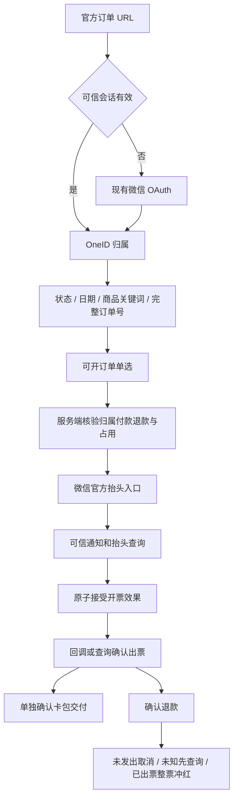

# 用户端订单中心与微信自动开票

本文件复用用户 2026-10-08 已批准的父 PRD。固定官方入口 `/my/orders`，微信授权识别 OneID，CRM 提供本人付款或受益订单。本人付款的已确认微信支付订单支持腾讯数电普通发票，官方页面填写个人或单位抬头，一单一票；确认退款后自动整票冲红。

复用结论：腾讯数电发票 https://pay.wechatpay.cn/doc/v3/partner/4015792556；官方 Go SDK https://github.com/wechatpay-apiv3/wechatpay-go；GoPay 发票调用仅作参考 https://github.com/go-pay/gopay/blob/main/wechat/v3/fapiao.go；CRMEB 仅参考交互 https://github.com/CRMEB/CRMEB。百望、金蝶不在本版增加供应商适配。官方冲红为整票 https://pay.wechatpay.cn/doc/v3/partner/4015792575；部分退款后的剩余金额保留财务处理，不净额自动重开。

分类：涉及 OneID、持久化、Provider 读取、开票/冲红 Provider 写。复用可信支付会话、Identity Port、Order Port、PostgreSQL UoW、External Effects 与共享 River 内部任务。申请、效果接受和审计同事务；网络调用不持有数据库事务。默认禁用 Provider，缺配置明确未开通。未知结果按原申请/票号查询，禁止换号盲目重开。

Product Design 以用户四张滴滴截图为已选视觉参考；使用当前 V4 公共页面字体、蓝色、圆角卡片，复用公共页资产挂载，不引入独立原型框架。仅保留订单与开票逻辑，不含出行、继续支付、用户申请退款、合票、专票或独立抬头管理。

订单页：全部、已付款（保留退款标识）、待付款、已关闭；组合起止日期（北京时间）、商品名包含关键词、完整订单号，支持重置与分页。历史时间缺失明确展示。开票页直接展示符合条件订单，单选且金额由服务端提供；展示待填抬头、开票中、已开票、失败、冲红中、已冲红以及独立卡包状态。

接口：GET `/api/h5/me/orders`；POST `/api/h5/me/invoices`；GET `/api/h5/me/invoices/{id}`；POST `.../{id}/resume`；GET `.../{id}/file`；POST `/api/callbacks/wechat-invoice`。会话中导出客户归属，URL 无身份凭据；ID 修改不可越权，写入拒绝跨站；OAuth 拒绝、冲突、过期、空态和接口异常有明确页面。

验收覆盖：身份合并、归属与越权、日期边界/关键词/分页/历史未知时间；重复/并发申请、冻结金额税务、事务回滚、重复乱序通知和未知结果恢复；开票前/途中/出票后退款（全额及部分）、冲红失败与通知重放；实际页面移动布局和操作。真实微信授权、出票、卡包和冲红单列于技术测试及安装证据。

五项影响：对外增加本人订单/发票合同；业务新增一单一票及退款冲红；直接关联 Identity、Order、Payment、External Effects、配置和共享任务；页面新增公共 `/my/orders`；验证采用相关领域合同、PG 原子并发、HTTP 权限和 Product Design 浏览器验收。独立候选交付唯一发布工作台，不安装共享预发或生产。
