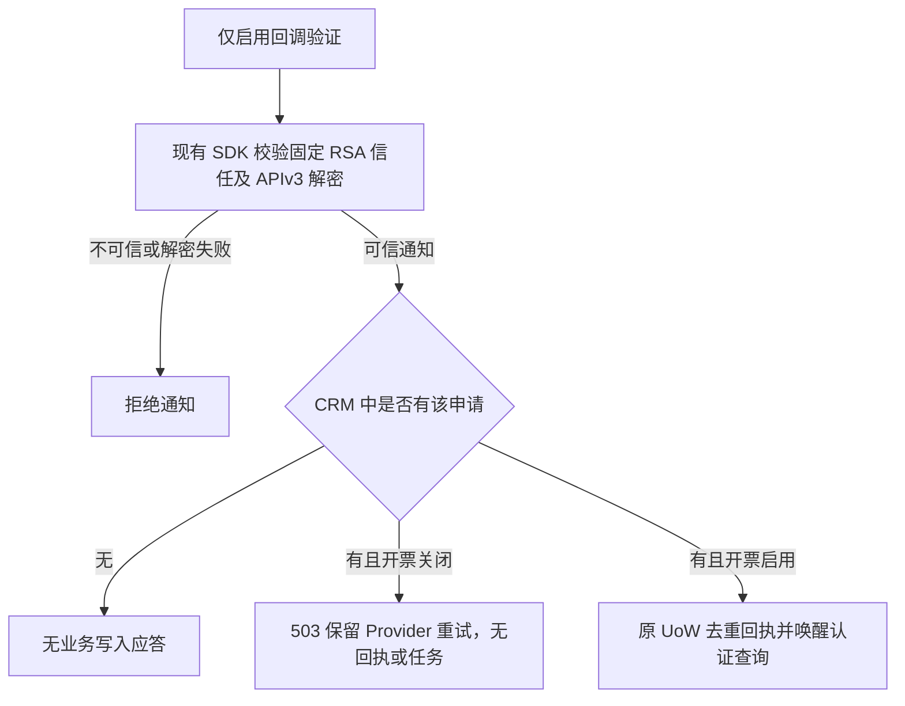
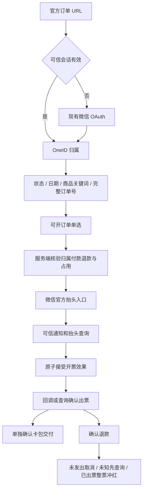
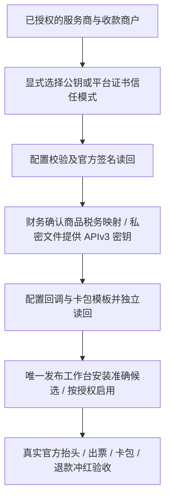

# 用户端订单中心与微信自动开票

本文件复用用户 2026-10-08 已批准的父 PRD。固定官方入口 `/my/orders`，微信授权识别 OneID，CRM 提供本人付款或受益订单。本人付款的已确认微信支付订单支持腾讯数电普通发票，官方页面填写个人或单位抬头，一单一票；确认退款后自动整票冲红。

## 官方回调初始化修复（2026-10-08）

已安装程序在业务 Provider 关闭时未创建通知验签组件，POST 在读包前返回 503；官方开发配置返回已验签的 PARAM_ERROR，独立 GET 确认回调尚未保存。受控观察确认验证 POST 长度为 603 字节，不能作为空请求直接应答。

进一步受控观察确认 pinned RSA 验签及 APIv3 AES-GCM 解密均成功，资源中服务商 mchid 匹配且申请号非空；精确事件与子商户是否为空尚未确认。不会猜测特殊探针事件或放行空子商户。本服务商的未知申请沿用原合同安全丢弃，其他子商户不对应本系统申请时也不生成业务状态；已知申请必须匹配冻结的收款商户。



分类：本次不改变 OneID、订单归属和财务映射；通知验签为无状态计算，已知申请读取及原通知 UoW 属既有 Invoice Owner，开票写能力继续由原 External Effects 控制。仅验签组件不实现 ProviderAdapter，不能出票、冲红、插卡。复用 [微信配置开发选项](https://pay.wechatpay.cn/doc/v3/partner/4012474031)、[官方通知合同](https://pay.wechatpay.cn/doc/v3/partner/4015792570) 和 [官方 Go SDK](https://github.com/wechatpay-apiv3/wechatpay-go)，不新建通知队列或重试机制。

最小独立开关 `AICRM_INVOICE_CALLBACK_ENABLED` 默认关闭；正式 Provider 开启时自动初始化同一验签器。仅回调开启只加载服务商范围、公钥/平台证书和 APIv3 解密密钥，不要求税务文件、公众号或签名私钥。新增开关依据：官方回调配置须先验证地址，不能因此提前授予正式开票写能力。通知的既有大小、签名、时间、解密和归属边界继续复用；不接受未经证实的空 POST 或猜测 TEST 事件。

五项影响：回调在独立验签后可处理可信通知；默认及开票资格不变；直接消费者为 Runtime 配置、invoice composition/HTTP/notification 和官方 SDK adapter；不改 UI；验证相关 RSA/AES 拒绝、仅回调初始化、关闭时已知/未知申请的 PG 无效果断言及实际挂载读回。官方保存、真实出票和卡包交付分别记录，修复测试不代表开通成功。

实际安装合同由 `scripts/run-installed-invoice-callback.sh` 运行 `TestInvoicePostgreSQLCallbackBootstrapInstalled`，参数绑定已安装 binary/root/head/hash。只启动隔离库上的该 binary API 角色，用临时合成 RSA/APIv3 密钥进行签名通知，断言伪签/SIGTEST/错误服务商/空子商户拒绝、可信未知申请无状态 200、已知他商户 409 和关闭时已知本人 503；独立读回申请不变且没有新增回执、查询任务或外部效果。该用例缺安装参数或显式隔离 PG 直接失败，无源码 Host 回退。财务、凭据、域名和真实 Provider 均不会被此 fixture 改动。

安装 fixture 就绪修复：原 Invoice 领域 fixture 只插入两位核心客户，真实 API 的既有 readiness 要求 active Customer 有最小 directory projection，因此安装用例在 503 处停止，尚未执行回调断言。仅安装 fixture 通过现有 Customer ProjectionWriter 和 UoW 补两位隔离客户的展示投影，并先核验原 schema readiness；保留实际安装程序的 ready 检查。分类为测试中读取已有 CustomerID、Customer Owner 的隔离持久化，无身份解析/新建/合并，无 Provider 效果、应用/UI/运行配置改动。相关验证只重跑该实际安装用例，已有发票单元/PG 和构件不重建。



复用结论：腾讯数电发票 https://pay.wechatpay.cn/doc/v3/partner/4015792556；官方 Go SDK https://github.com/wechatpay-apiv3/wechatpay-go；GoPay 发票调用仅作参考 https://github.com/go-pay/gopay/blob/main/wechat/v3/fapiao.go；CRMEB 仅参考交互 https://github.com/CRMEB/CRMEB。百望、金蝶不在本版增加供应商适配。官方冲红为整票 https://pay.wechatpay.cn/doc/v3/partner/4015792575；部分退款后的剩余金额保留财务处理，不净额自动重开。

分类：涉及 OneID、持久化、Provider 读取、开票/冲红 Provider 写。复用可信支付会话、Identity Port、Order Port、PostgreSQL UoW、External Effects 与共享 River 内部任务。申请、效果接受和审计同事务；网络调用不持有数据库事务。默认禁用 Provider，缺配置明确未开通。未知结果按原申请/票号查询，禁止换号盲目重开。

Product Design 以用户四张滴滴截图为已选视觉参考；使用当前 V4 公共页面字体、蓝色、圆角卡片，复用公共页资产挂载，不引入独立原型框架。仅保留订单与开票逻辑，不含出行、继续支付、用户申请退款、合票、专票或独立抬头管理。

订单页：全部、已付款（保留退款标识）、待付款、已关闭；组合起止日期（北京时间）、商品名包含关键词、完整订单号，支持重置与分页。历史时间缺失明确展示。开票页直接展示符合条件订单，单选且金额由服务端提供；展示待填抬头、开票中、已开票、失败、冲红中、已冲红以及独立卡包状态。

接口：GET `/api/h5/me/orders`；POST `/api/h5/me/invoices`；GET `/api/h5/me/invoices/{id}`；POST `.../{id}/resume`；GET `.../{id}/file`；POST `/api/callbacks/wechat-invoice`。会话中导出客户归属，URL 无身份凭据；ID 修改不可越权，写入拒绝跨站；OAuth 拒绝、冲突、过期、空态和接口异常有明确页面。

验收覆盖：身份合并、归属与越权、日期边界/关键词/分页/历史未知时间；重复/并发申请、冻结金额税务、事务回滚、重复乱序通知和未知结果恢复；开票前/途中/出票后退款（全额及部分）、冲红失败与通知重放；实际页面移动布局和操作。真实微信授权、出票、卡包和冲红单列于技术测试及安装证据。

五项影响：对外增加本人订单/发票合同；业务新增一单一票及退款冲红；直接关联 Identity、Order、Payment、External Effects、配置和共享任务；页面新增公共 `/my/orders`；验证采用相关领域合同、PG 原子并发、HTTP 权限和 Product Design 浏览器验收。独立候选交付唯一发布工作台，不安装共享预发或生产。

## 订单 OAuth 回跳修复 scope delta（2026-10-08）

```mermaid
flowchart LR
 A[/my/orders] --> B{可信 Payment Session}
 B -->|缺失| C[OAuth start: 校验固定回跳并持久化一次性 state]
 C --> D[跳转微信网页授权]
 D --> E[callback: 消费 state 一次]
 E --> F[Provider 读取 code 与认证用户资料]
 F --> G[现有 Identity Port 签发可信 Payment Session]
 G --> H[精确回跳 /my/orders]
 B -->|有效| H
 H --> I[订单与发票按会话客户归属读取]
```

生产只读诊断与公网复现确认：安装 SHA `560ff9d891b2e733569b2f38336a78af5c2e5b72` 的 OAuth 配置已启用，但 `payment_h5_oauth_states_return_path_check` 仍是 `0191_payment_h5_referral_return_path.sql` 的路径白名单；它没有精确的 `/my/orders`，所以 OAuth start 的状态插入失败并落回 `oauth_error=unavailable`。源码 `ValidReturnPath` 已接受该固定路径，形成应用与数据库约束不一致。

本候选仅增加 `0225` 前向迁移，将字面 `/my/orders` 加入数据库允许值，完整保留原有正向白名单、编码/反斜线拒绝及 `int64` 边界。真实 PostgreSQL start/consume/replay 与 HTTP 固定成功回跳覆盖这条缺口；不改 state/cookie、UnionID、授权权限或页面合同。

边界分类：**OneID involved**，只用现有 Provider-verified OA OpenID 与 UnionID facts 经既有 Payment Session/Identity 边界建立可信会话，不接收 URL 身份、不猜测客户；**Persistence**，一次性 state 的创建与消费仍经 Payment PostgreSQL Unit of Work，消费提交后再做网络读取；**Provider read**，只兑换 OAuth code 并读取用户资料，无 Provider 写、无内部持久任务、无 External Effect。

参考：OAuth 安全边界沿用 [RFC 9700 §2.1、§4.11](https://www.rfc-editor.org/rfc/rfc9700.html) 的受限回跳、CSRF 和禁止任意 open redirect 建议；市场实现对照 [Auth.js WeChat provider](https://github.com/nextauthjs/next-auth/blob/main/packages/core/src/providers/wechat.ts)，使用官方公众号授权/token/userinfo 端点并启用 state 检查。官方公众号网页授权说明亦由该实现链接至 [微信网页授权文档](https://developers.weixin.qq.com/doc/offiaccount/OA_Web_Apps/Wechat_webpage_authorization.html)。

## 服务商启用 scope delta（2026-10-08）



用户已完成商户开通，授权本任务完成剩余开发，待开发结束后集中确认配置。本次补齐公钥模式（保留平台证书模式）、APIv3 密钥文件加载、官方抬头完整字段及联系方式解密/加密、官方税率及财务显式优惠政策校验、只读配置检查和明确的配置操作入口。无新增页面；沿用已验收订单 UI 与官方抬头页。凭据及真实回执存私密目录，不进入仓库或日志。销售方、税率、税收编码不能从商品名猜测；未完成配置仍禁用开票。首版微信支付账单入口保持关闭，公众号菜单与消息使用固定订单 URL，避免账单申请编号未经 CRM 身份归属解析。

分类：不改变 OneID、客户归属或身份读取。已有申请、买方快照及外部效果仍经 Invoice 同一 PostgreSQL UoW；无迁移、新队列或重试器。Provider 读取复用官方 SDK；开票与冲红继续由 External Effects 执行。运维检查只读取官方权限/税务/开发配置，配置管理只修改官方开发选项和模板，保存明确请求与独立读回，未知结果停止写入。

参考与复用：[官方 Go SDK 公钥验签及加解密](https://github.com/wechatpay-apiv3/wechatpay-go)、[公钥获取](https://pay.wechatpay.cn/doc/v3/partner/4013038589)、[官方抬头字段](https://pay.wechatpay.cn/doc/v3/partner/4015784260)、[通用行业开票字段](https://pay.wechatpay.cn/doc/v3/partner/4015792574)、[配置与卡券业务示例](https://pay.wechatpay.cn/doc/v3/partner/4016078358)、[通知验签及应答](https://pay.wechatpay.cn/doc/v3/partner/4015792570)。开票人名称为选填，不新增必填配置。回调成功返回 200；无签名 POST、签名探测和商户错配均拒绝，GET 仅用于可达性检查，无业务效果。

五项影响：外部 HTTP 业务合同保持，增加只读回调可达性；买方快照保留官方可选字段且不进入客户端展示；直接消费者是配置、Composition Root、Invoice Provider 与运维工具；无前端或数据库结构变化；验证公钥/证书模式、错误信任材料、联系方式往返加密、回调拒绝及官方配置读回。真实出票、卡包和冲红仍需最终启用后独立验收。

## 配置工具发布登记修复（2026-10-08）

流程：原成员检查通过 → 最终构建发现工具未登记（安装前失败）→ 保留原 ref、成员与检查收据 → 仅检查登记及控制器修复 → 同一队列和锁追加修复成员 → 重试最终构建与预发。

实测证据：`9c9a046` 的 20 项 Linux 检查通过，但正式 builder 不含 `cmd/invoice-setup`，因此显式构建清单在安装前被拒绝。参考并复用仓库现有 `_release_commands`、`batch-tool-repair`、`maintenance-check`；不用临时 allowlist 或第二发布通道。仅严格新增标准 Go 程序登记时按应用与指定工具增量构建，其他脚本行为变化不套用该优化。恢复只接受原累计批次、成功收据仍绑定原成员、安装前构建失败且独立读回两台机器与生产游标均未变化的状态；安装未知继续停止对账。

分类：不涉及 OneID、业务 PostgreSQL、Provider 调用或新任务队列；涉及现有发布控制器的持久收据及串行锁。无页面变化。五项影响：发布 CLI 增加已检查的安装前恢复分支；保留成员、尝试与收据；直接消费者为 builder 和原发布控制器；无 UI；验证登记选包、拒绝脚本行为变化、收据保留、失败阶段及安装未知拒绝。修复继承父 PRD 开发授权，生产启用仍等待用户最终确认。

## 已安装累计批次的检查环境恢复（2026-10-08）

流程：已安装并验收的原批次 → 下一队首检查因环境中断、尚未评估 → 环境修复 → 同 SHA/ref/base 重提保留 attempt/checkpoint；若控制器本身需要修复，则从累计源码 HEAD 做 source-only maintenance → 验证两台机器及生产游标 → 既有 batch-tool-repair 追加已检查控制器成员 → 原运行时候选标记基线落后、保留历史 → 基于新累计 HEAD 重提同一业务修复。

实测：配置工具候选因系统盘容量中断、队首为 pending/environment/not_evaluated；容量恢复后 batch guard 只认 failed，挡住后续既有同 SHA environment_retry。复用当前同 SHA 重试、maintenance-check、batch-tool-repair、串行锁与保护收据；不手改状态、不新建发布通道。maintenance 仅允许明确 checks 环境中断且无 in_flight 的原 open 批次，核验原源码、预发、生产及游标；候选未知、真实检查失败、安装已开始或需恢复确认仍拒绝。固定字节与维护收据准确绑定后才追加 source-only 修复，不接受 logo 等运行时改动混入控制器成员。

分类：不涉及 OneID、客户、业务 PostgreSQL 或 Provider 效果；只使用原发布状态、同一串行锁和收据。五项影响：恢复已存在但不可达的精确候选重试；维护入口覆盖该真实环境状态；直接消费者为 submit/maintenance/batch-tool-repair；无页面；验证重提、attempt/checkpoint保留、不同候选/未知安装拒绝、精确维护回执复用和原队首重提。无需业务应用构建；原业务测试和预发证据保留。该相关修复继承本任务开发授权，不改变生产安装/开票启用仍待最终确认的范围。

## 永久素材 logo 域名兼容（2026-10-08）

流程：用户提供 logo → 当前插卡公众号上传永久素材 → 官方返回 `mmecoa.qpic.cn` → 工具保留该 URL 配置卡券 → 验签保存创建回执。实测上传及独立素材查询均由当前公众号完成，官方对 JPEG 重新编码；素材 ID、名称、更新时间及图片读回确认同一 logo。没有重复上传。

参考：[微信官方卡券模板](https://pay.wechatpay.cn/doc/v3/partner/4015792562) 要求使用插卡服务号上传永久素材返回的 URL；复用现有配置工具和官方 SDK，只补充此次已验证的官方图片域名，继续接受旧 `mmbiz.qpic.cn`，不接受头像 URL 或伪造域名。

分类：不涉及 OneID、客户或业务 PostgreSQL；现有运维工具 Provider 写入及私密请求/回执协议保持，无新队列或重试。无新增限制。五项影响：配置工具接受当前官方素材 URL；卡券请求内容与已有未知结果处理不变；仅直接影响 `cmd/invoice-setup`；无 UI；整包测试覆盖当前及旧域名、卡券主体/跳转保持，以及头像、伪装域名和带凭据 URL 拒绝。官方卡券创建受理、素材读回和真实卡包交付分别记录，税码按用户要求暂缓，生产开票不启用。
