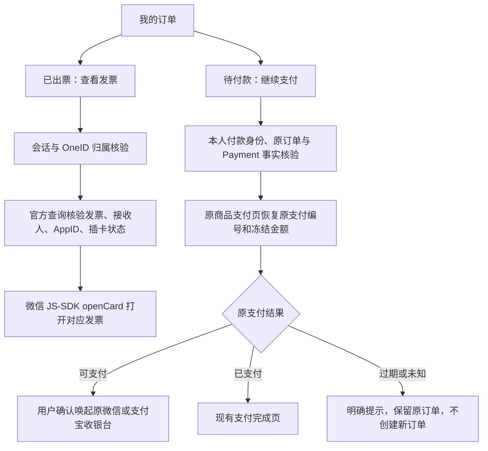

# 订单中心：微信卡包查看与原订单继续支付

本次复用用户订单中心与电子发票父 PRD。用户授权新增待付款继续支付，并要求已出票的查看按钮直接打开微信卡包票据；单位抬头、一单一票、交易单号申请编号保持现有合同。

## 复用与边界

- [微信官方发票查询](https://pay.wechatpay.cn/doc/v3/partner/4015792567) 已提供 card_appid/card_openid/card_id/card_code；沿用官方 Go SDK 的签名验签与现有公众号 JS-SDK 签名接口。
- [微信官方 JS-SDK](https://developers.weixin.qq.com/doc/offiaccount/OA_Web_Apps/JS-SDK.html) 的 openCard 负责原生卡券展示；[wechat-jssdk](https://github.com/JasonBoy/wechat-jssdk) 的卡券接口仅作参考，不增加第二套客户端。
- 继续支付复用 V4 商品/服务周期支付页、Payment.GetCheckout 的可信会话和支付通道校验、原 handoff 与现有结果查询。不会以当前商品价格重新下单。
- 涉及 OneID/外部身份读取；Payment/Order/Invoice 均通过稳定 Port 提供本领域事实。新增行为是 Provider 查询和浏览器收银台唤起，沿用现有支付外部效果，不新增队列、状态机或持久表。前向迁移仅扩展既有 OAuth return_path 白名单，支持严格的原订单支付页参数；保留全部既有行与约束。

## 合同与页面

`GET /api/h5/me/invoices/{id}/card` 先核验本人申请，再通过认证官方查询匹配发票 ID、蓝票号码、金额、销售方、公众号及当前微信接收人。仅已出票且已插卡可返回 openCard 所需的 cardId/code；响应不缓存，不返回 OpenID。查询结束再次检查申请未冲红。错误不跳外部 PDF 接口。

订单查询增加本人待付款原支付入口。`GET /api/h5/me/orders/{id}/payment` 返回已授权原 Payment 编号、通道、冻结金额及原商品标识；不返回 Provider 写权限。原支付页使用 `resume_order` 恢复，读取或点击重试均不会落入新订单创建分支。受益人、导入记录、订单与支付金额/编号不一致、非原付款身份或已关闭记录拒绝恢复；过期或结果未知显示原状态，不盲目重开。

Product Design 以用户本轮图二的蓝色卡片和现有订单页为选定目标。已出票按钮保留“查看发票”，卡包未送达时显示交付状态；待付款卡片增加“继续支付”。不增加个人抬头、出行信息、邮箱或新的文件格式。

## 验证与交付

验证本人/他人/合并归属、卡包接收人/AppID 不匹配、未插卡/冲红、JS-SDK 失败；原支付恢复的过期/未知/已支付、防重复下单、原金额、普通及服务周期、微信及支付宝；在实际挂载页面检查 320/390 移动端布局和按钮交互。真实手机卡包跳转和真实付款另记结果。

生产只读证据：2026-10-09 当前 ¥99 官方查询已出票、INSERTED，card_id/card_code 存在且 AppID 匹配；外部浏览器 session_required 符合 Cookie 隔离。候选推送国内准确 ref 后交唯一发布工作台，安装与真实 Provider 结果分别记录。回退本次应用构件；新增 OAuth 白名单保留，旧构件不使用新入口，不删除已有授权记录。生产迁移前由工作台按既有流程备份。

### Linux 检查准备修复

原候选 `21319d1d493b48ecbf3745061f729e106069998c` 的 Linux attempt 1 实际通过 30 项顶层检查，0 skip；三项 Go→Node 页面旅程因 backend checkout 未准备 jsdom 而未进入断言，frontend 尚未执行。本次仅在这三项测试前复用现有 `check_preparation.py npm` 的锁文件绑定缓存，并补充原安装包 callback fixture 的新 GET 鉴权、本人原订单冻结事实、未出票/确认退款卡包拒绝、no-store 与零新增订单/效果断言。不改应用实现、Provider URL、发布控制器或业务数据。

`docs/release-checks.json` 仅保留失败三项、新 fixture 源组合验证和未执行 frontend；原 30 项准确 Linux 通过收据分别绑定 head/tree、backend run SHA256 `cca9fc7a1996e20b66f843d0cdaa1d480f31254fce2c09f1db5ce26cf40612cd` 与 Go JSON SHA256 `35e50d4e003ef242ab1d73440e6918279ff853995bac62f29af34e5bf8551705`，由同一工作台随 supersedes 候选复用。实际安装包继续通过既有 invoice-callback 入口验证，无二次构建路径；手机卡包打开和真实扣款仍另记验收。
