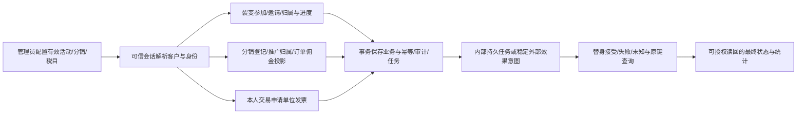

# 裂变、分销、开票审查父 brief

## 授权与基线

用户授权深入代码审查、隔离对抗性测试、必要修复和本地提交，指定 GPT-6.1 Sol / max，并允许独立模块并行。禁止推送、合并、预发或生产部署；禁止真实支付、退款、佣金划款、正式开票/红冲、客户消息。已受限 PAY/退款路径、D6 退款锁序和受限浏览器精确请求计数不重试，不换工具绕过。库存和问卷指定员工受众维持移除。

当前国内 main 经只读 ls-remote 核实为 `6b28130afa0f2b8e784b3e7372faf3451d33cfda`，tree `9360fc3b3fb3c19d363368b2f754649ad7a4c949`。历史 `4155b95` 已非当前基线。独立 clone/`codex/referral-distribution-invoice-review-20261009` 分支保护主仓及其他 worktree。生产安装先按当前本地正式收据记录，实时只读核验另列。

## 业务流程与成功条件

拒绝分支必须覆盖匿名/错身份/跨客户资源、不合法状态和输入、冲突幂等键；成功必须落库并在重放/并发/重启后保持同一事实。测试以合成隔离 PostgreSQL 和 Provider 替身进行；浏览器在用户 Mac 的本机浏览器验证。缺失但未承诺的能力不新增。

## 分类与复用

- OneID：涉及可信渠道会话、canonical customer、merge/split 读归属，复用 identity port/query，不新建身份匹配。
- Persistence：本地事务、幂等/审计/Outbox、内部持久任务；逐项核实 UoW、锁/CAS 和 River/jobqueue。
- External Effects：裂变奖励/通知、分销结算、发票发行/卡券/红冲等仅检查存在的意图与替身行为；复用 externaleffects 原键与未知结果语义。受限退款交叉链路单列暂停。
- 不新增身份核、Provider 写入口、队列或重试框架。新增限制只复用已存在业务、数据库或 Provider 边界，缺陷证据不足不凭猜测添加限制。
- 参考：[PostgreSQL 显式锁](https://www.postgresql.org/docs/16/explicit-locking.html)、[OWASP 授权](https://cheatsheetseries.owasp.org/cheatsheets/Authorization_Cheat_Sheet.html)，结合本仓真实 Ports、合同、迁移和现有 UI 组件。

## 测试与交付

先列真实入口、状态机、表归属和直接消费者；再复现失败并保存原始输出；每个修复保持最小范围，配备相关拒绝/重放/并发/回滚断言。按模块文件所有权并行，共享 composition/UI/schema 由主任务协调。UI 编码前使用 Product Design。已有测试中含受限退款路径的用例不整包运行。

修复后复验直接相邻链路、适用 Go/前端构建、类型/静态检查与定向回归，不为了数量反复无增量检查。报告明确通过/失败/未执行/受限，不宣称穷尽或零 bug。最终清单放 `docs/release-checks.json`；本轮独立报告、精确 commit/tree、日志摘要和剩余发布决策交付源任务。授权不包含发布，所以仅提供可审阅交接，不投递额外消息。

## 五项影响与回退

对外合同：只恢复既有合法行为与必要拒绝；业务机制：按证实问题修复身份、事务、幂等、状态一致性；关联模块：三个领域及其直接 Port/事件消费者；页面：后端状态与重复/中断交互，修改前另做设计判断；验证：隔离合成证据与真实 Provider/安装验收分开。每项候选独立本地提交，可通过回退对应代码提交恢复；迁移如确需新增则前向兼容且不在本轮安装。

## 收尾范围与确认边界

确认并修复裂变 4 项、分销后端 5 项/公共收益原因显示 1 项、开票 5 项。生产分销在 composition 的四处入口绑定当前 Identity subject reader；各消费者在业务 UoW 内复验。开票恢复与查询任务接受重新授权，应用 owner 冻结原订单付款根；不回写旧 owner、已接受票据或官方卡包接收人。

用户补充要求核实两个自动化基线错误。`automationContentHost.ts` 是最终 Host 构建的固定入口，其 ES2020 类型兼容问题只用一行等价 split/join 修复，并运行该既有变量校验测试及全量 v3 tsc。`automation_fixed_content_chromium_postgres_integration_test.go:171` 的直接环境变量读取仅属独立测试夹具，未参与本轮执行或应用构建；保留全仓 architecture 失败证据，不扩大自动化审查。

实际 Mac Chrome 154 使用独立 profile、本地当前 TypeScript bundle、合成 HTTP 替身检查 390px 手机视口的 11 个画面。无真实 OAuth、支付、退款、分账、正式发票、红冲或客户消息；未采集受限精确浏览器请求计数。快照修正直接来自 Referral 自有合成 ledger；不能替代受限 Order/Payment 来源验证。

分销 unique historical owner 的收款准备与 Payment canonical root 既存约束仍需金融归属决策；未迁移收款目标。裂变未参与 sales promoter 合并与旧独立 paid consumer 的 EndsAt 静态漂移未执行；当前 production consumer 的参与校验采用 AcceptingAt。发票历史错误 owner 行不自动修正，Card 仍要求官方 recipient 与当前 OA handle 一致。未增加未实现的独立作废或奖励 Provider。

本轮最终具名清单只含已读确认的非受限路径，整包 Invoice/Distribution app/cmd 不执行。前后业务失败、准备/夹具失败、最终 PASS、未执行和受限分开记账。最终 HTML 报告和验证 receipt 在 workspace 外层独立生成并绑定最终 commit/tree，避免报告自身哈希循环；仅本地提交，无发布。

## 2026-10-10 发布授权与集成

用户明确要求读取本任务并完成发布，并确认“与已预发710788a两项合并，一并上线”。以上原开发阶段的仅本地权限已由本次发布授权扩展至国内候选、预发及同包生产；真实Provider/支付/退款/佣金划款/红冲/客户消息和受限PAY/D6检查仍不执行。

以现有批次源码710788a为父累计15项修复及ES2020修复，保留原faced150及其31项用例/51子用例、12前端测试的本地收据。代码无冲突；发布清单合并并绑定新base，增加直接相邻布局事务合同与composition路由检查。最终安装包仅执行安全范围的Referral海报/布局浏览器与开票/分销HTTP认证冒烟，既存完整Distribution浏览器中的受限计数/退款交叉检查不执行。

OneID涉及，复用Identity subject reader在业务UoW内解析/加锁；保留原金融owner，不迁移历史账户或票据。持久化为既有本地事务/内部任务；未增加队列、Provider写入路径或身份匹配。生产仅0231新增布局迁移，迁移前原发布器备份。
