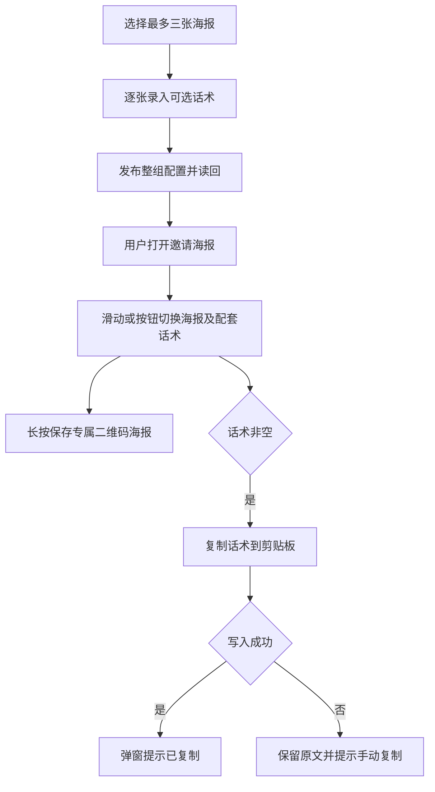

# 裂变活动海报配套话术

用户已授权本父 brief；一项候选交付整条配置、读取、选择和复制行为。

## 参考与复用

- [有赞图文推广](https://bbs.youzan.com/thread-692724-1-1.html)的文案展示及复制交互。
- [MDN Clipboard.writeText](https://developer.mozilla.org/en-US/docs/Web/API/Clipboard/writeText)的 HTTPS、用户点击及成功/拒绝结果合同。
- Product Design 已完成 user-context preflight、get-context 和现有代码/页面视觉目标确认；后台沿用 V4 admin_base、海报素材选择及表单布局，用户端沿用 Referral 邀请弹窗。实现后对照相同视口检查新增交互，不初始化新应用或发布原型。

浏览器实测后将海报预览收至 45vh，使常见双行话术的复制按钮在 375/430px 首屏可见；长话术继续在弹窗内滚动。后台海报列表占整行，素材选择及发布操作放在列表下方，避免输入框增高后把素材按钮拉成空白面板。以上是当前页面中的增量适配。

## 行为与边界

每张海报增加独立 share_text，使用纯文本多行输入，保留换行、表情及空格。空白文本视为未配置，用户端隐藏话术及复制按钮。description 仍为已有简短说明，不将其充当话术。删除时图片和话术成组移除。发布成功后 GET 活动配置，读回海报和真实版本再提示保存成功。

用户端默认第一张，保留点选，增加前后按钮及左右滑动；单张隐藏切换控件，首尾不循环。当前索引统一驱动图片、话术、剪贴板和下载，异步图片迟到不能覆盖新选择。已有二维码合成结果导出为 PNG data URL 的 img，保留下载按钮。话术以 textContent 展示，不解释 HTML、变量或自动追加邀请链接；复制结果在弹窗内反馈，浏览器拒绝时尝试兼容复制并提供手动选中入口。

Referral 拥有的海报表前向增加 share_text TEXT NOT NULL DEFAULT ''，保持原图和原说明。已有 PUT 的 posters[] 与后台/公共读取增加 share_text，省略视为空串，沿用整组替换。话术参与操作幂等摘要，与海报、配置版本、收据、审计和 Outbox 在同一 PostgreSQL UoW 提交。

OneID：本变更不涉及身份解析或客户写入；邀请二维码沿用已有可信凭据。Persistence：Referral 本地事务。External Effects：无新增 Provider 写入或持久任务，复制及保存为浏览器本地行为。不涉及新增限制，复用最多三张与 32 KiB 请求大小边界。

## 五项影响与验收

- 对外合同：海报请求/读模型增加可选 share_text，旧数据默认空串。
- 业务机制：同组持久化、幂等摘要与 CAS，保持同事务。
- 关联模块：Referral 的 port/app/store/http 和直接页面消费者；Media 继续只提供已启用原图投影。
- 页面：后台逐海报话术录入与读回；公共邀请弹窗的图片保存、同步切换和复制。
- 验证：具名 PG 用例验证旧数据保留、三组读回、删除重新编号、版本冲突、幂等冲突/重放和事务回滚；HTTP 拒绝与旧请求合同；前端空/单/三张、换行表情、切换迟到、加载失败和复制结果；375/430px 浏览器旅程。微信 iOS/Android 真机长按/复制单列未验证项，合成 Chromium 不替代真机。

失败只修复并重跑相关检查。交付准确 base/head/tree/ref 和测试收据至唯一路由工作台；本任务不安装共享预发或生产。前向字段由旧应用忽略，代码可按发布工作台同包路径回退，话术列及已保存数据保留。
