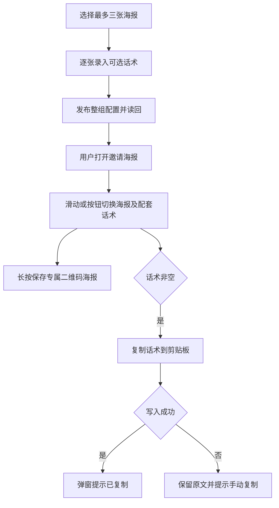
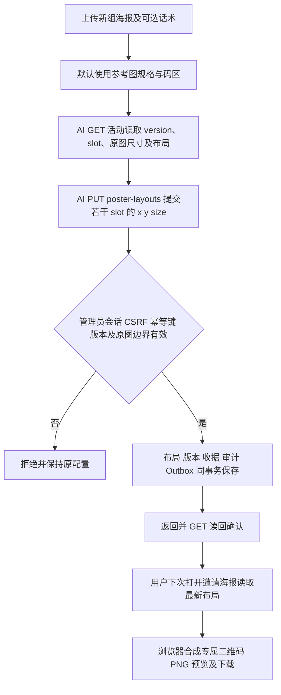

# 裂变活动海报配套话术

用户已授权本父 brief；一项候选交付整条配置、读取、选择和复制行为。

## 参考与复用

- [有赞图文推广](https://bbs.youzan.com/thread-692724-1-1.html)的文案展示及复制交互。
- [MDN Clipboard.writeText](https://developer.mozilla.org/en-US/docs/Web/API/Clipboard/writeText)的 HTTPS、用户点击及成功/拒绝结果合同。
- Product Design 已完成 user-context preflight、get-context 和现有代码/页面视觉目标确认；后台沿用 V4 admin_base、海报素材选择及表单布局，用户端沿用 Referral 邀请弹窗。实现后对照相同视口检查新增交互，不初始化新应用或发布原型。

浏览器实测后将海报预览收至 45vh，使常见双行话术的复制按钮在 375/430px 首屏可见；长话术继续在弹窗内滚动。后台海报列表占整行，素材选择及发布操作放在列表下方，避免输入框增高后把素材按钮拉成空白面板。以上是当前页面中的增量适配。

## 行为与边界

每张海报增加独立 share_text，使用纯文本多行输入，保留换行、表情及空格。空白文本视为未配置，用户端隐藏话术及复制按钮。description 仍为已有简短说明，不将其充当话术。删除时图片和话术成组移除。发布成功后 GET 活动配置，读回海报和真实版本再提示保存成功。

用户端默认第一张，保留点选，增加前后按钮及左右滑动；单张隐藏切换控件，首尾不循环。当前索引统一驱动图片、话术、剪贴板和下载，异步图片迟到不能覆盖新选择。已有二维码合成结果导出为 PNG data URL 的 img，保留下载按钮。话术以 textContent 展示，不解释 HTML、变量或自动追加邀请链接；复制结果在弹窗内反馈，浏览器拒绝时尝试兼容复制并提供手动选中入口。

Referral 拥有的海报表前向增加 share_text TEXT NOT NULL DEFAULT ''，保持原图和原说明。已有 PUT 的 posters[] 与后台/公共读取增加 share_text，省略视为空串，沿用整组替换。话术参与操作幂等摘要，与海报、配置版本、收据、审计和 Outbox 在同一 PostgreSQL UoW 提交。

OneID：本变更不涉及身份解析或客户写入；邀请二维码沿用已有可信凭据。Persistence：Referral 本地事务。External Effects：无新增 Provider 写入或持久任务，复制及保存为浏览器本地行为。不涉及新增限制，复用最多三张与 32 KiB 请求大小边界。

## 五项影响与验收

- 对外合同：海报请求/读模型增加可选 share_text，旧数据默认空串。
- 业务机制：同组持久化、幂等摘要与 CAS，保持同事务。
- 关联模块：Referral 的 port/app/store/http 和直接页面消费者；Media 继续只提供已启用原图投影。
- 页面：后台逐海报话术录入与读回；公共邀请弹窗的图片保存、同步切换和复制。
- 验证：具名 PG 用例验证旧数据保留、三组读回、删除重新编号、版本冲突、幂等冲突/重放和事务回滚；HTTP 拒绝与旧请求合同；前端空/单/三张、换行表情、切换迟到、加载失败和复制结果；375/430px 浏览器旅程。微信 iOS/Android 真机长按/复制单列未验证项，合成 Chromium 不替代真机。

失败只修复并重跑相关检查。交付准确 base/head/tree/ref 和测试收据至唯一路由工作台；本任务不安装共享预发或生产。前向字段由旧应用忽略，代码可按发布工作台同包路径回退，话术列及已保存数据保留。

## 追加范围：参考模板与运行时二维码布局

用户提供原图并要求微调后默认固定；随后明确要求 AI 通过生产管理员接口修改一组图的坐标，不能每次发版。默认模板为原图 1250×2426px，二维码白色区域左上角 x=830、y=1952、边长330px（原点为原图左上角）。后台只提示制图规格，不新增坐标编辑控件。

参考：[DENSO WAVE QR 码区及四模块留白](https://www.qrcode.com/en/howto/code.html)。复用原图/二维码编码、Referral UoW、管理员会话/CSRF 和发布收据。Product Design image-to-code 仅用于原图码区测量和同图叠加比对，保留所有提供的图文资产。二维码采用整数像素模块及至少四模块白色留白，覆盖原有码区，不重画海报文字。

接口：现有海报发布项可选 qr_layout={x,y,size}；GET 活动海报项返回 image_width/image_height 和有效 qr_layout。新增 PUT /api/admin/referral/campaigns/:id/poster-layouts，expected_version + posters=[{slot,x,y,size}]，允许一次更新部分或全部（最多三张）现有海报。只改坐标，不重读已停用 Media 源，不改原图/话术/说明。保存返回最新版本和坐标；重放不再写入；同键不同内容冲突；版本过期、越界或不存在的 slot 整组拒绝。重复 slot 拒绝，避免歧义。

旧数据默认保留旧像素尺寸及旧布局算法，1250×2426图使用已确认参考码区。新图不显式提供布局时使用参考尺寸1250×2426；AI提供有效坐标时可用其它已有尺寸边界内的原图。客户端后台保存必须保留已有布局，删除时图/话术/布局同组移动。活动版本约束防止 AI 坐标修改被旧后台页面覆盖。标准浏览器读取配置而不从源码常量覆盖已保存布局；已打开弹窗下次重新打开即读新配置，无应用重启/构建/代码审核。

OneID：无新身份解析，二维码内容沿用已验证邀请身份。Persistence：Referral 本地事务，前向增加原图宽高及可空布局字段；已有图片/话术/收据保留。External Effects：无新增 Provider 写、队列或持久任务。新增限制只用于避免不完整/重复slot、非整数/越界几何和无法适配默认模板；凭据及业务效果边界继续复用现有规则。

验收追加：三张独立布局、部分更新/换组/删除绑定、旧摘要/迁移保留、源图停用后改布局、边界/不存在slot/同键冲突/CAS/并发/回滚、匿名及CSRF拒绝；浏览器真实API修改后不发版重新打开显示新位置，下载PNG尺寸及QR独立解码，参考图码区外像素保持不变。运行时接口可在本功能首次发布后用于生产；本开发任务不凭新需求自行改生产活动或安装共享环境。
