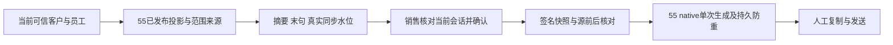

# 侧边栏 AI运营：基础信息与辅助成交

用户已批准并优先实施本范围。标准蓝白卡片工作台沿既有入口将核心画像改为 AI运营，二级为基础信息/辅助成交。销售先阅读上下文中心摘要、最近归档的客户末句、发生时间与同步水位，再核对企微当前会话，手动确认、生成、复制及发送。刷新只读取现有数仓投影；不拉上游存档、不调用模型。不承诺快速同步或整体迁云后无延迟。

当前候选已重基到只读验证的国内 main `4f25bc1e27d3a85995cf164c35a35d8a8333a0c5`（原基线 `82edf652065beecf77409723c0a25a7581d0764d`），独立分支 `codex/sidebar-ai-operations`。本机权威项目 `/Users/qianlan/Downloads/新CRM/main`。旧 Agent 是用户授权的独立话术项目，不是旧 CRM 源码/运行时依赖。迁移线程仍为前置准备；腾讯现网 `124.220.53.183`、火山演练 `115.190.113.5`、数仓目标 `115.190.115.55`、旧 Agent 源 `122.152.209.11` 分别核对。

参考产品为 [Microsoft 销售邮件辅助](https://learn.microsoft.com/en-us/microsoft-sales-copilot/use-copilot-kickstart-email-messages)。本范围复用原 scoped context、HttpOnly 员工认证、标准 Host/overlay、数仓 CID/alias 与 published projection、55 native prompt runtime，不新建客户匹配器、CRM 队列、CLI/批量模型恢复或发送能力。Product Design 已在本父 brief 编码前应用，当前沿已授权设计补接口装配。

## 合同、身份与生成

浏览器只访问同源 GET `/api/sidebar/v2/ai-operations` 和 POST `/api/sidebar/v2/ai-operations/suggestions`；后端从可信 context 获取企业、员工、canonical `customers.id`，禁止浏览器提交身份或原始正文。GET 完成后再次核验当前员工；POST 模型调用前后均核验身份和源。

Reader 固定读取55受保护 HTTPS `/api/local/v3/sidebar-ai-operations`，按 `crm-sidebar-ai-operations.v1` 和 `crm-private-message-scope.v1` 返回单一客户/企业/当前员工的摘要、水位、最多40条双向私聊及末条客户消息。依赖腾讯既有固定导出器补齐企业、唯一员工、双人私聊及发送方来源字段；缺失或歧义失败，非文本末句不伪造转写。前端读响应不含双向私聊正文。

生成固定调用 `/api/local/v3/sidebar-manual-generation`，传递5分钟签名快照绑定的全部冻结输入和稳定幂等 key。摘要或任何双向消息发生变化即返回冲突；不足则禁用生成。CRM 单次45秒上限，页面55秒兜底，超时为 outcome_unknown，不自动换 key 重试。

55 复用旧 Agent 已核验纯函数和本机现有 native v2 `sales_assist` 资源合同；摘要标为历史参考，近期消息保留角色/时间/来源。只进行一次 Ark/Kimi API 请求，不使用 CLI 重试、fallback、批量恢复或企微发送。排他 claim 在调用前 fsync；并发/重启/超时后同 key 不再次调用，完成收据可复用。真实模型及凭据尚未验证。

## 必要边界分类

OneID 涉及读取 canonical customer 和可信员工，复用既有 context/数仓 lineage，不建客、不自动合并。CRM 无新增表、持久任务或数据库迁移。远端 native owner 的最小 claim 是手动单次生成收据；不属于 CRM 内部作业或企微发送。资金和企微写不涉及。

新增/复用边界依据：客户/员工来源不足会串读其他私聊，故拒绝缺字段/歧义；冻结快照变化会使用过期会话，故绑定源版本和全文；模型结果不明会重复扣费/输出，故调用前持久 claim 且不自动重试；沿既定40条/文本字节预算计算4MiB JSON传输上限，正常边界与超限均有合同测试。既有 API admin/operator 授权保持，不扩大 agent 角色。

## 五项影响及验收

|项|实际影响|
|---|---|
|对外合同|CRM 两个侧栏接口；55 两个版本化适配接口及生产 facts 来源字段；缺范围/过期/未装配/未知结果可辨识|
|业务机制|只读投影、人工确认、单次生成、持久防重；不自动发送/追新/迁数据或建立调度|
|关联模块|sidebar、webshell标准Host/overlay、platform config、Composition Root；独立 Context Center 集成材料及既有固定 exporter|
|页面|AI运营两入口、真实水位、末句核对、复制；共享Host相关消费者按最新主线检查|
|证据|本地 fast/全仓编译/相关完整包与JS/Host；55 Linux合成范围/防重/native合同；真实腾讯范围、认证链路、活动安装和Provider另验|

Reader/Generator 分别默认关闭。接口装配不要求 CRM 整体迁云：腾讯服务端可访问55现有 HTTPS；实际网络/授权和生产来源仍需验收。RDS 保持私网，浏览器不访问数仓/数据库/模型凭据。

执行前的腾讯更新、55重启（会恢复既有工作）、既有凭据安全装配和回滚计划见 [交接](../operations/sidebar-ai-operations-handoff.md)。无数据库逆向迁移。CRM 由唯一路由指定工作台沿现有队列/锁安装与回退；本任务仅交付准确国内候选及隔离材料，不自行部署共享预发/生产、不切 DNS 或停旧 Agent。最终准确源码和实际检查以仓外 `candidate-receipt.json` 为准。

本次恢复沿用原业务和设计，不涉及新增限制。发布清单见 `docs/release-checks.json`：侧栏整包竞态与权限/快照/HTTP合同、当前员工与可选装配、标准 Host/overlay 和 OpenAPI；Linux 执行标准 Host Chromium，最终安装包以 `sidebar-ai-operations` 收据覆盖同源接口鉴权、关闭配置反馈和两分区入口。55 活动 API/真实模型启用仍独立待验。原断连后端日志不完整，本轮按用户要求补最终源码的完整本地后端检查；不把 macOS 的 Linux 专用 skip 算作门禁通过。
