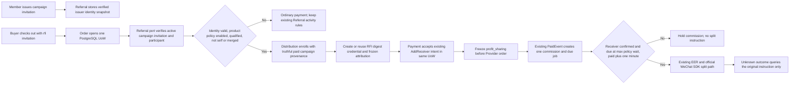

# Paid campaign referral commissions

## Outcome and flow

Make a valid `rfi_` invitation from an active product-purchase campaign eligible for the existing first-level Distribution commission and WeChat profit-sharing path. Keep the current Join and invitation actions; do not add enrollment screens, collection setup, or a claim that the user accepted the separate Distribution agreement. The issuer's actual verified Payment session identity is bound to the invitation when it is issued. Existing invitations without that verified snapshot remain activity-only.

## Invariants and boundaries

- Referral owns campaign/invitation facts and exposes only a stable `PaidInvitationCheckoutReader` to Distribution. Old invitations missing issuer identity remain eligible for Referral statistics, never financial attribution.
- Distribution reuses current OneID lineage, product policy, purchase qualification, PromotionCredential, Attribution, CommissionService, and refund rules. No commission for invalid/revoked/expired invitation, disabled/zero policy, failed qualification, self purchase, merged identity, or unverified issuer.
- Enrollment is recorded as `paid_campaign_referral_v1` provenance, not as acceptance of the general Distribution agreement. The RFI digest is the immutable PromotionCredential token digest; audit/outbox identify Referral as its source. No nullable attribution/source migration.
- Order calls Distribution and Referral within its existing PostgreSQL UoW. The accepted Payment receiver intent, attribution, `profit_sharing` checkout flag, snapshots, audits/outbox, and receipts commit or roll back together. Provider calls remain outside the transaction.
- Receiver preparation uses the identity snapshot on the actual invitation action, verified through OneID and the existing Payment/EER `AddReceiver` contract. No new identity matcher, implicit customer creation, Provider writer, job queue, worker, or retry state machine.
- A not-yet-ready receiver keeps the commission on hold. Payment split intent waits for both product wait-days and the official post-payment one-minute minimum. Unknown results permit original-instruction query only; no blind retry.
- Preserve the actual `referral.invitation:<id>` reference and frozen policy facts so Referral's paid scoring and post-merge self-purchase checks remain aligned with the existing PaidEvent path.

## References and validation

- Reuse current V4 `Order.CheckoutAttributionCoordinator`, Referral product-sale snapshot/PaidEvent fanout, Distribution `PromotionCredential`/`Attribution`/`CommissionService`, Payment `DistributionSettlementPort`, and External Effects.
- WeChat Pay official [Go SDK order examples](https://github.com/wechatpay-apiv3/wechatpay-go/blob/main/services/profitsharing/api_orders_example_test.go) and [receiver examples](https://github.com/wechatpay-apiv3/wechatpay-go/blob/main/services/profitsharing/api_receivers_example_test.go); continue using the installed SDK.
- WeChat Pay merchant documentation: [Add receiver](https://pay.wechatpay.cn/doc/v3/merchant/4012528995), [profit-sharing request and same-order idempotency](https://pay.wechatpay.cn/doc/v3/merchant/4012524936), and [profit-sharing FAQ: one-minute minimum, AddReceiver once, and exact receiver success](https://pay.wechatpay.cn/doc/v3/merchant/4014547102). The query-only maintenance role is specified in [its parent brief](2026-10-10-profit-sharing-query-role.md).
- **OneID: involved**; use Referral's verified issuer snapshot and OneID stable readers, with no second identity model or automatic merge. **Persistence: involved**; all checkout facts and Payment intent acceptance share the existing UoW. **External Effects: involved**; Payment/EER owns receiver and split writes, callbacks, and original-instruction reconciliation.
- Backend only; preserve the already released poster. Target PostgreSQL coverage: native mini-program and H5 checkout freeze financial attribution and the Payment flag; create/reuse one receiver intent and credential; duplicate callbacks create one commission; invalid invitations, legacy invitations without an issuer snapshot, and disabled policies produce no financial attribution. The PostgreSQL journey observes the receiver intent pending and no paid commission at the zero-wait boundary; it does not execute a real Provider split. Existing focused unit tests cover the receiver-readiness hold and self/merged-identity settlement gates. An unqualified-inviter financial PostgreSQL case is not claimed. Installed API smoke uses synthetic credentials and a loopback proxy, with no effects worker.
