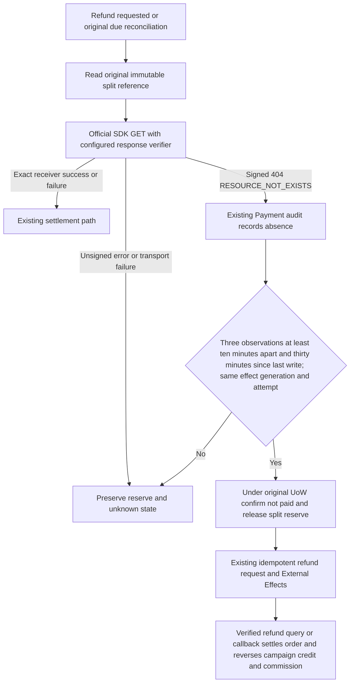
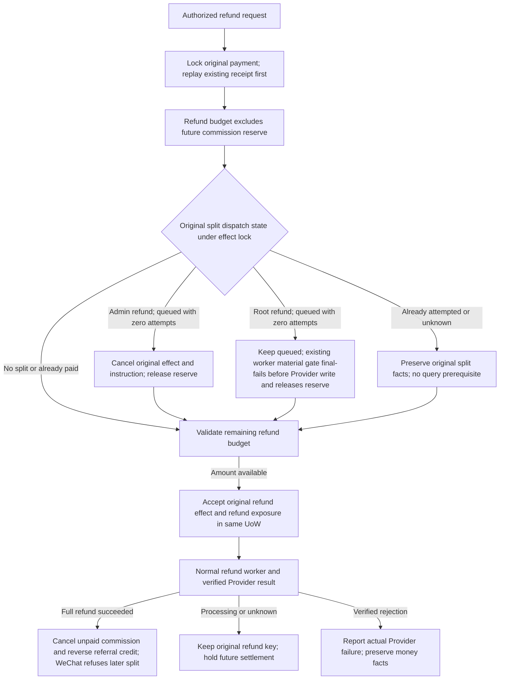

# Missing original profit-sharing order and full refund

User authorized a full RMB 6.80 refund for native order 5626 and related bug fixes. Existing production 7514476 already enforces paid plus one minute for new splits. Its historical instruction 6 remains outcome_unknown with a 204-minor reserve: a signed WeChat GET returned RESOURCE_NOT_EXISTS, while control instruction 5 returned exact receiver SUCCESS. No refund exists. One missing-order query does not authorize a new split or immediate reserve release.



References: official [WeChat FAQ](https://pay.wechatpay.cn/doc/v3/merchant/4014547102) documents three queries ten minutes apart over thirty minutes without intervening writes; [original-order query](https://pay.wechatpay.cn/doc/v3/merchant/4012525210) and [official SDK](https://github.com/wechatpay-apiv3/wechatpay-go/blob/main/core/client.go) show request/query and response verification. The installed SDK v0.2.21 checks HTTP error status before its signature validator, so an error code alone is insufficient evidence. Explicitly verify the original signed 404 with the same configured trust material.

Reuse Payment instruction/reserve/audit, original query maintenance role, existing Distribution due job, normal refund command, existing EER and refund callback/query. Do not create a split retry, new merchant split number, queue, migration, or frontend flow. Three accepted observations span at least twenty minutes, with the last no earlier than thirty minutes after the original effect's last write; intervening non-absence observations reset the sequence. A still running, queued, changed-generation or changed-attempt effect cannot provide absence proof. Final known pre-submit failures also release their retained reserve in the same Payment UoW.

OneID: existing identity/receiver validation through current ports only; no ownership change. Persistence: Payment-owned audit and reserve transition under existing UoW and instruction lock. External Effects: signed Provider reads, followed only by the authorized original refund effect; no split Provider write. No second execution or identity kernel.

Five impacts: query Port adds a verified absence signal; refund may reconcile original split before checking available funds; Payment/provider/store and direct Distribution settlement consumer are affected; existing admin refund page consumes the same API, with no UI edit; targeted tests cover signed/unsigned/tampered 404, spacing, stable attempt/generation, concurrent replay, rollback, known-paid preservation, pending protection, full-refund acceptance and commission reversal. Production verification separately records exact binary, signed absence observations, refund effect, verified WeChat refund result and final order/commission/campaign facts.

Minimum necessary constraint: retain reserve until the official missing-order observation window proves non-payment; this prevents simultaneous split/refund or duplicate money effects. Existing one-minute and idempotency constraints remain. No additional approval. Candidate is committed and pushed from an independent codex worktree, handed to the routed workbench, tested on Linux/PG and installed staging, then same-artifact production. No migration or database backup. Rollback restores the prior application; existing audit facts and truthful released reserves are preserved.

## Refund first (user scope clarification after standards review)

The user explicitly requires a distribution order to refund in full instead of protecting its future commission, and rejects split queries as a prerequisite. Standards review confirms that a fully refunded WeChat order cannot subsequently split and that unsplit funds can refund directly. The existing application incorrectly subtracts a future commission reserve from the refund budget and performs a split query before refund acceptance. Remove both prerequisites. Refund budget is original paid amount minus successful and non-terminal refunds, serialized by the original payment lock. WeChat remains authoritative for actual available/frozen funds and concurrent money processing; a refund request is not presented as success before a verified SUCCESS callback/query.

Reuse Payment/EER transactional cancellation for authenticated administrator refunds whose split is still queued with zero attempts. If dispatch already won, leave that immutable split effect/reserve truthful and accept the refund anyway; never forge a failed split, replay it, or discard a confirmed paid amount. A refund creates the refund receipt/effect and opens Distribution refund exposure atomically. The root refund role retains its distinct authorization in the refund receipt; it does not directly cancel a queued split, and this code has no due-worker cancellation callsite. The existing EER worker will load material through the refund-exposure gate and final-fail locally before any Provider write; Payment's existing completion handler then releases the reserve in the same completion UoW. On full refund success the existing consumer cancels the unpaid commission and reverses referral credit; during a pending/unknown refund, no new settlement is accepted. Original attempted split reconciliation may run later for accounting, independently of refund acceptance.



References actually inspected before application editing: [official GitHub Go SDK refund API/example](https://github.com/wechatpay-apiv3/wechatpay-go/blob/main/docs/refunddomestic/RefundsApi.md), [refund source](https://github.com/wechatpay-apiv3/wechatpay-go/blob/main/services/refunddomestic/api_refunds.go), [official split API/example](https://github.com/wechatpay-apiv3/wechatpay-go/blob/main/docs/profitsharing/OrdersApi.md), [WeChat order refund rules](https://pay.wechatpay.cn/doc/v3/merchant/4013071001) and [merchant split FAQ](https://pay.wechatpay.cn/doc/v3/merchant/4014547102). The SDK exposes independent Create/Query refund operations and does not make a split query mandatory. The provider rules, rather than the example alone, establish direct unsplit refunds, the impossibility of splitting a fully refunded order, and refund/split totals not exceeding original frozen money. Orders that already split partially may require the standard unfreeze step and sufficient merchant available balance; already-paid commission facts remain history and are never relabelled unpaid by this fix. This candidate targets acceptance of refunds without the local future-commission gate; it does not fabricate Provider success or auto-recover personal-account payouts.

No new approval, UI, Provider writer, queue, migration or identity mechanism. OneID uses the original canonical payment/customer facts. Persistence uses existing Payment and EER UoW with payment/instruction/effect locks. Normal admin cancellation records the authenticated administrator already frozen in the refund actor scope. Root refund operations keep their distinct root authorization in the refund receipt; they do not call a due-worker cancellation actor. The existing material failure path final-fails a pre-submit split locally and releases its reserve through the existing Payment completion handler. Fresh split material is refused during refund exposure, after full refund, and when successful partial refunds plus other paid/outstanding splits leave less than this frozen instruction amount. The calculation excludes this instruction's own reserve and does not impose a future-reserve gate on refund acceptance. An optional conditional guard on the existing cancellation Port cancels only queued zero-attempt effects under the EER lock and otherwise returns the unchanged projection. This is the minimum protection against falsely cancelling an attempted money write, and it never blocks the refund request. The old strict cancellation contract and receipts remain compatible.

| State | Refund acceptance | Commission/split handling |
| --- | --- | --- |
| No split / awaiting due date | Accept full remaining amount directly | Refund exposure prevents new split acceptance |
| Admin refund, queued with zero attempts | Cancel locally and accept full refund in one UoW | Cancel original split and release reserve |
| Root refund, queued with zero attempts | Accept refund without a direct split-cancel call | Existing worker material failure final-fails before Provider write and releases reserve |
| Running / outcome unknown | Accept refund without split query or local reserve deduction | Preserve original attempt; hold future splitting; reconcile accounting later |
| Provider confirms full refund | Verified successful refund fact only | Cancel unpaid commission, reverse ranking; never dispatch new split |
| Split already paid | Normal refund request, Provider fund rules apply | Preserve paid commission; existing refund-after-paid liability logic |
| Refund response unknown | Original-key replay/query only | No second refund or split intent |

Five impacts: unchanged refund API accepts eligible full refunds without split reads; no deduction of future split reserves, admin conditional cancellation shares refund UoW, and fresh split material is checked against completed refunds plus other paid/held split facts; Payment/EER and Distribution refund/due consumers; existing admin page receives the normal acceptance without UI edits; PostgreSQL tests cover full/partial/replay, insufficient and sufficient post-refund split funds, other paid/held instructions, concurrent refunds, dispatch wins and rollback. This follow-up candidate starts from domestic main fde403ef0e5d621fd7c32af40b1f7d679d283990, which already contains the original refund-first changes. Targeted checks and installed smoke precede same-artifact release through the routed workbench. Rollback reinstalls the preceding application, preserving already committed refund/split/cancellation facts.

## Authorized operator entry

The production administrator session has expired. Add a one-shot `payment-refund` runtime role restricted to effective OS UID 0 before composition. It uses the same Payment service, funding checks, operation receipt, audit, refund queue and verified query; it introduces no HTTP route, daemon, direct Provider writer or authentication bypass. Normal unauthenticated HTTP refunds remain forbidden. A payment/order mismatch, historical payment, non-WeChat payment, non-paid payment, missing authorization reference or invalid amount fails closed. The root command may report accepted/unknown before the normal worker and verified refund query prove completion.

Run the exact installed binary as root with its existing protected production configuration and the following explicit overrides. Do not print configuration secrets. The one immutable key and authorization reference are reused on every safe replay; never create another key after an unknown result.

```text
AICRM_ROLE=payment-refund
AICRM_PAYMENT_REFUND_ID=1244
AICRM_PAYMENT_REFUND_ORDER_ID=5626
AICRM_PAYMENT_REFUND_AMOUNT_MINOR=680
AICRM_PAYMENT_REFUND_KEY=order-5626-full-refund-680-20261010-v1
AICRM_PAYMENT_REFUND_AUTHORIZATION=user:01a12520-cccb-7bf3-8995-76a0f2c30782:refund-680
```

The user additionally supplied WeChat transaction `4500000511202610107247146771`. Production read-only mapping confirmed payment 1244 / native order 5626 / amount 680. Before the command, independently repeat that mapping and verify absence observations and released reserve. The original `profit-sharing-reconcile` role with instruction ID 6 can collect real-time signed absence observations; do not backdate receipts. After acceptance, read the same refund receipt, normal worker result, signed WeChat refund query, order refunded amount, commission cancellation and paid-referral reversal. No further split write is authorized for order 5626.
