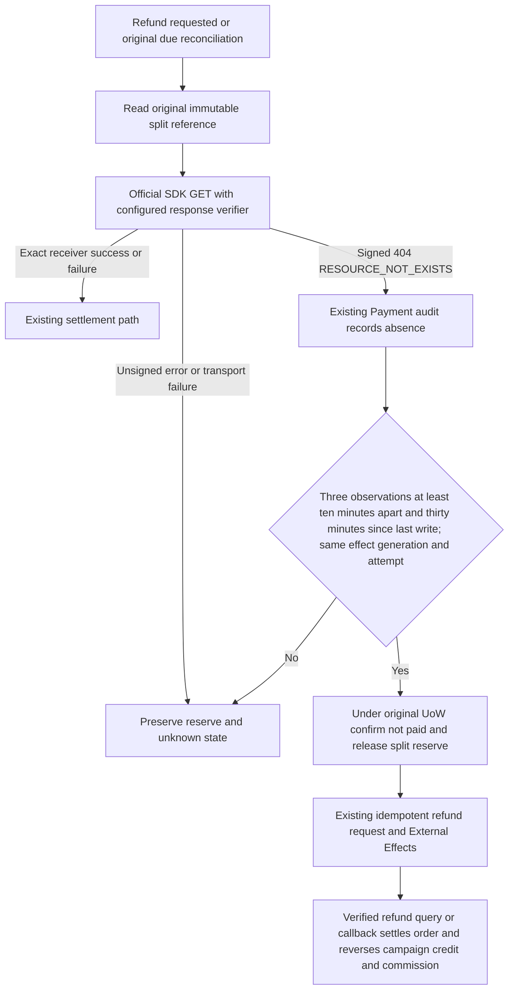

# Missing original profit-sharing order and full refund

User authorized a full RMB 6.80 refund for native order 5626 and related bug fixes. Existing production 7514476 already enforces paid plus one minute for new splits. Its historical instruction 6 remains outcome_unknown with a 204-minor reserve: a signed WeChat GET returned RESOURCE_NOT_EXISTS, while control instruction 5 returned exact receiver SUCCESS. No refund exists. One missing-order query does not authorize a new split or immediate reserve release.



References: official [WeChat FAQ](https://pay.wechatpay.cn/doc/v3/merchant/4014547102) documents three queries ten minutes apart over thirty minutes without intervening writes; [original-order query](https://pay.wechatpay.cn/doc/v3/merchant/4012525210) and [official SDK](https://github.com/wechatpay-apiv3/wechatpay-go/blob/main/core/client.go) show request/query and response verification. The installed SDK v0.2.21 checks HTTP error status before its signature validator, so an error code alone is insufficient evidence. Explicitly verify the original signed 404 with the same configured trust material.

Reuse Payment instruction/reserve/audit, original query maintenance role, existing Distribution due job, normal refund command, existing EER and refund callback/query. Do not create a split retry, new merchant split number, queue, migration, or frontend flow. Three accepted observations span at least twenty minutes, with the last no earlier than thirty minutes after the original effect's last write; intervening non-absence observations reset the sequence. A still running, queued, changed-generation or changed-attempt effect cannot provide absence proof. Final known pre-submit failures also release their retained reserve in the same Payment UoW.

OneID: existing identity/receiver validation through current ports only; no ownership change. Persistence: Payment-owned audit and reserve transition under existing UoW and instruction lock. External Effects: signed Provider reads, followed only by the authorized original refund effect; no split Provider write. No second execution or identity kernel.

Five impacts: query Port adds a verified absence signal; refund may reconcile original split before checking available funds; Payment/provider/store and direct Distribution settlement consumer are affected; existing admin refund page consumes the same API, with no UI edit; targeted tests cover signed/unsigned/tampered 404, spacing, stable attempt/generation, concurrent replay, rollback, known-paid preservation, pending protection, full-refund acceptance and commission reversal. Production verification separately records exact binary, signed absence observations, refund effect, verified WeChat refund result and final order/commission/campaign facts.

Minimum necessary constraint: retain reserve until the official missing-order observation window proves non-payment; this prevents simultaneous split/refund or duplicate money effects. Existing one-minute and idempotency constraints remain. No additional approval. Candidate is committed and pushed from an independent codex worktree, handed to the routed workbench, tested on Linux/PG and installed staging, then same-artifact production. No migration or database backup. Rollback restores the prior application; existing audit facts and truthful released reserves are preserved.

## Authorized operator entry

The production administrator session has expired. Add a one-shot `payment-refund` runtime role restricted to effective OS UID 0 before composition. It uses the same Payment service, funding checks, operation receipt, audit, refund queue and verified query; it introduces no HTTP route, daemon, direct Provider writer or authentication bypass. Normal unauthenticated HTTP refunds remain forbidden. A payment/order mismatch, historical payment, non-WeChat payment, non-paid payment, missing authorization reference or invalid amount fails closed. The root command may report accepted/unknown before the normal worker and verified refund query prove completion.

Run the exact installed binary as root with its existing protected production configuration and the following explicit overrides. Do not print configuration secrets. The one immutable key and authorization reference are reused on every safe replay; never create another key after an unknown result.

```text
AICRM_ROLE=payment-refund
AICRM_PAYMENT_REFUND_ID=1244
AICRM_PAYMENT_REFUND_ORDER_ID=5626
AICRM_PAYMENT_REFUND_AMOUNT_MINOR=680
AICRM_PAYMENT_REFUND_KEY=order-5626-full-refund-680-20261010-v1
AICRM_PAYMENT_REFUND_AUTHORIZATION=user:01a12520-cccb-7bf3-8995-76a0f2c30782:refund-680
```

The user additionally supplied WeChat transaction `4500000511202610107247146771`. Production read-only mapping confirmed payment 1244 / native order 5626 / amount 680. Before the command, independently repeat that mapping and verify absence observations and released reserve. The original `profit-sharing-reconcile` role with instruction ID 6 can collect real-time signed absence observations; do not backdate receipts. After acceptance, read the same refund receipt, normal worker result, signed WeChat refund query, order refunded amount, commission cancellation and paid-referral reversal. No further split write is authorized for order 5626.
