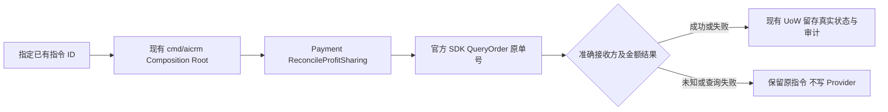

# 原分账指令查询维护入口

复用本批付费裂变父 brief；用户已授权修复、上线和核实未分账订单。本增量只查询准确已存在的 Payment 分账指令，不新建/重发 Provider 写入。

参考：微信官方 [Go SDK QueryOrder 示例](https://github.com/wechatpay-apiv3/wechatpay-go/blob/main/services/profitsharing/api_orders_example_test.go)、[查询分账合同](https://pay.wechatpay.cn/doc/v3/merchant/4012525210)。仓内复用 `RolePaymentReconcile` 的一次性入口、现有 `paymentDistribution` Port 和 Payment 服务；不新建执行系统。

OneID：不解析/新增身份，原指令服务校核已有接收方。持久化：沿 Payment 原 UoW 审计与状态提交。外部效果：Provider 读取，不提交分账、支付、退款或接收方写入。

五项影响：新增运维 role/env 合同；业务状态仍由原 Payment 查询服务判断；直接关联 Config/Composition/Payment；无 UI；验证显式正整数参数及隔离 PG composition，不启动 HTTP/worker、不登记 daemon。最小新增限制为必须指定已有指令 ID，依据是禁止不定范围资金查询/恢复；Provider 原单验证沿已有边界。

接受结果只输出原指令 ID、状态、是否已知及接收方成功标志、准确版本。查询失败不得输出 SDK 原始 error（可能含 Header/账号）；保留状态并报告失败。下游 Distribution 原 due job负责账本同步。与主候选同包安装；无需迁移数据库，兼容回退到上一完整包。真实 Provider 结果与测试证据分别记录。
