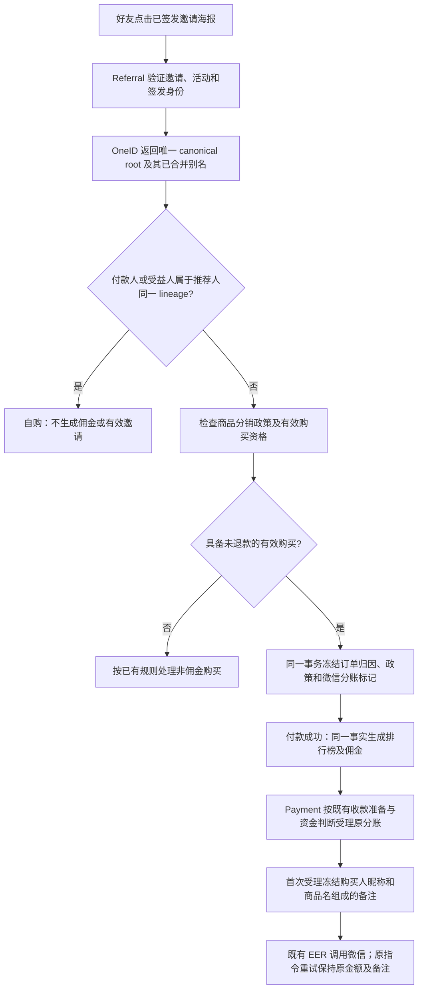

# 付费裂变：同一客户的分销归因与分账备注

## 生产事实与目标

生产订单 5629（商户单号 `v3pay_SV2GJLB2UDKLIDTESVNCGWMKCA`）在 2026-10-10 21:33:49 付款 680 分。邀请 11 的推荐人公开编号 1012934，付款人公开编号 1016168；活动 5 / 商品 72 开启 30% 佣金。推荐人此前订单 5626 全退，但订单 5628 在 21:30:49 重新付款且没有退款，因此重新具备购买资格。Referral 冻结推荐人并计入排行榜；Distribution 没有冻结归因，Payment 下单分账标记为 false。

根因：OneID 的 `LockedCanonicalLineage` 返回 `[canonical root, merged aliases...]`，不是多个候选主体。推荐人 root 12935 下有已合并 alias 23503，`recordPaidInvitationAttributionWithin` 的 `len(roots) != 1` 错误排除了合法客户。不得改客户合并事实、要求重新注册分销员或修改订单页面标签掩盖缺失。

另一个授权行为：将新分账备注从固定英文改为 `购买人微信昵称 + 购买 + 商品名 + 分账`。例如 `崔晓玲购买裂变商品分账`；支付重试保持首次冻结的备注。

## 业务判断流程

## GitHub 与官方标准参考

- [Supabase 身份模型](https://github.com/supabase/auth/blob/master/internal/models/identity.go)：多种身份归属于一个 `UserID`。这里只复用“主体与身份分离”的判断，不引入其匹配或自动合并规则。
- [Supabase 身份关联 API](https://github.com/supabase/auth/blob/master/internal/api/identity.go)：身份是否属于当前主体与身份数量是不同判断；关联到其他用户必须拒绝。
- [微信官方 Go SDK JSAPI 模型](https://github.com/wechatpay-apiv3/wechatpay-go/blob/main/services/payments/jsapi/models.go)：`SettleInfo.ProfitSharing` 是预支付请求的一部分。
- [微信普通商户分账常见问题](https://pay.wechatpay.cn/doc/v3/merchant/4014547102)：V3 下单未传 `profit_sharing=true` 的订单不支持分账。已付订单 5629 不能通过本地改标记追认微信冻结资金；不生成假分账成功、不自动退款重买或转账。
- [微信官方分账 SDK](https://github.com/wechatpay-apiv3/wechatpay-go/blob/main/docs/profitsharing/OrdersApi.md) / [普通商户请求分账](https://pay.wechatpay.cn/doc/v3/merchant/4012524936)：使用接收方 `description` 字段显示备注，并遵循长度 80 的接口边界。

## 复用与数据边界

OneID：读取现有 `identity/port` 的锁定 canonical lineage 和已验证签发身份。不自建身份匹配、合并、第二个客户 ID；合法别名不会导致资格丢失，自购必须检查整个 lineage。身份 Port 失败、空 lineage 或 root 不符仍按既有安全规则处理。

持久化：订单归因、政策、收款准备及付款后佣金继续由现有领域 Owner 在同一 PostgreSQL UoW 完成。资格检查使用 Order / Payment 的已有 Port，已全退购买不能证明资格，但同一客户另一笔有效购买能够证明资格。

外部效果：继续使用 Payment 的原分账指令及 EER，不新建 Provider writer、队列、重试或对账内核。备注从可信客户展示投影和 Order 已冻结商品名取得，在首次分账受理时由 Payment 冻结；昵称不能改变金额、接收人或身份。原指令重复受理先重放原指令，再读实时展示资料，避免改变原资金请求。备注不进入结构化日志和 EER envelope，只在 Payment 的业务材料中保存；新增字段保持旧指令原英文备注兼容。

限制必要性：删除“lineage 必须只有一个成员”的无依据限制。只保留 canonical root 正确、已验证身份和非自购判断。备注长度仅来自微信接口；超长按 UTF-8 边界显式缩略展示内容并保留 `购买`、`分账` 和双方文本，不以超长备注阻断正常佣金。缺昵称使用 `微信用户`，不替换成手机号或 OpenID。

## 候选与验收

候选 A：修复 canonical lineage 判断。真实 PostgreSQL + Composition Root 重现合法已合并别名时，好友订单仍冻结 30% 佣金及分账标记；同根别名自购不产生佣金；先退款后重新购买仍可分销；拒绝已失效资格和未知身份。保留原邀请、旧分销链接、回滚及幂等合同。验证付款回调重放仅一条佣金 / 一条排行榜 credit。无 UI 或数据库迁移。

候选 B：冻结中文分账备注。验证昵称来自买家、商品来自原订单；SDK 实际请求使用中文备注；首次受理后的改昵称/改商品展示不改变重试备注；中文、emoji、超长与缺昵称兼容；原已创建指令保持原英文。涉及 Payment 自有材料持久化时使用前向兼容迁移，生产迁移前由唯一工作台备份。

五项影响：接口保持兼容；机制为 canonical 主体判断与 Provider 文本材料；直接消费者为 Distribution / Order / Referral / Payment / Customer 展示 Port；现有后台及微信账单输出变化，无页面编码；相关具名用例及最终同包预发旅程、生产独立读回分别记录。局部合成测试不代表真实新订单或微信分账已成功。

发布与回退：候选从现有累计源码继续，推送国内后实际交付唯一路由工作台；已有修复生产授权直接同包晋级。候选 A 可应用回退；候选 B 的新增材料字段前向兼容且不删除旧指令。订单 5629 原始下单与付款事实保留；其微信分账能力不可事后修改，补偿资金动作需用户另行指定具体处理，不能当作技术修复自动执行。
