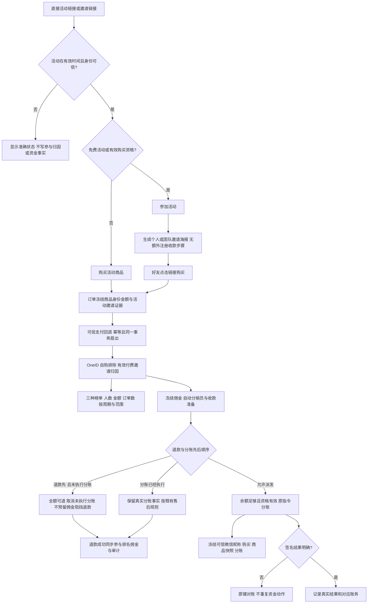

# 裂变、分销与资金链路对抗审计 PRD

授权：原任务 `01a12520-cccb-7bf3-8995-76a0f2c30782` 用户要求先调研、设计测试方案，再全面测试、修复并部署。准确初始 base `970e3e3c9f454fc14abd3115fa6daca41522422f`。复用今天已批准的业务规则；此 brief 同时覆盖本轮相关缺陷的修复和生产发布，不重复请求批准。

## 业务判断流程

## 参考及采用方式

- [OWASP WSTG Business Logic](https://wstg.owasp.org/v4.2/4-Web_Application_Security_Testing/10-Business_Logic_Testing/) 与 [流程时序](https://wstg.owasp.org/v4.2/4-Web_Application_Security_Testing/10-Business_Logic_Testing/04-Test_for_Process_Timing/)：以业务不变量、伪造、绕过、并发与重放设计攻击，不能只看 HTTP 状态。
- [Go 官方 fuzzing](https://go.dev/doc/security/fuzz/)：对确定性 token/金额/文本边界运行覆盖引导模糊测试，保存失败输入为回归种子；相关 race 检查用于进程内共享状态，不替代数据库并发证明。
- [PostgreSQL 16 隔离](https://www.postgresql.org/docs/16/transaction-iso.html)：以真实双连接和明确 barrier 验证行锁、重读和原子回滚，不用 mock 证明事务正确。
- [Playwright API 测试](https://playwright.dev/docs/api-testing)：浏览器操作后检查 API 和数据库最终状态，隔离上下文，不把页面按钮点击视为完成。本仓已有 Chromium/CDP 旅程，优先复用而不新建框架。
- [微信退款规则](https://pay.wechatpay.cn/doc/v3/merchant/4013071001)、本仓绑定的微信官方 Go SDK：未分账可直接退款；签名、原指令查询和 Provider 错误分类沿用真实合同。官方 SDK 请求由隔离 transport 接收，禁止测试真实资金写入。

## 分类与复用

OneID：涉及 canonical customer、可信渠道身份、合并前后主体和自购排除；只用现有 Identity Port、真实 OneID merge/provision 旅程。持久化：业务状态/幂等/audit/outbox/EER 必须在同一 PG UoW。外部效果：涉及支付、退款、接收方准备与分账的 Provider 写入；复用 payment 与 EER/jobqueue，不增加执行内核。生产只读核验已退款 5626、正常对照及历史未标记分账 5629，不重复退款，也不为历史订单制造新分账。

不涉及新增业务限制。发现需要更改限制时先用核心 skill 必要性判断并记录依据。UI 编码前使用 Product Design；本轮先审计现有 UI 和测试。

## 测试矩阵与不变量

| 领域 | 正常与兼容路径 | 对抗和故障路径 | 证据方式 |
| --- | --- | --- | --- |
| 活动生命周期 | 免费/购买资格；draft/active/disabled/ended；开始、结束边界；迟到支付 | 活动跨界、失效后接受、状态 CAS 冲突、陈旧资格 | domain/app/HTTP + PG |
| 参与与海报 | 购买并参加即可邀请；直接链接；个人/队长/队员；三张海报及配套文案 | 匿名或他人身份、CSRF、重复参加、缺海报、图片失败/空结果；不得要求手动分销注册 | HTTP + JS + Chromium |
| 邀请与归因 | H5/小程序；RFI/历史 DPC；普通和分销商品；原商品快照 | token 修改/过期/跨活动/跨团队/错 scope；自购的 buyer/beneficiary 别名；错误 RFI 不降级旧归因 | token tests + fuzz + composed PG |
| OneID | 合并前邀请、邀请后合并、支付后合并、别名资格与再购买 | 重复参与、跨根猜测、合并后自购、退休身份、两个真实历史记录歧义 | genuine merge PG +拒绝不写断言 |
| 三种排名 | invites/sales_amount/sales_orders；历史 sales/all；个人/团队/队内；日/周/总 | 同人多单、别名、跨队重复、部分/全退、乱序回调、午夜周界、稳定分页 | PG 与独立期望模型 |
| 佣金与资格 | 比例、等待期、最后一次有效购买与退款再买；自动准备 | 禁用政策、错误冻结证据、退款金额边界、重复事件、资格撤销与已到账保留 | distribution 全相关包 + PG |
| 退款与分账 | 未分账全退、部分退、已分账售后、余额保护 | refund vs enqueue/claim/material/finish；未知结果；原键重放；回滚故障注入；多笔退款 | payment PG + barrier + scoped race |
| 分账备注 | 可信 OAuth 微信昵称+购买+原商品名+分账；缺失用微信用户；历史兼容 | 手工名字/企微更新污染、UTF8/控制符/超长 emoji、重试后名称改变、摘要篡改 | customer PG + compose + fuzz + signed SDK transport |
| 管理后台/只读 | 订单、佣金、售后、资格、警告、导出及稳定分页 | 非 root 越权退款、缺 CSRF、订单来源碰撞、脱敏、错误 Provider 诊断 | HTTP + PG + Chromium |
| 可靠性 | 重启重放、过期 lease/fence、原指令对账 | 双并发、接受后进程失败、错误签名/金额/接收人、404 与暂时错误、取消和旧 worker | existing EER/payment 合同与直接消费者 |

先运行所有 referral/distribution 包和相关 payment 包、customer nickname 及 cmd/aicrm 具名旅程，统计实际 pass/fail/skip；不会运行无关全仓回归。再基于代码覆盖和缺陷假设补模型/性质/模糊、并发/失败注入及浏览器场景。失败保留复现和精简输入，修复后重跑受影响合同；已通过输入未变化的结果可复用。评估相关 Provider SDK/认证依赖已知漏洞时，只审查当前链路的可达结果。

## 环境和完成标准

本地 PostgreSQL 16 只用 loopback `aicrm_test_*` 隔离库及 disposable journey databases；Provider transport 为 loopback/.invalid 合成，浏览器合成账户，不启动真实支付 worker。生产只读 `/readyz`、相关 public API 与选中订单/迁移/worker 数值状态。

交付 audit 清单、实际测试结果、缺陷复现/修复、准确 head/tree 与未验证项。部署交给路由唯一工作台，Linux 相关测试、同一最终包预发旅程、同包生产和独立读回。无运行时变化只推进源码，不为测试文件重装应用。真实新单微信到账和微信端备注展示单列，合成测试不冒称真实成功。此轮不修改旧订单资金事实、不新增补偿/重新支付。

五项影响：外部合同保持已授权购买邀请、三榜和退款优先规则；业务机制审查身份/冻结/事务/重放并仅修复复现缺陷；关联模块 referral/distribution/order/payment/identity/customer/EER 及直接 composition；页面以现有活动、分销、订单后台为直接消费者；验证以领域/PG/HTTP/浏览器/Provider 合同和安装包读回分别记账。运行时修复按独立行为提交，测试与行为一起交付。

## 本轮确认的缺陷与修复设计

1. 支付后 OneID 合并仍按历史 customer ID 分榜，同一买家被计算两次、同一邀请人分成两行，合并后自购仍计入。免费邀请的计数、明细和榜单也没有统一当前主体。通过 Identity Port 在同一 reporting snapshot 解析当前根，对 Referral 自有事实作只读投影，按当前买家去重、聚合邀请人并排除自购。只读榜单复用现有 Repeatable Read UoW；可信会话校验需要 `FOR SHARE`，仍保留正常事务。封榜的奖励名单也必须复用当前根、去重和自购排除；已有封榜快照不改写，原始事件 watermark 继续包含被统计排除的事实。封榜单独使用平台 PostgreSQL 的可写 Repeatable Read UoW，将快照、状态、收据、审计和 Outbox 原子提交；其余命令事务保持原语义。第二连接在快照建立后提交的合法邀请不进入本次封榜，重放不能改写原快照。原邀请、订单、归因、佣金和退款事实不改写。Identity 每批 500 个输入为已有 Port 合同；分批处理，不限制活动人数。
2. RFI/DPC 解码校验接受了含换行、实际只有 31 字节的畸形凭证。按照已有签发合同要求解码后恰为 SHA-256 的 32 字节，不增加用户资格或有效凭证限制。模糊失败输入成为永久回归种子；拒绝输入不得产生归因或资金效果。
3. Product Design 实际生产匿名付费活动审计：`/referral?campaign=5` 的微信登录状态错误承诺“活动不要求购买商品”。公共配置与私有状态并行读取遇到 401 时走通用提示，无法证明免费资格。改成中性、准确的微信登录后查看规则并参加活动文案，保留无需额外注册分销员或收款准备的承诺及 OAuth 返回路由。布局、组件与海报视觉复用当前页面。实际 before 图见仓外证据 `screenshots/01-production-anonymous-paid-activity-before.png`；最终包/生产 after 再独立捕获。
4. 两项验证缺口：分账退款组合 fixture 未应用已存在的 0233 备注迁移；新建商品浏览器脚本仍操作页面已移除的库存字段，且仅凭旧页面政策节点就继续。修复 isolated fixture 与当前字段/目标 URL 就绪条件，保留真实保存、服务端政策版本读回和单次 Product 命令断言。不恢复已移除的库存 UI。

## 实际安全扫描与补丁范围

`govulncheck` symbol 扫描先覆盖 referral/distribution/payment，随后覆盖实际 Composition Root。发现 Go 1.26.6 标准 HTTP/TLS 已知漏洞及实际应用依赖告警；采用 [Go 1.26.9 官方同系列补丁](https://go.dev/doc/devel/release#go1.26.9)、[GMSM 官方安全修复](https://github.com/emmansun/gmsm/security/advisories/GHSA-5xxp-2vrj-x855)、[Excelize 官方修复](https://github.com/qax-os/excelize/security/advisories/GHSA-h69g-9hx6-f3v4)及 Go 漏洞库列出的依赖修复版本，不更换框架。候选 minimum Go、`.tool-versions` 与测试环境版本检查保持一致；唯一工作台负责准备对应编译版本与同包发布，本开发任务不修改共享机器发布配置。

安全补丁后的相关领域、真实 PG、SDK 验签/退款、浏览器及 XLSX 直接消费者合同重新执行。扫描需同时报告 module/package/symbol 可达性；未维护的 `x/crypto/openpgp` 模块告警必须核实是否实际导入，不能把仅模块告警称为已被攻击或为消除数字添加无关代码。

## 证据与实际边界

仓外证据根：`/Users/qianlan/Documents/Codex/2026-10-10/referral-distribution-adversarial-audit/`。保留最初失败、环境修复、行为修复及最终准确源码的收据。初始化时未装 jsdom、缺浏览器必需参数、PG extension DDL 并行冲突属于环境失败，初次 skip/空匹配均不计通过；后续用具名有效执行补齐。

新增独立期望模型覆盖 605 笔合成订单、跨 OneID 输入批次、两队、别名买家/邀请人、部分全额退款、当前自购、三个指标及旧 `sales`、日周总及旧 `all`、翻页和缺根拒绝。真实 OneID merge/撤销、可信会话与不可变历史断言仍由 Composition 旅程证明，不用 fixture map 冒充真实身份合并。

四个 fuzz target 各运行 30 秒、2 workers；这些是有限覆盖引导测试，不能证明穷尽全部输入。无 Provider 真实资金写入；生产既有选中订单在部署前后读取并比较。真实新单微信备注、用户端实际海报长按保存及微信扫码仍属于现场业务观察，不由合成浏览器代替。

## 发布复核补充：我的邀请明细快照

唯一工作台复核指出 `ListMyInvites` 的身份批次与邀请事实仍使用默认 Read Committed。新增真实双连接 PG 复现：605 条同一买家历史别名的冻结事实，Identity Port 第一批读取后，另一连接提交合并为邀请人的根；原实现只保留第一批 499 条（339320 分），而同一读取快照应为全部 605 条（411400 分），下一独立快照才全部排除为自购。测试 Adapter 明确模拟 Identity Port 的 PG 版本标记，不冒充真实 OneID；真实可信会话与 `FOR SHARE` 仍由 Composition genuine merge/OAuth 旅程验证。

`MyCampaign` 的身份/参与状态和 `ListMyInvites` 复用已新增的可写 Repeatable Read UoW：允许可信身份校验的 `FOR SHARE`，在一份读取快照中解析所有批次和邀请事实。只读榜单仍用原 read-only RR，封榜仍同事务写快照与收据，不增加队列或身份主键。原四个未发布候选按原队首顺序重提修复后的累计成员；授权继承，生产保持原版本直到相关验证完成。
