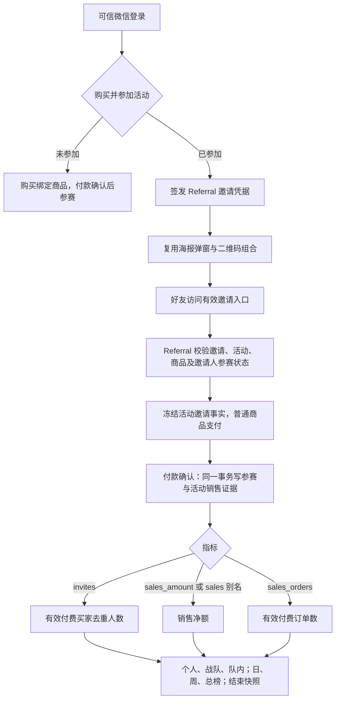

# 付费参赛海报与三种排行修复

授权：用户要求购买参赛即可邀请，不要求分销注册/收款；付费邀请人数榜按有效付款人数统计，三种排行兼容；测试通过后部署生产。base 为国内 main 73b8669dbf7357102d0fc4569811acbce9a829c9。

OneID：复用可信微信会话和 Identity Port，邀请归属由服务端签发/冻结，不增加客户主键、隐式建客或自动合并。Persistence：复用 Referral 邀请、checkout、销售事件，均参与已有 PostgreSQL UoW；无新表/迁移/队列。External Effects：不新增 Provider 写；普通邀请不制造佣金，原 Distribution 入口与财务校验保留。不涉及新增限制。

公开合同：海报改用 /invite；付费邀请凭据作为已存在的活动 cookie 被 Payment 传递给 Order/Referral，仅拥有者解引用，不接受前端客户/活动归属声明。旧 /promotion-link、签名活动推广与 rpa_ context 保留。有效邀请拒绝过期、撤销、错商品、自购成绩；付款回放不得重复记分。无有效 inviter 时保留普通购买语义。

三种成绩：人数为窗口内有效付费买家 distinct（重复订单一人）；金额为剩余净金额；订单为仍有有效净额的订单。部分退款保留人数/订单、减少金额；全退款撤销相应订单，买家其他有效订单仍保留人数。免费活动保留邀请积分。日/周/总 period 别名、sales 别名及现有范围兼容；实时榜和结束快照使用相同口径。

五项影响：公开邀请/支付活动 cookie 和排行输出；业务仅活动非财务归因与只读排名；直接模块 Referral、Payment HTTP、现有 Order paid fanout；H5 保留原布局/海报与二维码组件；验证拒绝/重放/退款/去重/三指标三范围周期与结束快照，以及无分销身份完整付款旅程。局部测试不称全仓回归。

Product Design：使用本次目录中的 index、image-to-code、user-context preflight 与 design-qa；选定视觉目标为用户截图及现有 referralCenter/referral.css。沿用活动页、海报弹窗、composeReferralPoster、parsePosterQRLayout、copyPlainText，不生成新资产/模板/独立原型；用户要求真实生产修复。需要浏览器验证 360px 页面、邀请海报打开/关闭/再次打开、排行展示和控制台，形成 design-qa.md。

参考：[ReferralCandy 官方 affiliate 机制](https://www.referralcandy.com/affiliate-marketing/) 的购买/退款核验与 [OWASP REST 错误语义](https://cheatsheetseries.owasp.org/cheatsheets/REST_Security_Cheat_Sheet.html)。复用本仓邀请签发和不可变付款事件，不引入第三方排行或其他队列。

验收与发布：相关真实 PG/Go/浏览器合同通过后，准确候选推送国内，再读唯一路由实际交付工作台。用户本轮生产授权覆盖这两项及关联兼容修复，不二次询问。工作台使用现有队列/锁，同一最终包预发及生产；无迁移无需数据库备份。真实微信支付/手机扫码不由合成旅程代替。回退为上一完整应用包，新增数据继续兼容原表。
