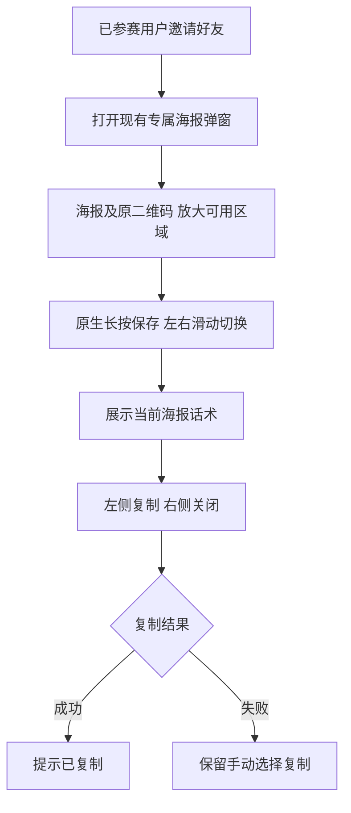

# 裂变海报弹窗精简及分账诊断

授权：用户本轮截图和逐项 UI 指令；复用已批准海报 brief。base aed5b78f6c4fc2d0bf5b6f913250b0fd40798849。

删除可见标题、文件名及下载按钮；保留隐藏的弹窗可访问名称、保存提示、话术与手动复制反馈。复制和关闭放同一行等宽，沿用橙色主按钮及浅色次按钮。空话术隐藏复制，关闭仍可用；切换不得显示上张图片或复制旧话术，保留原生长按和纵向滚动。海报限制从45vh增至60vh，保持完整比例，不裁切二维码；小屏弹窗可滚动。

Product Design：读取 index/user-context/image-to-code/design-qa，preflight 完成；用户截图及现有 referralCenter/referral.css 是指定视觉目标，在原 V4 生产组件做局部修改，不初始化新原型。复用 composeReferralPoster、copyPlainText 和原邀请签发。参考 MDN aria-label https://developer.mozilla.org/en-US/docs/Web/Accessibility/ARIA/Reference/Attributes/aria-label 。没有新素材或新增限制。

OneID 不涉及：本候选仅排版及本地复制，沿用已有可信会话及归因。Persistence：无新持久化。External Effects：无 Provider 写入，不修改佣金或重放历史付款。

五项影响：无 HTTP/事件合同变化；无财务机制变化；直接消费者为 referralCenter、referral.css、海报配套话术测试；仅 H5 海报弹窗；选海报测试、活动页测试及安装后资源读回。局部检查不称全仓回归。浏览器检查移动端海报/复制/关闭及空话术关闭；图片失败、迟到响应、复制拒绝继续覆盖现有测试。

生产只读诊断：19:10活动5三个 credit。5625佣金204分已 paid/receiver_succeeded，真实执行一次；5626佣金204分已创建但instruction/effect outcome_unknown，真实调用一次，不重试写；5627使用referral.invitation，佣金0、未注册分销、未带profit_sharing标记。现有30%商品政策不会自动应用到普通活动邀请。微信未带分账标记订单不可事后补标分账（官方FAQ https://pay.wechatpay.cn/doc/v3/merchant/4014547102）。诊断不修改财务历史；若需将所有活动邀请自动纳入佣金，须另定分销资格/收款准备及未来订单路径，不能把已有未标记订单强制重放。

发布：同原队列/锁 Linux 相关检查、最终包一次预发、受影响弹窗/资源验证后已有授权同包生产及独立读回；无迁移不备份数据库。回退前一完整安装包，未知安装只读核对。真实手机长按及微信扫码另列。
