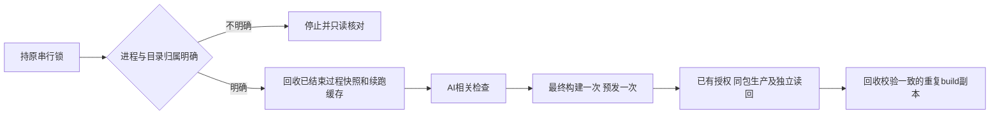

# 发布过程自动清理

## 业务目标与分类

用户授权：每次发布预先清理无用过程缓存，形成极简发布器机制；原应用批次继续完成生产发布。
OneID/客户归属不涉及：只管理本机发布生成物。内部持久任务与外部Provider效果不涉及：复用原发布队列、锁、attempt、安装/检查收据；生产源码游标的更新仍由原控制器执行。不增加任务系统、定时器或发布通道。无UI能力变化。

## 判断流程

## 参考与复用

复用当前V4 `_check_attempt_directory`、check-lifecycle、diagnostics、安装收据和manifest inventory校验，沿用 maintenance-check 准确工具安装路径。2026-10-10 本批存在4份可验证重复构件（约1.45GB）及历史 preparation/continuation 状态，是直接现场案例。
目录删除使用既有标准库，拒绝符号链接与未知生成物；标准库说明 `rmtree` 的目标不能是目录符号链接：[Python shutil 文档](https://docs.python.org/3/library/shutil.html#shutil.rmtree)。不引入新的清理依赖。

## 机制合同

1. 相关检查开始前回收登记的已结束attempt资源、全量校验后的 preparation snapshot 缓存与旧 `*-checkpoint.json`；检查收尾回收当前临时生成物。普通 Go编译/模块缓存和npm依赖下载缓存继续保留。
2. 不注入共享 `AICRM_TEST_PREP_CACHE`；不从旧失败attempt恢复部分lane、command、Go或browser结果。准确候选完整通过的维护收据仍保留并用于同候选工具安装后的发布，不重复执行维护检查。
3. 构件回收仅针对与健康安装收据SHA/tree/manifest绑定、与完整安装包清单一致的重复build目录。保留完整安装/回退包、源码、数据库、配置、诊断、收据和包元数据；当前pending构件与未知进程资源保留。
4. 状态/身份/数据库归属不明停止后续写操作并只读核对；已完成业务断言或安装后的普通临时删除失败记录warning，不改成业务失败、不盲目重装。
5. 用户授权的source-only更新通过原队列和原锁安装，业务应用保持已部署的f6538bd构件，不再次构建或安装。

## 验证与非目标

准确短清单见 `docs/release-checks.json`：7项直接Python合同，经现有unittest发现/结果收据验证；加工具语法、help、配置与原锁排他检查。没有全仓回归、DB迁移、真实Provider调用或页面回归。

实际路径修复：源码累计构件位于配置的 `work_root/builds`（当前 `domestic/control/work/builds`），自动回收使用该真实生产者路径；旧实现从 releases 同级推断路径，漏掉已完成重复副本。继承本PRD分类与流程，无OneID、UI、Provider、数据库或应用变更。相关具名合同在真实路径布局中验证完整安装/回退包和metadata保留、pending/changed/unknown保护以及删除失败warning；只运行这一项维护合同，不重复应用构建。
