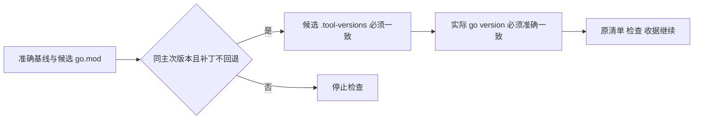

# 发布检查的 Go 同系列补丁升级

复用裂变分销对抗审计父 PRD。当前最终候选 go.mod/.tool-versions 要求 1.26.9，可信基线检查器硬编码 1.26.6，因此正常检查会拒绝已核验的新编译器。这是环境版本判断修复，不改业务或收据接受条件。

参考 [Go 官方 Toolchains](https://go.dev/doc/toolchain)：实际工具版本会随 go.mod 改变；最低 Go 声明与实际编译版本需分别核验。继续复用原 trusted runner，只调整 Go 的必要环境版本，不加载候选执行策略、不更换发布通道。无 OneID、持久业务任务或 Provider 效果；只有原锁内固定工具维护及版本检查。生产发布仍独立核对最终二进制 go version -m。

验证升级 1.26.6 到 1.26.9、错误实际工具、声明不一致、降级及跨主次版本拒绝；原 runner 参数传递及生成语法合同。旧通过成员结果不重跑；仅环境失败队首按已有 maintenance-check/batch-tool-repair 恢复并保留收据。
