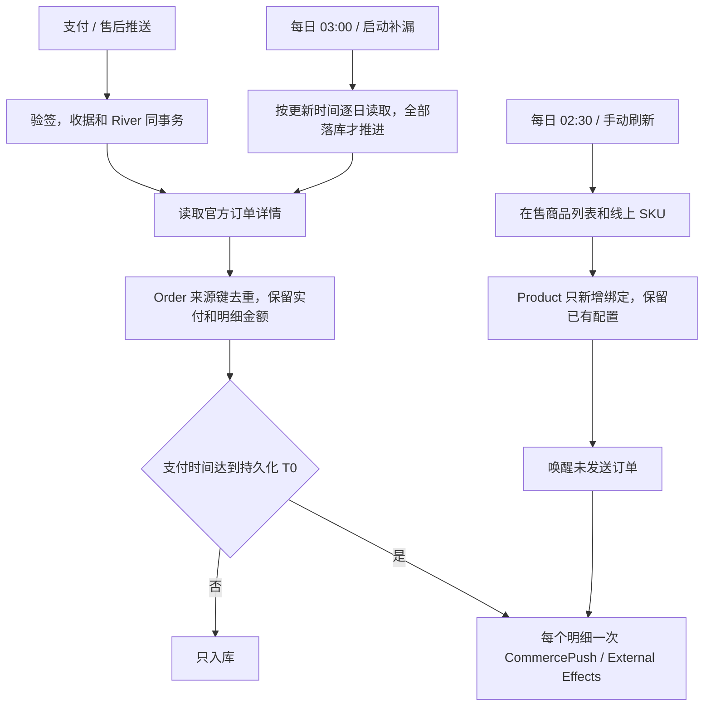

# 微信小店接入（已授权父 PRD）

当前国内基线：0fe8bbcc3ee27d5dbb6aae0a4e4cc24e40a1dcca。商品、订单两个行为分别连同测试交付。

分类：涉及 Provider 验证的外部身份，使用现有 OneID 的 App scope 解析；无唯一证据保留空客户，不建客。涉及内部持久任务、Provider 读取和外推写入；任务使用 River，Product / Order 各自拥有其表，外推由 Outbound / External Effects 接受。收据、业务事实、审计和队列在同一 PostgreSQL UoW；网络读取在事务外。

规则：商品每个 SKU 一个 CRM 商品，只开放基础信息和外推，后台也拒绝分销、本地结账。每天完整读取线上 SKU，只新增，不覆盖、不联动下架。订单按 update_time_range 逐日补漏，每个不可变明细只发一次，数量不增加次数。T0 前只入库。缺手机号、账号、客户仍发送空值；首次发送前全额退款仍依支付事实发送。退款金额和状态同步，权益人工处理。外部实付 / 明细金额与原生校验分开。商品导入和外推配置保存唤醒未接受订单，已接受及结果不明的发送沿用原键。

成熟参考：[微信商品列表](https://developers.weixin.qq.com/doc/store/shop/API/channels-shop-product/shop/api_getproductlist.html)、[线上商品详情](https://developers.weixin.qq.com/doc/store/shop/API/channels-shop-product/shop/api_getproduct.html)、[订单列表](https://developers.weixin.qq.com/doc/store/shop/API/channels-shop-order/api_getorderlist.html)、[订单详情](https://developers.weixin.qq.com/doc/store/shop/API/channels-shop-order/api_getorder.html)、[支付通知](https://developers.weixin.qq.com/doc/store/shop/notify/order_callback/channels_ec_order_pay.html)、[WxJava](https://github.com/binarywang/WxJava)、[River](https://riverqueue.com/docs/periodic-jobs)。复用 V4 Adapter，不引入第二 SDK、队列或定时器。每日任务采用 River PeriodicJob 加持久化进度，启动后补漏。日常不扫描全部历史，指定窗口复用同一读取入口，最大 7 天。

UI：Product Design 已读取现有生产商品列表 / 编辑页作为视觉目标；沿用同一顶栏按钮、状态提示和编辑维度，微信小店只显示基本信息和外推。新增管理员刷新提交 / 状态接口，沿用商品编辑权限和 CSRF。

验收：并发刷新、重试、新 SKU、分页失败、保留本地修改；推送和补拉并发、重复明细 / 多数量、大整数、优惠 / 运费、退款先到、缺字段、待绑定 / 待配置恢复；逐日边界、停机补漏、详情失败不推进；错误签名和 App scope、事务回滚、未知外推结果不得换键；本地售卖 / 分销拒绝。生产安装与接收方实际开通分别验收。凭据仅进入受保护生产配置，不进入源码或报告。

实现补充：现有 `history` 来源订单保留查询，不转换成激活候选。订单明细快照保持不可变；商品后到时仅通过来源绑定补充外推意图。SKU 名称组合标题与规格，超出 Product 既有 200 字节合同按 UTF-8 边界截短，来源 ID 不截短。未付款 / 尚未扣款的先用后付 / 积分与抽奖事实不构造支付成功。正式启用和独立验收操作见 [运行说明](../operations/wechat-shop.md)。
