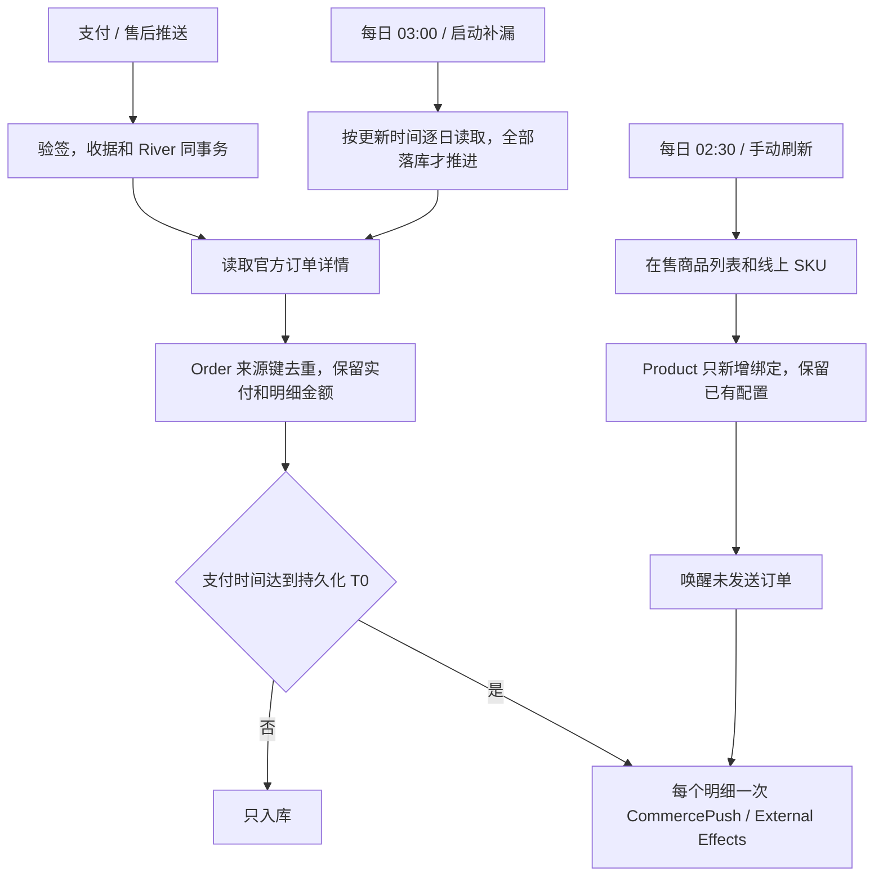
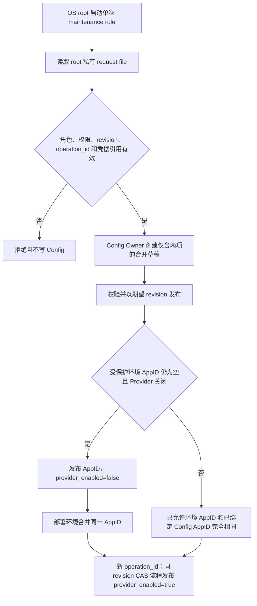

# 微信小店接入（已授权父 PRD）

当前国内基线：0fe8bbcc3ee27d5dbb6aae0a4e4cc24e40a1dcca。商品、订单两个行为分别连同测试交付。

分类：涉及 Provider 验证的外部身份，使用现有 OneID 的 App scope 解析；无唯一证据保留空客户，不建客。涉及内部持久任务、Provider 读取和外推写入；任务使用 River，Product / Order 各自拥有其表，外推由 Outbound / External Effects 接受。收据、业务事实、审计和队列在同一 PostgreSQL UoW；网络读取在事务外。

规则：商品每个 SKU 一个 CRM 商品，只开放基础信息和外推，后台也拒绝分销、本地结账。每天完整读取线上 SKU，只新增，不覆盖、不联动下架。订单按 update_time_range 逐日补漏，每个不可变明细只发一次，数量不增加次数。T0 前只入库。缺手机号、账号、客户仍发送空值；首次发送前全额退款仍依支付事实发送。退款金额和状态同步，权益人工处理。外部实付 / 明细金额与原生校验分开。商品导入和外推配置保存唤醒未接受订单，已接受及结果不明的发送沿用原键。

成熟参考：[微信商品列表](https://developers.weixin.qq.com/doc/store/shop/API/channels-shop-product/shop/api_getproductlist.html)、[线上商品详情](https://developers.weixin.qq.com/doc/store/shop/API/channels-shop-product/shop/api_getproduct.html)、[订单列表](https://developers.weixin.qq.com/doc/store/shop/API/channels-shop-order/api_getorderlist.html)、[订单详情](https://developers.weixin.qq.com/doc/store/shop/API/channels-shop-order/api_getorder.html)、[支付通知](https://developers.weixin.qq.com/doc/store/shop/notify/order_callback/channels_ec_order_pay.html)、[WxJava](https://github.com/binarywang/WxJava)、[River](https://riverqueue.com/docs/periodic-jobs)。复用 V4 Adapter，不引入第二 SDK、队列或定时器。每日任务采用 River PeriodicJob 加持久化进度，启动后补漏。日常不扫描全部历史，指定窗口复用同一读取入口，最大 7 天。

UI：Product Design 已读取现有生产商品列表 / 编辑页作为视觉目标；沿用同一顶栏按钮、状态提示和编辑维度，微信小店只显示基本信息和外推。新增管理员刷新提交 / 状态接口，沿用商品编辑权限和 CSRF。

验收：并发刷新、重试、新 SKU、分页失败、保留本地修改；推送和补拉并发、重复明细 / 多数量、大整数、优惠 / 运费、退款先到、缺字段、待绑定 / 待配置恢复；逐日边界、停机补漏、详情失败不推进；错误签名和 App scope、事务回滚、未知外推结果不得换键；本地售卖 / 分销拒绝。生产安装与接收方实际开通分别验收。凭据仅进入受保护生产配置，不进入源码或报告。

实现补充：现有 `history` 来源订单保留查询，不转换成激活候选。订单明细快照保持不可变；商品后到时仅通过来源绑定补充外推意图。SKU 名称组合标题与规格，超出 Product 既有 200 字节合同按 UTF-8 边界截短，来源 ID 不截短。未付款 / 尚未扣款的先用后付 / 积分与抽奖事实不构造支付成功。正式启用和独立验收操作见 [运行说明](../operations/wechat-shop.md)。

## 运行时配置维护入口（2026-10-11 运维补充）

目标：在没有后台界面的生产故障恢复中，用 OS root 身份调用现有 Config Owner 正常绑定小店 AppID 并发布 Provider 开关。只支持 `wechat_shop.app_id` 与 `wechat_shop.provider_enabled`；请求带期望基线 revision 和稳定 `operation_id`，Owner 保留原子事务、校验、发布、幂等收据、审计和 Outbox。完整配置快照必须保留其他现有值。

首次绑定分为两次发布：受保护环境中的三个小店凭据已存在且 Provider 保持关闭时，先发布请求 AppID、`provider_enabled=false`；随后把完全相同的 AppID 加入受保护环境，再基于新 revision 发布 `provider_enabled=true`。原有非空 AppID 只能原值重放，不能借此入口重绑。请求 AppID 来自受保护 root-owned `0600` 文件；Secret 仅以既有环境引用存在性参加 Owner 校验，值不进入 Config、审计或命令输出。

复用与参考：入口通过 `internal/config/app.RuntimeReleaseService` 与其 PostgreSQL repository / Unit of Work 完成 draft、validate、publish 和收据，不直写配置表、不构造 HTTP 管理员会话，也不初始化 API、Provider、Worker、River job 或 runtime-application 观测。常规 Composition 仍由 `applyRuntimeConfig` 保留“非空绑定拒绝切换”保护。外部配置系统的校验后发布模式可参考 [AWS AppConfig validators](https://docs.aws.amazon.com/appconfig/latest/userguide/appconfig-creating-configuration-and-profile-validators.html)；本补充只借鉴先校验再发布这一顺序，配置事务、身份保护和审计继续归属 V4 Config Owner。

运维补充：维护角色和常规 Composition 使用同一 Config Owner `ReadAIModelRuntime` 读取既有加密模型设置，在进程内评估当前 AI 生成 guard；不发起模型 Provider 请求，也不输出密钥。若 active Config 已启用 AI 生成但受保护密钥或模型配置不可读，必须在创建 Shop 草稿前拒绝，保留原 AI 开关与 Owner 状态不变。

Provider 故障安全补充：Shop HTTP transport、请求构造和响应体读取错误以固定安全错误返回，不传播可能包含 access token URL 或原始错误内容的 transport/body error。退款请求一旦进入 HTTPDoer，仍标记为已尝试并保持 `outcome_unknown`，不改变原幂等/对账路径。

分类：OneID 不涉及，因为只处理集成 AppID、不关联客户或外部用户；Persistence 为 Config Owner PostgreSQL 本地事务；External Effects 不涉及，maintenance role 不执行 Provider 请求。非 UI 运维入口，不新增页面、API、队列、timer 或发布状态机。

验收：严格拒绝缺字段、`null`、重复/未知字段、尾随 JSON、错误角色、非 root、过期 revision、同 operation ID 不同 payload、缺失凭据引用及 AppID 重绑；同 key 重放返回同一 release 且不复制审计/outbox；两阶段变更仅改变请求的两个设置并保留原非 Shop 值。OS-root 实际候选二进制在隔离 loopback PostgreSQL 上验证；断言没有管理员 session、runtime application 记录或 Provider 调用。Config Owner publish 事务沿用现有 Outbox append 失败回滚合同测试。
