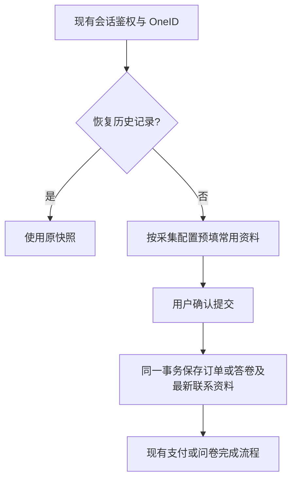

# 客户常用联系资料

获批父方案：本任务 2026-10-12「客户常用联系资料：对抗性审查后的精简方案」。实现基线 7e299faf7ea3ed788d058b5b50cc7596ce90a81c。

参考：WooCommerce `class-wc-checkout.php` 的用户资料预填和提交优先；Saleor checkout/address 的客户地址与交易地址分离。保留一份最新资料为已确认业务裁剪，不引入外部电商引擎。

OneID：读取当前授权客户谱系，不按电话匹配、建客或合并。Persistence：Customer 自有最新电话、整组收货资料；Order/Survey 经 Port 同一 PostgreSQL UoW 更新。External Effects：无新增；源业务原有效果接受保持。

问卷在已有 sidebar_profile_field 配置中明确指定 contact_phone 或 shipping_contact；不猜测其他题目。一个问卷最多一个常用电话来源，防止推荐人等信息误覆盖；普通手机号题不限制数量。收货题携带电话。可选空答案不清空；地址部分输入拒绝；重放不覆盖；手机号更新保留地址；原记录恢复永远不套用最新地址。

接口：扩展受保护结算/问卷会话和侧边栏安全投影；新增可选结构化收货答案，缺省保留旧摘要。历史初始化为一次性 inspect/apply 维护命令，明确版本/题目来源，按组选择最新、仅补空、不触发身份或 Provider。

Product Design：复用已选收货/电话/不采集三张图与现有表单、地区选择、问卷和侧边栏组件，不增加地址管理页面或新视觉体系。预填失败可手填，迟到响应不覆盖用户输入及主动清空。

五项影响：对外增加可选预填字段及收货题；业务增加本地原子写；直接消费者 Customer/Order/Survey/Payment/Sidebar/Product public；页面为现有结算、问卷编辑及填写、侧边栏；验证覆盖权限、重放、并发、回滚、历史快照、旧摘要与前端输入保护。

迁移前向兼容，停止新写并退回旧二进制时保留新表及快照。候选由唯一路由工作台检查/预发；不授权本任务安装共享环境或生产。真实 Provider 验收另列。

实施维护入口：`cmd/migrate-customer-contacts`，默认 `-mode inspect`；`-mode apply` 只补空。`-survey-mapping` 为明确的 `{definition_version_id,question_id,target}` JSON 数组；每个版本最多一个来源，必须属于不可变定义且题型匹配，不能覆盖已经配置的另一来源。未指定旧题按 unmapped 报告。输出只有候选数、补空事务数和跳过原因计数，不输出电话号码、地址或答卷。补空事务数不代表所有组被更新，已有组保持原值。初始化未在真实数据库执行。
