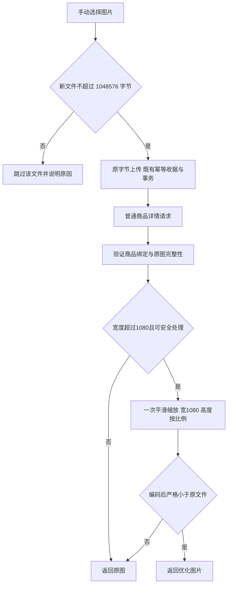

# 商品图片：上传体积与详情展示分开判断

## 业务判断

目标是保持海报可读、减少传输字节。用户确认：所有后台手动图片上传每文件不超过 1 MiB；仅普通商品详情以宽 1080 为优化目标；体积或视觉语义不收益时保留原图。周期商品详情继续原图。历史素材继续可用。

## 对抗性验证与必要性

- 离线沿用现有最近邻与 JPEG quality 90：1200×2500、194332 字节输入缩为 1080×2250 后产生 1298161 字节，约增大 6.7 倍。因此产物必须比原图小，否则回退原图。
- 最近邻对交替单像素细节采样可完全丢失条纹。新变体使用 Go x/image 的 BiLinear；不改其他既有变体。
- 1080×10000 PNG 仅64000字节，RGBA缓冲43200000字节。上传1MiB与既有解码资源预算分开；高度不参与新缩图判断，不删除旧资源防护。
- GIF、JPEG方向/色彩元数据、PNG方向/色彩元数据无法保证视觉语义时直接保留原件，不开发动画转换或自建元数据处理框架。
- 先验证原图权限与完整性；损坏和未授权不得通过优化回退掩盖。
- 单文件限制不引入整批拒绝；合规文件保持顺序上传，已成功记录和失败重试键保留。

## 最小实现

- Media新增 `web_1080` 读取变体，Product普通详情单独使用，分享卡片等既有直接消费者维持其合同；缓存与ETag复用。
- 手动上传新接受统一1MiB，Media普通创建与Excel封面复用Port常量/错误。multipart、JSON/base64、原始封面覆盖。旧同键同载荷完成收据仍重放，未知超限命令回滚且不接受外部效果。
- 前端复用Product Design已检查的当前截图、V4 adapter、既有错误反馈，仅改1MB文案和文件检查。不修改冻结donor，不新建设置、队列、转换任务、动态配置或迁移。
- 超限使用HTTP413与各入口既有错误结构，不新增全局错误体系。

## 分类与五项影响

OneID不涉及（资源与商品）。Persistence沿用Media本地事务与收据；不迁移。External Effects不新增；正常上传既有素材准备不改。

对外合同：新增变体及新上传大小规则；业务机制：只影响新接受与只读优化；关联模块：Media/Product/Excel封面桥与直接前端上传消费者；页面：普通/周期商品、素材库、雷达和封面入口；验证：相关Go/Node与隔离PG收据，生产由唯一路由工作台完成。

## 验收

- 宽1079/1080/1081、超高竖图、超宽图、产物膨胀/等大/错误、GIF与元数据回退、透明PNG；回退字节和ETag一致。
- 1MiB前后边界、multipart与JSON及封面入口、同键重放/载荷漂移、超限零持久化和零效果接受、旧大图可读。
- 混合选图仅跳过大文件，保存顺序、忙态恢复、重复/部分失败重试和切商品后的迟到响应。
- 普通详情的新URL、分享封面合同、周期详情原图、商品绑定拒绝。

参考：[Go缩放实现](https://pkg.go.dev/golang.org/x/image/draw)、[File字节大小](https://developer.mozilla.org/en-US/docs/Web/API/Blob/size)、[浏览器图片懒加载](https://web.dev/articles/browser-level-image-lazy-loading)。上线可回退上一应用包，无数据转换；当前未获生产安装授权。

## 验证范围与发布读回

本机已通过相关具名单元、Media HTTP/真实 PostgreSQL、Excel HTTP Composition 与前端交互检查。额外覆盖16位PNG保留原件、Excel原始图片1MiB及旧2MiB读入边界、雷达图片超限零请求以及PDF继续进入原有上传路径。Go1.26.9、Node24.18.0、npm11.12.1、PostgreSQL16.13。

Mac Chromium采用隔离合成数据库诊断；当前后台原生输入为单选，验证普通和周期商品超限后重新选择有效图片、后台原图保存及顺序读回；多文件兼容路径由前端交互用例覆盖。它不等同Linux及安装包验收。完整Product HTTP包的推广上下文测试失败，在恢复基线相关实现后仍复现；该无关失败未纳入本次修复，相关图片具名用例通过。

顾客详情Chromium亦通过：同一640×2200海报在普通详情通过web_1080实际解码仍为640×2200，周期详情通过original同样保留尺寸，验证高度不会触发新优化。后台1280/1440与顾客375/390/430截图已在仓外收据目录保存并查看。

清单只选择直接图片消费者。工作台确认阶段收据使用 `product-image-delivery`，沿用原 InstalledProduct 与受保护 stage-evidence 流程；复用已有 Product 浏览器旅程，不新增发布runner。详见[安装包验收路径](../development-evidence/2026-10-12-product-image-installed.md)。源码浏览器不重复构建/冒称最终包；Linux最终包、生产和真实顾客观察尚未验证。

## 本批接续与跨成员边界

本成员最终从工作台确认已实际累计的海报 `7e299faf7ea3ed788d058b5b50cc7596ce90a81c` 接续，保留海报成员及0237/0238/0239/0240，无新迁移，OneID/Payment/UI前成员行为不改变。a3db零元B基线上的直接用例、附件1db基线上的图片与安装模式诊断证据保留；旧82ead82与db6eb9a候选ref保留审计。最后接续仅清单冲突，图片业务/SQL/测试实现保持同字节，有效收据复用。

问卷附件规则独立：有效文件严格小于2MiB，由Survey调用Media PrivateImageStorage稳定Port并参加调用方UoW；1MiB只应用后台手动素材的新接受。未降低共享Inspect的10MiB、尺寸和像素解码防护。新增直接PG合同用一个无尾部填充、有效且接近2MiB的PNG完成问卷保存/原件读回/同键重放；同一文件在后台手动素材创建被拒绝，私有图片不进入公开素材库。既有大图片完成收据重放继续覆盖。

已从工作台当前批次文件核对人类授权：各项完成后进入预发、审核后停留；全部完成且获得新的集中授权前，生产不得晋级。本开发任务不安装共享环境。
