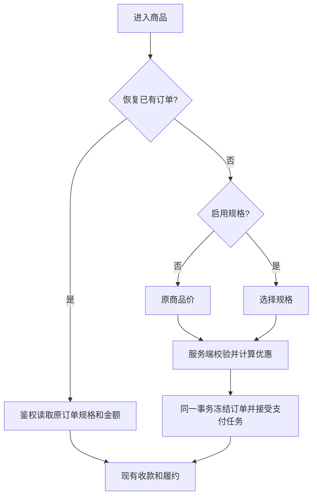

# 普通商品规格

用户已批准的精简方案；基线 8245526b89d04111acb2b03f66416b9c10d4064e。

商品拥有公共设置，规格拥有名称、可选描述/键值属性和独立售价，订单明细拥有不可变的规格购买事实。数量保持 1；三人成行只是名称。不开启规格保持原链路；开启后必须选择当前有效规格。不增加库存、人数、权益倍数、矩阵、规格级履约或支付状态机。微信小店仅模型兼容，原 SKU 绑定不变。

参考：微信小店 [商品](https://developers.weixin.qq.com/doc/store/shop/API/channels-shop-product/shop/api_getproduct.html) / [订单](https://developers.weixin.qq.com/doc/store/shop/API/channels-shop-order/api_getorder.html) 的 SKU、属性和订单行模型；[Shopify ProductVariant](https://shopify.dev/docs/api/storefront/latest/objects/ProductVariant) / [LineItem](https://shopify.dev/docs/api/admin-graphql/latest/objects/LineItem)；[Medusa variants](https://docs.medusajs.com/user-guide/products/variants)。仅采用当前需求所需部分。

商品编辑一次保存所有规格，使用商品版本 CAS。旧客户端未传字段保留配置。移除保留历史行；复制生成新 ID。关闭规格时保存明确单价。选中规格版本仅在其内容/价格变化时递增。订单原价、优惠、应付复用结账快照，不重复存规格价格。用券按所选价格；配置券时至少一个有效规格满足原价大于优惠额。

OneID：沿用当前可信会话和父商品已购判断，不新增身份匹配。持久化：Product 拥有规格，Order 拥有快照；同 PostgreSQL UoW 原子保存。外部效果：复用 Payment、External Effects 和履约，不增加队列或 Provider 调用。已有有效购买阻止新单，多个待支付订单规则保持。

Product Design：使用现有商品编辑和付款页作为视觉目标，参考 docs/design/product-alipay-toggle/01-sale-reference.png；在售卖信息嵌入规格列表，付款页增加选择，不新建页面体系。

验收：无规格旧请求/收据；归属/移除/版本/价格校验；无可用规格拒绝；保存回滚和并发；旧客户端保留；改价/关闭后恢复原单；同幂等键换规格拒绝；优惠切换；父商品已购/履约；订单三端展示及固定 27 列导出；小店绑定不变。

五项影响：API 增加可选规格字段；商品选择和金额来源扩展；直接涉及 Product/Order/Payment/Coupon/Invoice 展示；商品后台、付款页、订单后台/我的订单/侧边栏；相关单元、PG 事务、浏览器验证分别记录。增量迁移，不回写历史订单。交付国内候选给唯一发布工作台，真实支付及履约另验。
