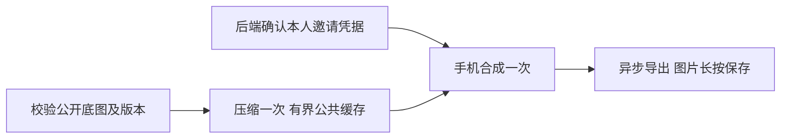

# B 版海报提速与稳定性

用户已批准本父 brief，采用 1250×2426、JPEG 质量95。基线 8245526b89d04111acb2b03f66416b9c10d4064e；当前底图使用既有 Go JPEG 编码器得到 789024 字节，减少70.1%。样张及离线解码证据位于本任务 poster-compression-validation 输出目录；36次软件解码不代表真机保存或归因验收。

参考与复用：[MDN Canvas toBlob](https://developer.mozilla.org/en-US/docs/Web/API/HTMLCanvasElement/toBlob)、[FileReader](https://developer.mozilla.org/en-US/docs/Web/API/FileReader/readAsDataURL) 和 [HTTP caching](https://developer.mozilla.org/en-US/docs/Web/HTTP/Guides/Caching)；腾讯云 COS 图片水印及火山 TOS 水印说明作为云接入备选，首版不用云服务。复用现有 Referral 快照、image_sha256、可信邀请签发、posterComposition、剪贴板及邀请弹窗。已复现请求返回前连点3次产生3个请求；现有304先读取全图；mutable slot URL可混用同尺寸新图与旧布局。

实现：原图及数据库快照不改；图片响应在事务外 JPEG95 编码，透明图、失败或体积未缩小保留原图。缓存按活动/slot/原图SHA/编码版本，最多32MiB，同键合并、全局解码并行1；不同冷图争用时503明确繁忙，不无限排队。读取轻量公开元数据后判断ETag，304不读BYTEA；原图读取以摘要作条件并验证内容摘要。现有image_url添加唯一v参数（图片SHA及固定编码版本的摘要）；旧入口保留60秒缓存，版本入口同样保持60秒缓存，避免公开状态长期过期；弱ETag涵盖同像素编码回退，过期版本409要求重新打开。

前端邀请处理中去重，邀请与配置并行读取；图片fetch失败区分繁忙/更新/不可用。FileReader用于本地图片解码和异步toBlob结果展示，沿用self/data CSP；二维码整数模块及4模块留白不变。个人结果只在弹窗内按底图URL/布局/邀请URL缓存；失败移除，关闭清空，旧选择在绘制前取消。保持布局、长按、话术和复制反馈，不增加新页面。原图透明或服务端保留PNG时，客户端保留PNG，避免黑底或二次质量损失。

Product Design：已读取 index/user-context/get-context/image-to-code/design-qa，并完成preflight。目标为本仓现有referralCenter/referral.css及已确认B样张；在现有组件中适配，局部浏览器检查与同视口图像对照，不新建应用或生成新素材。

OneID：沿用可信会话及Identity Port，不改归属/匹配/签发。Persistence：无新业务持久化，缓存可丢弃；原快照事务不变，编码不持有事务。External Effects：无Provider写或新持久任务。必要限制依据：原图现有限制最高5000×10000，RGBA解码约200MB，故串行编码；32MiB缓存避免请求量驱动无界内存。不增加上传、尺寸或用户配额，不改活动锁，不加表/迁移/队列/通用图片服务/CDN。

五项影响：图片URL版本及Content-Type/ETag改变，旧URL继续可读；业务身份与财务机制不改；直接消费者为Referral port/app/store/http和referralCenter/posterComposition；仅公共海报生成交互；相关HTTP/PG/并发/前端/实际导出/隔离负载验证，未覆盖项明确列出。

验收：原尺寸、码区、原图SHA及话术不变；304不读图片；不同用户/活动/布局不串；更新同尺寸图、草稿拒绝、过期版本、冷缓存/失败/并发/取消；连点3次1请求、切换迟到、关闭重开、复制；最终浏览器JPEG独立解码。隔离PG环境1000用户10秒集中打开，成功/繁忙/P95/数据库等待/内存/带宽分别记录，同时检查订单/登录读取。微信iOS/Android原生保存及真实扫码归因单列，无法验证不记通过。

交付：相关检查随候选登记；国内准确ref推送后重读唯一路由并实际投递head/tree/base/ref、五项影响、收据和未验证项。用户当前授权开发与交付，无生产部署授权。本任务不安装共享预发或生产；回退为上一应用包，原图数据不变。
